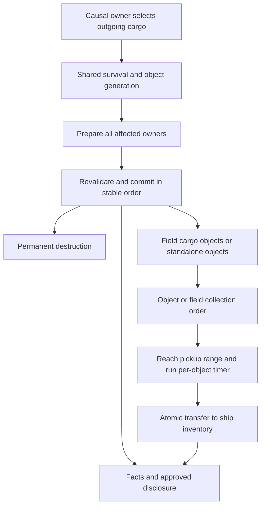

# Shared cargo disposition and collection

[Project index](../README.md) · [Inventory and cargo](inventory-and-cargo.md) ·
[Stations](stations.md#shared-cargo-disposition-policy) ·
[Entity lifecycle](entity-lifecycle.md) ·
[Moving-ship interactions](moving-ship-interactions.md) ·
[Fog-of-war and scouting](fog-of-war-and-scouting.md) ·
[Deterministic randomness](deterministic-randomness.md) ·
[Project task list](task-list.md)

## Purpose and decision status

Station storage destruction determines how much cargo leaves storage. Some of
that cargo may survive outside the station and become collectible. A shared
domain must account for that survival, physical presence, and eventual
transfer into another inventory without duplicating cargo or silently deleting
it.

**Task:** TASK-108. Design begun at the owner's request on 2026-10-29.

**Status:** Design complete and accepted by the project owner on 2026-11-09,
including C01-C12 and R01-R10. The owner approved R01-R03, R04-R06, and
R07-R09 as drafted; R10's closing behavior was separately accepted that day.
Implementation remains pending under TASK-108. TASK-105's design dependency is
resolved; its live cargo-loss commits still require the shared cargo runtime.

## Established boundaries

| Existing contract | Consequence for TASK-108 |
| --- | --- |
| Station Q12 and Q51 separate storage loss from disposition. | TASK-105 selects affected cargo; shared disposition determines permanent destruction versus recoverable ejection. Do not apply the station loss fraction twice. |
| Station R01 defines threshold accumulation, whole-unit loss, overflow credits, and deterministic selection. | Credits count all cargo removed from storage, including ejected cargo. Recovery does not put that cargo back into surviving station storage. |
| Inventory uses fungible quantities and stable discrete item identities. | Recovery must distinguish quantities from exact instances. A rendered stack is not an authoritative object identity. |
| Inventory custody currently requires a typed physical owner and a controlling principal. | Accepted unclaimed cargo requires a custody representation that does not fabricate a neutral principal. R01 defines its accepted technical representation. |
| Reservations do not protect station cargo from destruction. | The causal loss owner prepares affected workflow invalidation. Shared disposition cannot silently erase reservations or decide workflow failure behavior. |
| Lifecycle creation and removal prepare every affected owner before mutation. | Source removal and recoverable-object publication must succeed together, including accounting, commitments, identity allocation, and receipts. |
| Facts and presentation use commit-time disclosure. | A hidden loss cannot disclose private inventory, object contents, or a hidden cause through collection targets or notices. R06 defines the accepted safe-view and notice contract. |
| Stable evaluation, buffered effects, and deterministic commit are required. | Worker completion order cannot select survivors, allocate objects, or award contested cargo. Keep a serial reference path. |

The station small-loss cutoff is already a versioned shared policy with a 1%
default. That cutoff decides when storage loss is charged. It is not a cargo
survival percentage. The initial destruction recovery fraction is separately
approved as 50%, rounded down, uniformly across cargo definitions.

## Current implementation evidence

The inventory implementation currently offers complete inventory removal by
explicit destruction or transfer to an existing inventory in
`PhysicalInventoryRemoval.cs`. Live commitments block that operation. This
alone does not implement partial storage loss, creation of a destination
during the same transaction, or collectible cargo.

`InventoryCustody.cs` requires a nonzero controlling principal and a typed
owner. It can reference a registered session entity, but that reference alone
does not establish a cargo-object entity kind, lifecycle, spatial target, or
observation policy.

`SensorDeployableTransactions.cs` provides a nearby example of coordinated
inventory and entity publication, range validation, and idempotent receipts.
Deployment consumes an item and pickup creates a fresh equivalent item. That
behavior is specific to the accepted deployable contract. Cargo recovery must
instead preserve each surviving discrete item's original identity and state.

TASK-105 currently has pure construction and storage-loss arithmetic. Its
existing calculations do not constitute cargo selection, disposition, or live
station lifecycle integration.

## Technical source evidence

These sources establish current implementation shape; they do not imply cargo
support already exists.

| Source | Current constraint or reusable boundary |
| --- | --- |
| [Custody](../src/GalaxyCommand.Simulation/Economy/Inventory/InventoryCustody.cs) | A physical owner and nonzero principal are required today; R01 requires an explicit unclaimed variant. |
| [Physical transfer](../src/GalaxyCommand.Simulation/Economy/Inventory/PhysicalInventoryTransfers.cs) | Destination-only reservations and original-item transfer exist; smaller-than-reserved consumption needs R04's atomic extension. |
| [Reservation owners](../src/GalaxyCommand.Simulation/Economy/Inventory/Inventory.cs) | Transport, production, and construction owners exist; collection must extend admission and restore validation together. |
| [StateUpdate host](../src/GalaxyCommand.Simulation/Session/Runtime/ActorOrderRuntimeCoordinator.Interactions.cs) | Spatial/sensor envelopes and commit ordering are explicit; R05 defines the accepted cargo reduction extension. |
| [Simulation time](../src/GalaxyCommand.Simulation/Kernel/Time/SimulationTime.cs) and [random derivation](../src/GalaxyCommand.Simulation/Kernel/Determinism/DeterministicRandom.cs) | Time is integer milliseconds; scoped stateless bounded samples are available. |
| [Runtime policy manifest](../src/GalaxyCommand.Simulation/Session/RuntimePolicyCheckpointModels.cs) | Runtime parameters are authoritative; cargo policy needs its own versioned entry. |

## Accepted foundation decisions

The owner selected the following behavior on 2026-10-29:

- **Cause-dependent survival:** Destruction uses a configurable recovery fraction
  per loss cause. When a functional entity ejects an item, successful ejection
  preserves it in full. Do not apply the destruction recovery fraction to that
  ejection. The initial destruction recovery fraction is 50%, rounded down,
  using the same fraction for all cargo definitions. Calculate recovery
  separately per cargo type within one causal destruction commit. Exact
  survivor selection still requires definition; no definition-specific override
  is selected for the initial policy.
- **Unclaimed cargo:** Any ship with sufficient cargo capacity may collect
  ejected cargo, regardless of its original principal. Previous custody does
  not reserve collection rights. Collection uses a travel-and-collect order,
  targeting either an individual cargo object or an entire debris field.
  Collection uses the acting ship's existing pickup range, initially 5,000 meters,
  and takes a configurable duration per object once in range. Free-floating
  cargo cannot be reserved. At collection start in range, reserve only the
  ship's incoming capacity for the amount that fits. Multiple ships may run
  timers against the same object; the first eligible completion takes available
  cargo.
  Cancellation or leaving range discards elapsed collection time; a later
  attempt starts over. Field orders select using player cargo priorities, then
  nearest object. Exact-time completion ties use earlier accepted order, then
  stable ship identity. Collection precedes expiry at the same simulation time.
  Unlisted types follow all prioritized types. Equal-priority candidates use
  nearest object, then stable object identity. Skip cargo that cannot fit and
  finish a field order when nothing eligible remains. An individual-object
  order completes successfully after a partial pickup. If another ship takes
  its target, an object order fails; a field order moves on to the next eligible
  object. Release unused capacity in either case. R04/R07 define the accepted priority representation. At collection start, an object order with no
  room for one cargo unit fails immediately with insufficient cargo capacity.
- **Debris fields and standalone objects:** Destruction of an entity creates
  one field containing its recoverable cargo objects, rather than separate
  fields for its different cargo types or objects. Storage-module loss while a
  station survives also creates or merges into a destruction field for that loss. Functional-entity ejection
  creates standalone cargo objects and no field for now. Each object's cargo represents
  a share of the type being ejected. Across those objects, the quantities must
  total 100% of that type's dropped cargo. Fungible cargo uses a configurable
  object count with deterministic random shares, initially four objects per
  cargo type per ejection/destruction occurrence, capped by whole-unit quantity
  so no object is empty. Each surviving discrete item
  is a separate collectible object, retaining the original instance. Objects
  scatter deterministically within a configurable radius and then remain
  stationary. The configurable radius initially uses 10,000 meters for every
  source. Source-size-dependent radii are a possible future refinement, with no
  formula selected. Merge overlapping destruction fields and keep each merged
  field together until empty, even if its original overlap chain breaks. Remove a field
  when its last object is collected or expires. Merging preserves original
  object identities, positions, timers, and expiry times and redirects existing
  field orders to the merged field. Each destruction occurrence contributes a
  circle centered on the source entity with its scatter radius. Intersecting or
  boundary-touching circles connect fields, including transitive overlap chains.
  R02-R03 define the accepted scatter distribution and merged-field identity. Standalone ejected objects do not
  implicitly become fields or join nearby fields.
  R01 assigns each object an entity and inventory identity, with a separate
  logical field identity.
- **Item continuity:** A surviving discrete item retains its original item
  identity and state through ejection and collection. It is not replaced by a
  newly created equivalent item. Domain-owned state needs explicit links in the
  completed transfer and persistence contract.
- **Partial fungible collection:** If the object contains more fungible cargo
  than the collecting ship can carry, transfer only what fits and leave the
  remainder in the object. An individual-object order then completes
  successfully; collecting that remainder requires a new order. This does not
  split a discrete item. If no cargo unit fits at collection start, fail the
  individual-object order immediately with insufficient cargo capacity.
- **Visibility:** Hide fields and cargo objects outside sensor coverage. Do not
  retain a player-visible stale field or cargo-object projection. Coverage
  reveals cargo type, quantity, occupied storage, and discrete item identity and
  state. An accepted order continues toward the last observed position after
  coverage loss, revealing no hidden updates. Collection is allowed in pickup
  range even if the target is still outside coverage; coverage is not an
  additional execution prerequisite. For a partially covered field, show and
  choose only currently covered objects. Do not reveal hidden object counts,
  contents, or field extent. R06 defines the accepted safe result notices.
- **Local pickup feedback:** While actively collecting in pickup range, the
  owned ship may inspect current contents and receive target-loss feedback even
  without sensor coverage. Keep hidden objects off the map. During approach,
  retain only the last observed anchor until the execution boundary.
- **Collection motion:** Keep the committed approach motion, add no new leg
  during an attempt, and reset collection on strict range exit. Field orders may
  choose currently covered members after a hidden merge without regrouping the
  inspector or exposing hidden counts, contents, or extent.
- **Lifetime:** Uncollected cargo expires after a configurable simulation-time
  lifetime. Expiry occurs on schedule even during an active collection timer;
  the attempt loses its target. Initially use a fixed 730 simulation days
  (63,072,000 seconds). Collection precedes expiry at exactly equal simulation
  times; earlier expiry still removes the target before later collection.
  Expiry permanently destroys remaining contents, with no replacement objects
  or recovered resources.

The no-reservation rule for floating cargo supersedes the earlier selection to
reserve both cargo and capacity. Only the collector's incoming capacity is
reserved; another collector may take the object while that reservation exists.

The 100% object-partition rule applies to cargo actually dropped after
survival is determined. Splitting that cargo into objects cannot impose a
second recovery loss or duplicate a surviving item. Whole discrete instances
cannot be divided into fractional instances. The initial fungible object count
is min(4, dropped whole-unit quantity) per cargo type per occurrence. The
configured count may change; cap it by available whole units to avoid empty
objects. R02 defines the accepted positive-integer random partition algorithm. Configurable grouping must not combine discrete items.

For a cargo type with selected destruction quantity q, the initial recoverable
quantity is floor(q / 2), and permanent destruction is q minus that result.
Thus 5 affected units of one type yield 2 dropped units and 3 destroyed units;
one affected discrete item of a type yields no survivor. Another type's
rounding remainder cannot increase that result. Fractions are not accumulated
across causal destruction commits. Splitting the resulting dropped amount
across objects preserves it exactly. Successful functional ejection drops the
full selected quantity instead.

The cause distinction establishes full-preservation behavior for functional
ejection. Voluntary-ejection player commands and map controls are future work
under TASK-110. TASK-108 includes collection controls. This does not authorize
installed-equipment recovery or supersede TASK-096.


## Initial collection duration

Use the object's occupied storage at collection start as size S, measured
using physical definitions' capacity costs. The owner selected a linear rise
from 1 second at S = 1 to 15 seconds at S = 100, capped at 15 seconds:

```text
duration_seconds(S) = min(15, 1 + 14 * (S - 1) / 99), for S >= 1
```

This is exact rational arithmetic until conversion to simulation-time units.
R05 requires upward rounding once to the next integer millisecond. The size is the object's total
occupied storage at start, including when the collector can carry only part of
its contents. A later collector's timer uses its own start-time size; another
ship's collection cannot retroactively change an already started timer. This
follows the approved start-time size basis.

| Occupied storage at start | Collection duration |
| --- | --- |
| 1 | 1 second |
| 34 | 5 2/3 seconds |
| 100 | 15 seconds |
| 200 | 15 seconds |

## Accepted decision register

The project owner accepted the gameplay choices during the initial review and
their complete technical/control contracts on 2026-11-09.

| ID | Accepted decision | Contract |
| --- | --- | --- |
| C01 | Cause-dependent survival, initially 50% floored per type per destruction commit; full functional ejection; exact instance selection. | R02-R03 |
| C02 | Unclaimed cargo, collectable by any authorized ship with capacity; explicit unclaimed custody. | R01, R04 |
| C03 | One field per destruction occurrence, including surviving-station storage loss; standalone functional-ejection objects; deterministic grouping, merging, and identity continuity. | R01-R03 |
| C04 | Preserve surviving discrete identities and domain-owned state through ejection and collection. | R01, R08 |
| C05 | Stationary uniform integer-meter scatter, initially within 10,000 meters, with checked numeric bounds. | R02-R03 |
| C06 | Object/field travel-and-collect orders, size-based duration, capacity-only reservations, partial pickup, explicit priorities, cleanup, and terminal outcomes. | R04-R05, R07, R10 |
| C07 | First eligible completion wins; equal-time completions use accepted order then ship identity; collection precedes equal-time expiry. | R04-R05 |
| C08 | Live covered views, safe notices and local pickup feedback, hidden travel continuity, and covered-only choices after hidden merges. | R06, R10 |
| C09 | Configurable expiry, initially 730 simulation days, permanently destroying remaining cargo. | R05, R08 |
| C10 | Station storage/base-loss integration; voluntary-ejection controls remain TASK-110 and installed-equipment disposition remains TASK-096. | R03, R09 |
| C11 | Explicit validated versioned policy/content, exact saved parameters, and current-schema continuation. | R08 |
| C12 | Focused-ship cargo inspector, object/field collection actions, priority editing, progress, and safe feedback. | R07-R09 |

## Cross-owner accounting flow

Station loss selection and shared disposition have distinct responsibilities.
The station selects cargo that leaves storage; disposition partitions it into
permanent loss and recoverable contents. Collection later transfers
recoverable contents into the collecting ship. R01-R09 define the accepted
owners and execution contract.



For each definition, selected source quantity equals permanently destroyed
quantity plus recoverable quantity. Exact discrete instances form disjoint
partitions. Retained source cargo is outside that partition. Station overflow
credits count both outgoing branches once. Splitting into objects and merging
fields cannot repeat survival calculation or create new contents. Rejection
changes no holding, reservation, accounting credit, allocator, committed
random state, or fact. A repeated accepted cause returns its receipt.

## Accepted technical contract (2026-11-09)

**Decision status:** R01-R09 accepted by the project owner on 2026-11-09 as
drafted. R10 records the separately accepted closing behavior. Type names
below identify approved responsibilities; runtime APIs remain to be implemented.

### R01. Identity, custody, and authoritative contents

Register each collectible object as a `CargoObject` entity with a session-wide
`EntityId`, stationary `SystemPosition`, and one generalized `InventoryId`.
That inventory holds either one fungible definition and positive quantity or
one exact discrete item instance. Its initial capacity equals its initial
contents' occupied storage; later partial collection reduces holdings without
refilling the object. Objects cannot accept deliveries or gameplay
reservations. Store contents only in inventory authority, not again in cargo
metadata.

Extend inventory custody with explicit principal-controlled and unclaimed
variants. Unclaimed custody has a physical cargo-object owner and no
principal; it is valid only for registered cargo-object inventories. Existing
ship, station, and facility custody retains its principal checks. Neither null
custody nor principal zero represents unclaimed cargo. Ordinary physical
transfer still checks custody links, exact instance/definition, capacity, and
workflow authority.

Use a separate session-scoped `DebrisFieldId` for logical grouping. A field
has no inventory, controller, sensor source, or moving spatial state.
Individual objects remain the physical collection targets. A discrete item's
`ItemInstanceId` remains distinct from its cargo-object `EntityId` and
survives collection; the object entity is retired when emptied. Existing
item-state owners must retain their exact references through transfer. Do not
invent condition fields or convert installed equipment inside this task.

Allocate object/inventory IDs through the existing lifecycle sequences and
field IDs through one saved cargo-domain allocator. Preview IDs during
preparation; allocate only at accepted commit, in causal occurrence order,
qualified cargo key order, then generated object ordinal or original discrete
instance order. Never allocate an item ID for surviving cargo. Zero survivors
create no live object or empty field, while the causal accounting and receipt
still commit.

### R02. Exact generation and randomness

Station loss selection remains TASK-105's responsibility. Shared disposition
receives only selected quantities/instances, so it does not repeat the storage
loss calculation. For each selected definition, compute the survival count
using checked integer/rational arithmetic and the approved floor rule. For
discrete cargo, select that count without replacement using a partial
Fisher-Yates shuffle over the selected instances in canonical instance-ID
order. Each selection step uses an unbiased bounded sample; publish survivors
in instance-ID order. This avoids a permanent identity-age preference.

For fungible dropped quantity Q and configured count N, use K = min(Q, N).
Choose K - 1 distinct, unbiased cut positions from 1 through Q - 1, sort the
cuts, and take adjacent differences including endpoints 0 and Q. This produces
K positive whole-unit shares whose sum is exactly Q. Use Floyd's
without-replacement selection over zero-based candidates 0 through Q - 2: for
j from Q - K through Q - 2, draw t uniformly from 0 through j and add j if t
is already selected, otherwise add t. Add one to the selected values to obtain
cut positions. Iterate in ascending j with a named sample for each step. This
takes K - 1 draws and O(K) retained values without enumerating every cargo
unit. K = 1 needs no cut sample. Share ordinals are their sorted-cut order;
random placement prevents that order becoming a fixed spatial bias.

Scatter uniformly over valid integer-meter points in the source-centered disk.
Sample independent integer X/Y offsets from the inclusive square [-R, R],
reject samples outside the disk, and retry using a named candidate index. Also
reject candidate positions outside the accepted coordinate envelope; do not
clamp them. Near an envelope edge this samples the valid disk intersection.
The source point remains valid. Objects may share a position; there is no
minimum separation, collision response, or packing search in this contract.
Use wide checked squared-distance arithmetic, including for field overlap.

Use existing stateless `RandomSampleKey` derivation under the cargo domain.
Keys identify runtime scope, source entity, committed causal occurrence,
policy behavior version, qualified definition, purpose, and the
item/step/object ordinal. Separate purposes are survivor selection, share
cuts, and scatter. Rejection-sampling candidates use explicit candidate
ordinals; they are not new gameplay attempts. Do not use newly allocated
object IDs as inputs to their own generation. Persist causal identity and
policy references, not a random sample log. Retry/re-evaluation yields the
same result and does not advance a shared stream. Counter, identifier, or
arithmetic exhaustion rejects preparation without partial effects or a
fallback position.

### R03. Prepared disposition and field continuity

A disposition input identifies the causal source operation, source
entity/inventory, committed system-local source position, selected cargo,
destruction/ejection cause, and exact policy. Source position survives removal
through this input; no live lookup after source removal is required.

Prepare the entire transaction: source holdings and affected reservations,
station loss-accounting credits, destroyed/surviving partition, new cargo
inventories/entities, original occurrence circle, field merges, expiry events,
idempotency receipt, and fact/disclosure proposals. The station/causal
workflow owner supplies its commitment cleanup rather than cargo silently
cancelling another owner's work. Revalidate all expected revisions and
resource/allocator capacity before mutation. Apply all owner deltas under the
session health guard; publish facts and observable state last. Unexpected
failure after mutation poisons the session and prevents advancement or
checkpoint capture.

The exact causal key is a typed command sequence or scheduled `EventKey`, plus
source entity ID and grouped occurrence ordinal. The initial station path has
one grouped occurrence (ordinal zero) per source entity per cause; multiple
module losses do not receive separate ordinals. Receipt equality compares the
canonical source inventory/position, cause, exact policy reference/version,
sorted selected definition quantities and instance IDs, and prepared station
accounting input. It does not compare localized names or collection
enumeration order. Command and event causes occupy distinct key namespaces.

For stateless sampling, the existing key can use source entity as owner,
command sequence or globally unique event creation sequence as decision ID,
distinct command/event decision kinds, and occurrence ordinal as attempt.
Encode qualified definition and named sample coordinates with an explicit
versioned length-delimited sample-name encoding. Do not hash a composite cause
into an unchecked numeric ID. The full causal key remains in the receipt and
validates event timestamp/phase as well as sequence.

Exact replay returns the committed receipt without recreating cargo. The same
causal identity with changed input rejects. Group module losses for the same
station and causal commit before loss/survival rounding or field creation.
Base destruction disposes of the remaining selected inventory once. This does
not activate ship destruction or installed-equipment salvage.

Each destruction occurrence with survivors contributes one original circle.
Resolve same-system touching/overlapping circles with the approved connected
merge rule. The canonical merged field is the lowest participating field ID;
other field IDs become flattened aliases. Orders retain their original field
reference and order identity; resolution follows the alias without restarting
travel or a collection timer. Aliases must be acyclic and cannot point to an
unrelated later field. IDs are never reused.

Keep original occurrence circles for the entire lifetime of the merged field,
even after an occurrence's own objects disappear. This explicitly means a
later loss can join through an old circle until the whole field becomes empty.
Do not split fields or replace their footprint with a bounding circle. Retire
the field and its live circles when empty. For the initial implementation,
retain flattened aliases, empty-field tombstones, and causal outcome receipts
for the session's lifetime and save them. A reference to an emptied field
resolves as unavailable/completed, never to a newly allocated field. No alias
reclamation or receipt eviction is assumed. This conservative policy has a
measurable storage cost; R09 benchmarks must report retained circles, aliases,
tombstones, and receipts across repeated losses. A later compaction contract
requires a proven replay/reference boundary and separate owner review.

Standalone functional-ejection objects have no field membership and do not
merge. TASK-110 will add their voluntary-ejection command/UI path; TASK-108
supplies the reusable transaction contract and collection support.

### R04. Orders, selection, and capacity-only attempts

Add distinct typed object and field collection intents to the existing order
coordinator. Both retain original accepted command sequence, actor/source,
replace-or-append placement, and last observed target/position. A field
command also carries an ordered list of unique physical `QualifiedContentKey`
priorities. An empty list means all types equal. Duplicate or unknown keys
reject admission. Snapshot priorities into the order; later client editing
affects new commands.

Choose field candidates only from currently covered member objects. Compare
priority rank (unlisted types last), squared Euclidean distance from the
ship's committed position, then object entity ID. Skip cargo for which no
whole unit fits. Once selected, retain that object's ID and last observed
position so the accepted order can continue after coverage loss. A merge may
redirect the field reference, but cannot disclose new hidden members or
retarget from hidden state.

Approach through existing navigation and range-order execution. At in-range
start create a collection attempt bound to ship, order, and monotonic attempt
generation. For per-unit capacity cost C and available incoming capacity A,
reserve C times min(current object quantity, floor(A / C)); a discrete attempt
reserves exactly its item's cost if it fits. Use a new typed
`ReservationOwner.CargoCollection` and an ordinary incoming-capacity
reservation. No source reservation exists. Save the attempt's target, reserved
quantity, reservation ID, start time, start-time occupied object storage, due
time, and exact pending event keys. Capacity reserved by an attempt is
unavailable to other ship workflows.

At completion revalidate actor/order authority, attempt generation, same
system, inclusive pickup range, target availability, and the exact
reservation. Transfer min(current quantity, originally reserved quantity) for
fungible cargo or the original discrete instance. Consume applicable reserved
capacity and release any unused portion in the same commit. Existing inventory
transfer requires reserved capacity to equal the actual transfer cost, so a
smaller contested remainder needs explicit prepared consume-and-release
support (or an atomic prepared reservation resize). This is part of TASK-108's
inventory integration; do not release then recreate a reservation between
separate mutable calls. Other domains retain their existing exact-reservation
contract. Another collector's partial pickup cannot shorten an already started
timer or expand its reserved quantity.

A successful partial object pickup completes that object order. A field order
reselects after each success or lost target and finishes when no eligible
covered member remains. No capacity at object collection start fails
immediately. An object removed by another collector fails its object order;
field orders continue. If the selected target becomes unavailable while hidden
and the ship is still approaching, retain travel toward its last observed
position. Report generic target unavailable only at the owned ship's execution
boundary; do not stop hidden travel merely because a private lifecycle lookup
found removal.

### R05. Timing, interruption, and exact agenda ordering

The current runtime measures time in integer milliseconds. Round
the approved rational duration upward once, so collection cannot finish early:

```text
duration_ms = 1000 + ceil(14000 * (min(S, 100) - 1) / 99)
expiry_at_ms = created_at_ms + 63,072,000,000
```

S is fixed occupied storage at attempt start, not the amount that will fit.
Use checked wide intermediate arithmetic. S = 1 takes 1,000 ms; S = 34 takes
5,667 ms; S >= 100 takes 15,000 ms. Expiry addition must be representable
before object creation is accepted. Policy validation rejects unsupported
versions or invalid parameters. Require a positive denominator, a recovery
numerator between zero and that denominator, a positive object count, and a
nonnegative radius no larger than the accepted coordinate-envelope axis limit.
Validate positive duration endpoints, ordered min/max durations, a storage cap
above one, and a positive representable lifetime. Apply content structural
bounds before materializing configuration.

Add cargo envelopes to the existing `StateUpdate` wave host in
`ActorOrderRuntimeCoordinator.Interactions.cs`. Add one cargo
sub-reduction after existing generic spatial-effect and sensor-action commits
and before interaction-wave acknowledgement/reforecast. Preserve other
domains' existing relative order. The current envelope admission only permits
spatial and sensor work, so this is an explicit host extension, not an already
available hook.

Collect all cargo completion and expiry envelopes due in the captured wave.
First invalidate attempts strictly outside pickup range at that timestamp;
then commit eligible completions in original acceptance-sequence/ship-ID
order; then expire remaining due objects in object-ID order. Do not rely on
`EventKey.CreationSequence` to award contested cargo. Defer next-object
selection and new starts until this reduction ends. Positive durations ensure
a new timer cannot overtake same-time expiry. Already committed removal or
authority loss still invalidates later completion; the cargo tie rule does not
override an earlier causal commit in another domain.

At timer start, retain the already committed approach motion under
its existing movement owner. Mark the action as collecting so arrival/leg
completion cannot complete the action, restart its timer, or submit a new leg
while that attempt is live. Cargo does not teleport, force-stop, or claim
motion authority. Bind the attempt to the exact motion/capability revision and
reforecast exit on changes. A strict exit resets the attempt and lets the
order resume approach. This motion behavior is accepted in R10; the runtime
guards and scheduling mechanics remain part of the accepted R05 contract.

Range must remain valid throughout the attempt. Reuse shared exact range-exit
forecasting and reforecast when motion or pickup capability changes. Equality
at the inclusive boundary permits completion; the first strictly outside
integer-millisecond boundary interrupts before a due completion. Checking only
at completion would incorrectly allow leave-and-reenter continuity.

Cancellation, replacement, strict range exit, suspension, control loss, actor
removal, and target expiry release incoming capacity, invalidate/cancel exact
pending work, and discard elapsed time. Suspension retains the existing order
but not a collecting attempt; resumption selects/revalidates and incurs the
full duration. Range exit returns an active order to approach/re-evaluation.
The range-return behavior follows accepted R10 motion monitoring. Suspension resets the attempt and releases capacity under the accepted R05 contract. No fractional pickup occurs before completion.

### R06. Observation and safe results

Expose a dedicated live cargo-object view containing the approved entity ID,
position, cargo definition/quantity, occupied storage, and exact discrete
identity/state. Only covered objects appear. Cargo objects and fields provide
no sensor radius and have no persistent last-observed world projection.
Accepted orders may retain their last observed anchor privately from that
projection; owned-ship order presentation may show the captured intent,
without refreshing hidden target state.

Present field actions using a covered object's original field reference,
resolved privately through aliases. Do not expose canonical merge IDs, hidden
membership changes, total object count, complete footprint, original hidden
source, or expiry/collector attribution through a field row. A field inspector
shows only its covered object subset and labels totals as visible cargo. A
hidden merge cannot replace exposed handles or announce a new field boundary.

At commit, cargo appearance/removal notices require coverage of the object's
committed position and carry only approved visible fields. During an active
pickup interaction in range, R10 permits current target inspection and
target-loss feedback even without coverage. That feedback is limited to the
owned ship action; it does not expose a hidden world marker, other cargo
objects, removal cause, or collector identity. Private causal facts remain
available for authoritative diagnostics. Owned-ship results may state what
that ship collected, its own progress, capacity failure, or generic target
unavailable. A hidden unavailable result cannot distinguish another collector,
expiry, or some other private removal cause. Its own successful inventory
transfer remains visible even if the target was outside coverage. Persist
these bounded disclosure decisions with facts; never reconstruct them from
coverage at read/restore time.

### R07. Collection controls

Keep focused owned-ship selection and cargo-target selection separate.
Clicking a visible cargo marker selects it without replacing ship focus or
issuing a move. A keyboard-accessible cargo inspector shows approved visible
contents and explicit `Collect object` and `Collect field` actions for the
focused authorized ship. Standalone ejected objects offer only the object
action. No multi-ship collection allocation policy is introduced.

For field collection, show an ordered cargo-type priority editor with add,
remove, move-up, and move-down actions. Its empty default has equal
priorities. The editor is a client draft; the submitted order receives its own
immutable copy. Preserve selected draft priorities while editing in this
client session; do not add a separate saved preference format in TASK-108.

Use the application's existing FIFO input capture and order replace/append
boundary. Expose explicit replace/append choice and existing cancel behavior.
Show approaching/collecting state and elapsed/due progress from the owned
ship's attempt, plus partial success or terminal reason in order/result
presentation. Hide cargo details when coverage ends, while retaining the owned
ship's captured order intent. Live progress comes from saved simulation times,
not a UI timer. New controls must follow the accepted
localization/accessibility contract. TASK-094 retains broader order-failure
notifications; TASK-108 still needs usable collection results in its included
controls.

### R08. Policy, content, and checkpoint contract

Use one explicitly selected, versioned cargo policy per cargo-enabled session,
resolved through the existing content admission path and recorded in the
runtime-policy manifest. Extend that path with a validated cargo-policy kind
and exact qualified reference; do not infer it from display names or load
order. The built-in authored policy declares the accepted values: destruction
1/2, full functional ejection, four fungible objects/type/occurrence,
10,000-meter scatter, 730-day lifetime, and the duration curve. Require
explicit entries for supported causes. Initial content has no per-definition
survival overrides. Unsupported causes reject instead of defaulting to total
destruction.

Version the generation, merge, ordering, and duration behavior as well as
their parameters. The existing ship definition remains the pickup-range
source. Record exact rational recovery values, count, radius, lifetime
milliseconds, minimum/maximum duration milliseconds, storage cap, and
algorithm versions. These are declarative parameters rather than configurable
behavior code. Update built-in/preview composition and relevant fixtures
explicitly when they admit the cargo domain. A parameter change on a new
launch cannot change an already saved object's expiry or an in-flight timer.
Resolve exact compatible policy/content before restoration; historical
compatibility remains TASK-037.

| Authoritative owner | Saved once |
| --- | --- |
| Lifecycle/inventory | Cargo entity and inventory IDs, custody, contents and item instances/state references, inventory and item allocators, incoming capacity reservations. |
| Cargo domain | Object position/source occurrence/creation/expiry/policy references, fields and original circles, membership, aliases, field allocator, causal receipts and replay obligations, exact pending expiry keys/generations. |
| Orders/collection | Object/field intent, original admission sequence, priority keys, last observed anchor, suspension/approach state, attempt generation, start-time size, reserved quantity/capacity reference, start/due times, exact completion/range-exit work. |
| Policy/random/facts | Exact policy versions/parameters/references; existing root random seed/derivation identity; bounded facts and immutable disclosure decisions. |

Capture only at a healthy completed timestamp. Restore privately and validate
all owner links, global item uniqueness, positive single-definition object
contents, principal/unclaimed restrictions, field aliases/membership/circles,
allocator high-water marks, exact reservation owners, and matching agenda
keys. An object has exactly one pending expiry; an active attempt has its
exact due work and matching incoming reservation. Remaining objects cannot
already be expired at a completed boundary. Rebuild spatial indexes, coverage,
and batch layouts; do not rebuild authority from facts or reset timers.

Extend current-schema checkpoint encoding/decoding and all reservation/intent
validators together. Current-schema roundtrip and continuation are required;
adding only in-memory test records does not establish save delivery. Do not
invent historical cargo state for older or incompatible saves.

### R09. Delivery and proof boundary

Implement approved contracts through the existing session, inventory,
lifecycle, spatial interaction, content, observation, and Godot boundaries.
TASK-105 supplies live station loss/cleanup; TASK-108 supplies shared
disposition and collectible-object transactions. Require an end-to-end
station-loss-to-field-to- collection proof before claiming the integration
delivered. Test-only spawning or a placeholder emitter cannot close that
boundary. TASK-073 owns its existing observation integration; cargo adds live
targets and safe views without silently extending station-only persistent
discovery rules.

Retain coarse immutable evaluation batches and stable merge/commit. Use
indexed same-system circle/object candidates rather than all-pairs field
comparison. No per-object task, lock, worker-affine owner, or worker-order
sequence exists. Keep benchmark work explicit: many separate loss occurrences,
an overlap chain, one crowded field with contested timers, and large fungible
quantities with small object counts. Measure allocation, retained field
circles/aliases/receipts, agenda size, and domain time; verify authoritative
digests across supported worker/batch/partition layouts. Timing stays
informational; a correctness mismatch blocks completion. Concurrent execution
requires measured benefit.

### R10. Accepted closing behavior (2026-11-09)

The owner resolved the three behavior choices identified during technical
review. These choices are accepted independently of R01-R09's accepted technical
implementation contracts:

| Choice | Accepted contract |
| --- | --- |
| Pickup interaction feedback outside coverage | An owned ship actively collecting within pickup range may inspect current target contents and receive target-loss feedback without sensor coverage. Use that inspection for start-time size and capacity. The object remains hidden on the map; this creates no sensor source or visibility of other objects. Approaching orders still receive no hidden target updates. |
| Motion while collecting | Keep the already committed approach motion. Do not submit a new travel leg during the active attempt. Monitor exact range, and reset collection if the ship leaves range. Existing motion remains under its owning subsystem. |
| Hidden merges with covered objects | An existing field order may choose other currently covered objects from the privately merged field. A hidden merge must not regroup the inspector or reveal hidden object counts, contents, or extent. |

An owned pickup interaction's local feedback is distinct from sensor coverage.
After collection starts, losing a target may therefore end its timer and
release its reservation immediately. This is permitted local action feedback;
it does not publish the hidden object's lifecycle cause or another collector's
identity. The timer and capacity reservation must not lag behind that result.

## Required implementation proof

These cases verify the accepted gameplay and R01-R10. They do
not record implementation completion; that status remains in the task list.

| Boundary | Evidence required |
| --- | --- |
| Conservation and generation | Odd/single-unit survival per type/cause, no fractional carry, exact discrete partition and state continuity, positive shares summing to dropped quantity, counts capped by quantity, unchanged samples under retry/batching, scatter and numeric-envelope bounds. |
| Prepared disposition | All-owner rejection atomicity; exact replay and conflicting replay; failed allocation/overflow; reserved source cargo and station commitment cleanup; grouped module/base loss without duplicate disposition; zero-survivor outcomes. |
| Field lifecycle | One field per entity/cause, surviving-station storage-loss fields, standalone objects, touching and chained overlap, no splitting, stable aliases and order redirection, no repeated splitting/survival, preserved timers/expiry, removal when empty. |
| Collection and contention | Object/field orders, quantity and reserved-capacity calculations, original discrete transfer, partial success/remainders, no-room failure, competing completions independent of event allocation, smaller-remainder transfer with unused reservation release, field reselection and lost object targets. |
| Time and motion | Ceiling-to-millisecond duration, 1/100-unit endpoints and cap, fixed start-time size, no early transfer, inclusive range equality, strict exit and leave/reenter reset, motion-revision reforecast, suspension/cancellation cleanup, completion before equal-time expiry, permanent expiry loss. |
| Observation | Only covered objects/contents/visible totals, no hidden field extent or merge signal, priorities selecting only covered objects, hidden travel continuation, generic execution-time unavailability, own collection result without hidden cause attribution, historical fact disclosure retained through restore. |
| Persistence | Current-schema encode/decode and identical uninterrupted/restored continuation; malformed policy, alias, inventory, custody, duplicate instance, allocator, timer, reservation, and agenda links reject before publication. |
| Application | Focused ship and cargo-target coexistence, keyboard collection/priority controls, replace/append/cancel through existing input FIFO, owned progress/result feedback, hidden cargo cleared from views, localized/accessibility-compatible controls. |
| Determinism and scale | Serial-reference equality of contents, identities, receipts, policy/random state, orders, agenda, and facts across supported worker/batch/partition layouts; explicit overlap/contested/large-quantity benchmarks before concurrent delivery. |
| End-to-end delivery | Live station loss, shared disposition, observation, player collection, inventory settlement, expiry, and save continuation together; passing generic fixtures alone is insufficient. |

Run appropriate solution/Godot builds, focused domain tests, regression tests,
and benchmark correctness checks at implementation delivery. Timing is
informational; authoritative disagreement is a failure.

## Delivery ownership

TASK-108 retains design and implementation ownership of shared disposition and
collectible cargo. TASK-105 supplies station loss and coordinates
station-owned accounting and commitment cleanup. TASK-073 owns the existing
player observation integration; any cargo-specific extension needs the
explicit contract in C08. TASK-096 retains installed-equipment disposition
after ship destruction. TASK-110 retains voluntary-ejection player commands
and controls.

Design approval is complete for R01-R10 and the included player controls.
TASK-108 remains open for implementation and full delivery proof. TASK-105 can
consume this accepted contract without selecting additional cargo policy;
its live integration still requires the shared runtime and end-to-end proof
specified in R09.
