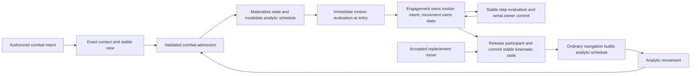
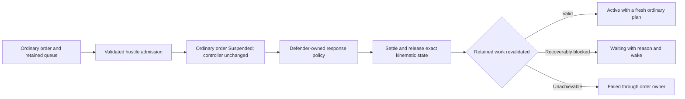
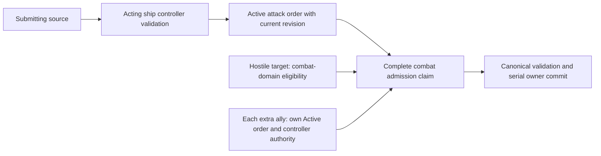
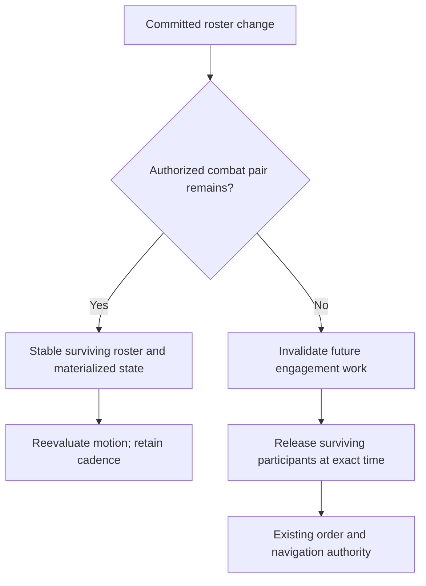
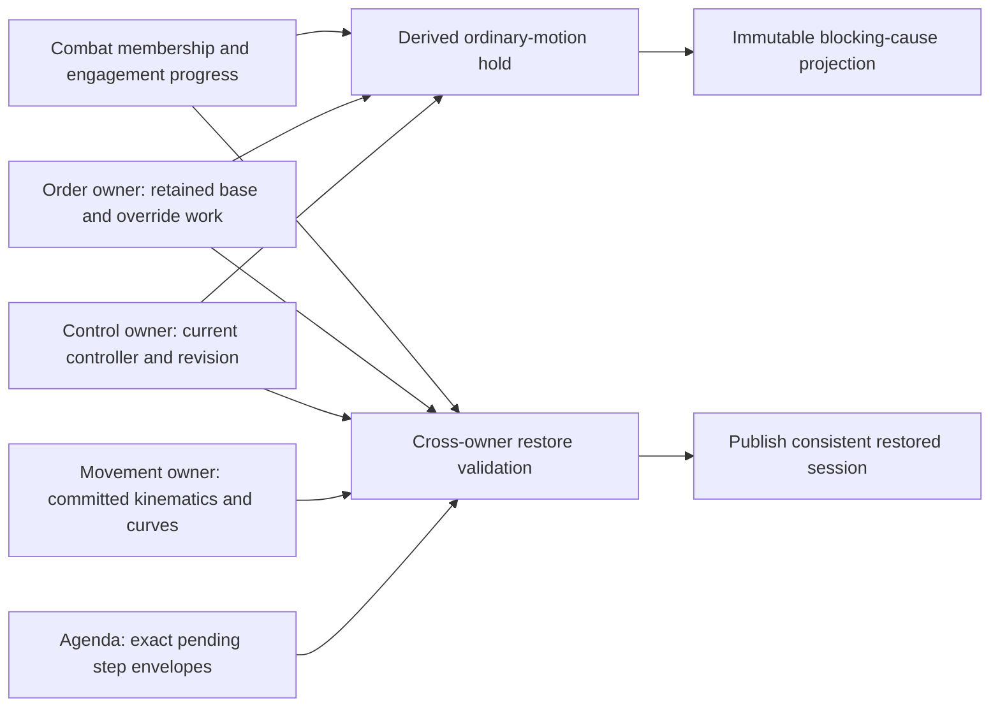

# Combat activation and movement handoff

[Project index](../README.md) · [Task list](task-list.md) · [Moving-ship interactions](moving-ship-interactions.md) · [Ship maneuver kinematics](ship-maneuver-kinematics.md) · [Actor control and orders](actor-control-and-orders.md) · [Concurrency and performance](concurrency-and-performance.md) · [Ship and fleet balance](ship-and-fleet-balance.md)

## Purpose and decision status

On 2026-10-13 the owner selected combat as the first consuming domain for
TASK-071's fine-grained movement activation handoff. TASK-046 owns this combat
contract; TASK-071 implements the shared discovery, timing, and movement
handoff. Collision and docking decisions are deferred with TASK-072 and
TASK-051. Choosing combat does not settle those domains' policy.

The interaction substrate currently discovers and delivers exact contact
through domain-neutral evaluation and buffered effects. It does not yet retain
an active engagement or step combat-controlled motion. The first design slice
therefore establishes ownership and lifecycle requirements before implementation.
This document records accepted choices and identifies the remaining decisions;
it is not approval of a combat algorithm or a complete runtime API.

The owner froze further combat design on 2026-10-16 to resume TASK-071
implementation. The decisions below remain accepted and the open questions
remain with TASK-046. This freeze does not require the shared motion-handoff
implementation to wait for every combat mechanic or expand it with placeholder
gameplay policy. Resume this design only when TASK-046 is taken up again.

## Accepted owner decisions

| Question | Accepted contract |
| --- | --- |
| Which domain activates first? | Combat, under TASK-046; collision and docking decisions are deferred |
| Engagement membership | An engagement may contain multiple ships; each ship belongs to at most one movement-controlling engagement |
| Engagement identity | A dedicated session-wide nonzero `EngagementId`, separate from contact interest IDs |
| Step duration | Combat policy supplies an explicit fixed positive integer-millisecond duration for each engagement; restore preserves it |
| Entry authority | Entry requires explicit combat intent authorized by combat policy; proximity supplies evidence and does not create intent |
| Replacement movement order | The affected participant exits its engagement before ordinary navigation replans |
| Competing admission | A ship already in an engagement rejects admission to a different engagement. Transfers or automatic merging are not introduced in this first contract; TASK-101 revisits the decision later |
| First evaluation and cadence | Evaluate motion at entry; subsequent evaluations occur at entry time plus whole multiples of the fixed duration |
| Simultaneous admission | Process canonical contact/effect order; accept the first still-valid complete participant claim and reject conflicting later claims without partial admission |
| Exit between steps | Materialize the committed motion curve at the exact exit timestamp, preserving position, velocity, and heading before navigation replans |
| Mid-interval roster change | Materialize and immediately reevaluate motion for the surviving engagement; retain the original entry-anchored cadence |
| Membership change at a scheduled boundary | Settle the previous interval for its eligible original participants, commit membership changes, then choose motion for the next interval |
| Engagement termination | Terminate when no authorized combat pair remains, including fewer than two participants; release all surviving ships through the exact-time movement handoff |
| Intent and admission target | Admission is backed by a combat order identity and generation, with a complete participant claim and an explicit create-new or join-existing target |
| Admission origin | Equivalent claims supported by several eligible contacts in one wave use the smallest contributing canonical contact key |
| Partial-interval settlement | Settle elapsed outcomes exactly once through the change/exit timestamp before membership changes; retain a durable settlement cursor |
| Authorizing order lifecycle | Only Active combat orders authorize admission and continued combat; other states require an explicit valid transition to Active |
| Range and continuation | Leaving entry range preserves intent; a separate combat-policy continuation condition controls departure |
| Valid order after disengagement | A still-valid combat order and target remain Active and resume combat-defined pursuit through ordinary navigation; replaced or terminal work is never revived |
| First combat command | One acting ShipId, one explicit target ShipId, and existing ReplaceAll/Append placement; group and area targeting are deferred |
| Hostile target participation | Combat policy may admit the hostile target without its own combat order; the attack command still controls only its acting ship |
| Additional friendly participants | Each additional ally requires its own current Active combat order and independently validated controller authority; no proximity-based recruitment |
| Defender ordinary work | Suspend its current ordinary order with a combat-specific reason, retain its queue, and preserve its controller |
| Defensive response | Use the defender's own versioned combat policy; do not synthesize an attack order or grant attacker control |
| Defender release | Revalidate retained work from exact current kinematics; replan if valid, Waiting with an explicit wake if blocked, or Failed if no longer achievable; never restore the old motion schedule |
| Override transitions during combat | Allow begin/end under existing control validation; revalidate combat authority and retain combat motion only while authorized pairs remain |
| Combat release with an active override | Revalidate only the current override's eligible work; base work stays suspended until that override ends |
| Override release during authorized combat | Restore base controller/work ownership, but retain the combat motion hold over ordinary navigation until combat releases the ship |
| Combat-hold authority | Combat membership is the single authoritative combat-motion binding; the order owner retains work and derives its combat hold from that binding |
| Overlapping blocking causes | Project every applicable structured cause with its owner correlation rather than collapsing script and combat into one suspension reason |
| Pending step restoration | Preserve exact authoritative next-step event keys/correlation and validate them against cadence and settlement progress; do not allocate fresh keys on restore |
| Termination cleanup | Cancel every still-queued step for the engagement before removing its state; queued steps naming an absent engagement invalidate restore. Stale-generation steps for live engagements may remain no-ops |

An engagement identity represents durable combat state, not a ship pair, spatial
cell, discovery batch, or evaluator object. Several directed pair interests may
supply evidence for the same engagement. Restoring or rebuilding an index must
not allocate a replacement engagement identity. Authoritative identity allocation
belongs to ordered combat commit, never worker completion.

## Ownership and read/evaluate/commit boundaries

Combat owns authorized intent, engagement membership, fixed step duration,
behavior version, and its eligibility, targeting, and outcome policies. The
movement owner remains the sole authority for each ship's system-local position,
velocity, heading, motion generation, and spatial revision. Combat controls the
participant's motion through a validated owner handoff rather than maintaining
a second authoritative combat position.

TASK-071 supplies exact contact evidence, correlation, invalidation, and the
shared activation boundary. TASK-090 supplies materialization and analytic
maneuver rebuilding. Existing order authority validates a replacement move;
combat membership must be released before that replacement reaches ordinary
navigation. Leaving an engagement is the participant's movement handoff, not a
new order terminal state. Withdrawal, retreat, surrender, capture, and damage
remain combat-policy decisions.

Evaluation reads one stable phase view and returns buffered proposals.
Membership changes, identity allocation, motion commits, and event-sequence
allocation occur through serial owners in deterministic order. The first
implementation retains serial domain callbacks, matching the current
`ISpatialInteractionDomainEvaluator` contract. Independent pure work may become
batchable through the established executor, but no thread is assigned permanently
to an engagement or ship. Observing an engagement, drawing it, or changing
application speed cannot activate, deactivate, or alter its simulation cadence.

The diagram shows authority transfer, not a global movement tick or a selected
combat force model. Other domain-approved exit causes use the same movement
handoff; their eligibility is still to be defined.

## Combat intent and admission correlation

On 2026-10-13 the owner selected order-backed combat intent, explicit complete
claims and create/join targets, and the smallest contributing canonical contact
key as the admission origin. Combat intent uses its authorizing combat order's
identity and generation; it does not introduce a separate intent allocator.
Controller permissions and order lifecycle remain with the existing order owner.

The current `ShipOrderSnapshot` and checkpoint records are movement-specific and
have no order generation or combat order kind. This is an implementation boundary:
TASK-046 must define the combat order extension and its authoritative revision
before admission can bind to it. The design does not assume those fields already
exist or reinterpret a navigation destination as combat intent. Changes to saved
order representation must coordinate with TASK-037.

### First combat-order command and participant authority

On 2026-10-14 the owner selected a first combat command containing one acting
ship, one explicit target ship, and the existing `OrderPlacement` choices
`ReplaceAll` and `Append`. The command source remains submission attribution;
it must match the acting ship's current controller under the existing command
rules. A shared principal or friendly relationship is not controller authority.
The command enters the ordinary per-ship order lifecycle; this design does not
create a group command, area selector, or durable fleet order. TASK-102 retains
later group/area targeting design.

The target is a ship identity, not a sampled position or a permanent link between
motion plans. Combat policy still validates the target, hostility, entry
eligibility, and current authorization before admission. An accepted appended
order remains Queued until ordinary promotion makes it Active; it cannot admit
participants or begin combat merely because the target is already in range.
ReplaceAll retains the existing replacement boundary rather than becoming a
combat-specific order queue. Detailed combat cancellation/replacement effects
must integrate with the accepted settlement and exit rules before implementation.

The public command's actor/target pair is distinct from the complete internal
admission claim. The former expresses one actor's combat intent; the latter
states exactly which eligible ships a validated combat proposal will admit to a
new or named existing engagement. Step duration, behavior version, entry range,
and continuation conditions remain explicit combat-policy inputs, not defaults
inferred from the command's ship IDs. This is a semantic payload contract, not a
C# command declaration or a selected serialized schema.

#### Hostile target admission

The owner authorized combat-domain admission of the hostile target without a
combat order of its own. One valid Active attack order can therefore authorize
a combat pair involving its named target. The earlier Active-only rule concerns
the order granting authorization; it does not require every target to have a
matching order. A queued, suspended, canceled, or otherwise ineligible initiating
order still cannot grant that authorization.

Target admission is an explicit combat-policy decision validated against the
complete claim. It does not submit an attacker-controlled command to the target,
replace the target's controller, or let the attacker select the target's steering
or response. Movement remains authoritative through the combat handoff and its
owner. The accepted defender contract below preserves ordinary work and selects
defender-owned response authority. Exact defense and evasion mechanics remain
TASK-046 decisions. Target admission does not synthesize a defensive attack
order or give the attacker a navigation fallback choice.

A target already controlled by another engagement cannot be pulled into a newly
created engagement. The existing complete-claim conflict rule still applies.
A join request may name the target's existing engagement, with that target as
existing context and the proposed free additions validated explicitly. Target
admission cannot bypass the accepted rejection of competing ownership or create
an implicit transfer or merger.

#### Current order-runtime boundary

The 2026-10-14 source review found that `ShipOrderCoordinator.BeginOverride`
suspends base work with `SuspendedByScriptedOverride` and installs a separate
override work set. Its release path restores that base work. The ordinary
`Cancel` path finishes current work and immediately promotes its queue. These
are existing script/order behaviors, not an implemented combat hold.

The override command handlers expose another required integration boundary:
`HandleBeginOverride` and `HandleEndOverride` call `EndActiveLocalMotion`, and
`HandleEndOverride` calls `StartOrContinueOrders` immediately after restoring
base control. `ActorControlRevision` already identifies current control authority.
A combat-aware implementation must explicitly reconcile these motion/resumption
paths with engagement membership rather than assuming the current handlers
compose with an active combat hold. The owner accepted the begin/end and
release-composition rules below; the current handlers still require explicit
combat-aware integration.

The accepted target-order lifecycle below requires combat retention, queue
promotion, cancellation, replacement, and release to integrate without installing
an attacker-controlled script override. The accepted composition contract below
prevents combat release from independently ending a script override or restoring
work belonging to obsolete control authority.
No combat suspension, response-policy object, or queue-hold field should be
assumed to exist in the current runtime. The owner subsequently accepted
preservation, defender-owned response, and release revalidation below. These
choices are design contracts; their implementation still requires the order
and movement owner extensions.

#### Defender hold, response, and release

On 2026-10-14 the owner accepted suspension of the target's current ordinary
work with a combat-specific reason, retention of its queue and controller,
defender-owned versioned response policy without an automatic attack order,
and exact-state revalidation on release.

Successful hostile admission materializes and invalidates the target's old
analytic movement schedule through the shared handoff. Its current ordinary
order retains its identity and intent in Suspended state, with a combat-specific
reason rather than `SuspendedByScriptedOverride`. Queued work remains retained
and does not become a second source of navigation motion while combat owns the
participant. A defender with no ordinary work does not receive a fabricated
order or destination. This contract applies to ordinary target work; it does
not suspend another authorizing Active combat order and silently revoke an
otherwise valid combat pair.

The defender retains its current controller. Its own versioned combat response
policy supplies defensive motion and response proposals, evaluated under the
same stable-view and serial-commit boundaries as other combat work. The attacker
cannot choose those proposals. No automatic defensive attack order, script
controller override, or independent post-combat pursuit intent is created.
Defense/evasion algorithms, weapon use, policy selection, and defaults still
require combat design. An independently accepted Active combat order can grant
its own authority under the existing intent rules; the response policy alone
does not become such an order.

The retained ordinary queue is not a queue of combat steps. Cancellation,
replacement, target removal, and queue promotion must respect both the existing
order lifecycle and combat's single motion owner. In particular, cancellation
must not trigger competing ordinary navigation merely because today's `Cancel`
path promotes the queue immediately. Accepted replacement movement still uses
the existing exact-time exit-before-replan rule. Canceled or replaced retained
work is never restored when combat later ends. The implementation must define
validated hold-aware owner transitions rather than bypassing command validation.

At release, settle elapsed combat outcomes and commit exact position, velocity,
and heading under the accepted exit contract. The current order/control owner
then revalidates the retained ordinary work from that state. If it remains valid,
return it to Active and build a fresh ordinary plan. If a recoverable condition
blocks it, use Waiting with a stable reason and an explicit wake. If its
completion condition is no longer achievable, use Failed and ordinary owner
lifecycle handling. The pre-combat analytic schedule is never reinstated.
Retained queue order remains meaningful, but promotion must follow current order
state and permissions; release does not independently skip or revive work.

A ship with no valid retained or promotable work still needs the separately
tracked idle/coasting policy. The accepted scripted-override composition below
prevents premature base resumption or overwriting a committed controller change;
its owner-state representation and validation must precede implementation.

The diagram assumes retained work still exists and the current owner permits
resumption; it does not restore canceled work or select idle behavior.

#### Scripted override and combat-hold composition

On 2026-10-14 the owner accepted override begin/end during combat with authority
revalidation, current-override-only work resumption on combat release, and base
controller/work restoration without ordinary navigation resumption when combat
remains authorized. The existing one non-nesting scripted override limit remains.
Combat is a motion hold, not another controller override.

The control owner validates an override transition against current source
permissions and `ActorControlRevision`. A stale or unauthorized request changes
neither control, orders, nor engagement membership. A valid transition updates
control/work ownership through its existing owner and revalidates the combat
orders and authorized pairs affected by the change. Superseded control/order
correlation cannot authorize later admission or future combat intervals. Accrued
work retains its validated historical interval inputs under the settlement
contract; a control change cannot grant extra elapsed time. An override
transition is not itself a rule that ejects the ship unconditionally.

For example, beginning an override suspends the base combat order's authorization.
If that was the only authorization supporting the engagement, loss of its last
pair invokes normal elapsed settlement, termination, and exact-time release.
If hostile combat remains supported by another current Active order, the ship
can remain a combat participant under the accepted target-admission rules. Its
ordinary scripted work cannot compete with combat motion. The transition does
not reset engagement identity, duration, or cadence for an engagement that survives.

| Release or transition | Work/control ownership | Ordinary motion eligibility |
| --- | --- | --- |
| Begin override while combat remains authorized | Install the validated override; preserve suspended base work under its owner | Current ordinary override work remains subject to combat hold |
| Combat releases while override remains active | Keep override control and its current work; leave base work suspended | Revalidate eligible override work from released exact kinematics; do not resume base work |
| Override ends while combat remains authorized | Apply the explicit release policy, restore base controller/work ownership, and revalidate authorization | Restored ordinary work remains held; combat retains sole motion authority |
| Override ends after combat has released | Apply normal override release and current base-work validation | A fresh ordinary plan may run only if no combat hold remains and the work is valid |

Each release clears only its own constraint. Both ownership boundaries must permit
ordinary work before navigation can start. Restoring base work selects the current
work set; it is not permission to execute ordinary movement while combat still
owns motion. A restored combat order must separately pass the accepted Active/
controller/eligibility checks before it contributes authorization. Canceled or
replaced work is never recovered from a pre-transition copy.

A combat hold must retain enough authoritative association with actor, engagement,
current control, and retained work to make these independent releases unambiguous.
The accepted owner-state model below derives holds and structured blocking
causes from one combat membership authority. Exact compiled record layouts and
combat-aware owner preflight still require design. Reusing a single script-only
reason or unconditionally calling `StartOrContinueOrders` cannot implement this
contract. Neither release may restore old motion event keys or produce duplicate
resumption merely because the other release occurs at the same timestamp.

Accepted replacement movement from the current authorized controller still uses
exit-before-replan. Ordinary begin/end override processing must reconcile motion
materialization and unsettled combat outcomes with the existing phase barriers;
it cannot discard accrued elapsed work or reopen an earlier physical phase.
These rules do not authorize additional controller-transfer or nested override
features. Defender response-policy selection after a control change and exact
owner/preflight/checkpoint schemas remain explicit design work.

#### Additional allies and supporting order correlation

Each additional friendly participant in a complete claim needs its own current
Active combat order and independently validated controller authority. Proximity,
friendship, common principal ownership, or an initiating attacker's order cannot
recruit it automatically. Its order must actually authorize the proposed combat
participation under combat policy; an unrelated Active combat order is not a
blanket grant to claim that ship.

An admission therefore retains the authorizing root order correlation and the
supporting order/controller correlations needed for each additional ally. All
must be current at serial commit. If a required ally's authorization becomes
stale, reject the complete proposed claim without admitting a subset; a different
claim requires fresh valid evaluation. Hostile target participation uses its
separate domain authority and must not be mistaken for missing ally consent.

Equivalent-claim normalization must include supporting authorization correlation
as well as the root order, target, and participant set. Claims with different
supporting order revisions cannot be treated as identical merely because they
name the same ships. This extends the correlation requirements; it does not
select a record layout, add a second intent allocator, or provide missing combat
order generations in today's movement-only implementation.

The diagram separates permission to submit a ship command from permission for
the combat domain to admit a target. It does not grant player control over that
target or define hostile/friendly classification mechanics.

### Complete create and join requests

An admission proposal must correlate the current authorizing order identity and
generation, its complete intended participant claim, the contributing eligible
contact evidence, and its explicit engagement target. These are semantic
requirements, not a selected C# record layout. The first command and participant
authority are specified above; combat eligibility, order revision mechanics,
and the serialized representation still require design.

A create-new request claims its complete set of free participants and allocates
a dedicated EngagementId only during accepted serial commit. A join-existing
request names the exact existing EngagementId and expected lifecycle/membership
correlation, plus its complete proposed additions. Existing members of that named
engagement are context, not competing free-ship claims. All required additions
must be eligible and free; a ship owned by another engagement makes the complete
join claim conflict. A stale or terminated target cannot silently turn a join
request into creation, transfer, or merging.

The accepted fixed duration, behavior version, and entry anchor belong to the
existing engagement when a join succeeds. A create request needs those values
from combat policy. Neither the spatial index nor the first worker to finish
chooses an engagement target, inferred participant subset, or step duration.
Before motion or membership commits, the owners revalidate order authorization,
claim completeness, target correlation, eligibility, and available identity and
agenda capacity. Order replacement or cancellation cannot authorize an admission
with obsolete order correlation. The accepted lifecycle rules below distinguish
order authorization from engagement membership; exact combat completion, expiry,
and payload policies still require TASK-046 decisions.

### Intent lifecycle and authorization revocation

On 2026-10-13 the owner selected Active-only authorization. An Active combat
order may authorize admission and continued combat only when its identity,
generation, controller authority, target, and combat eligibility are current.
Active status is necessary, not sufficient. Queued, Waiting, Suspended,
Completed, Cancelled, and Failed orders grant no combat authorization.
Terminal orders cannot transition back to Active; retained nonterminal work
requires an explicit valid lifecycle transition and revalidation.

| Current combat order state | Admission or continued-combat authority | Return to combat authority |
| --- | --- | --- |
| Active | Only with current order/controller correlation and combat eligibility | Revalidate when intent, target, control, or eligibility changes |
| Queued | None | Ordinary order promotion, then valid Active authorization |
| Waiting | None | Explicit wake and revalidation, then valid Active authorization |
| Suspended | None | Existing control/override release and revalidation, then valid Active authorization |
| Completed, Cancelled, Failed | None | A new accepted order is required; never revive terminal work |

A transition out of Active invalidates that order's contribution to combat
authorization and makes pending admissions using its old correlation stale.
Recompute authorized pairs and affected membership under any other still-valid
Active intent. Do not assume that canceling one order terminates an engagement
still supported by other authorized pairs, or that the canceled order owns every
participant. The multi-ship authorization correlation above identifies the required contributions;
the combat policy must still define their validity and revocation triggers before
implementation.

When this change causes departure or termination, use the accepted elapsed
settlement and exact-time movement handoff. Previously accrued outcomes remain
subject to their valid interval inputs and current effect/lifecycle validation;
revocation does not grant new future combat time. The implementation must ensure
that later pending work cannot use the old authorizing correlation to restore
membership. Combat order revisions and trigger publication need an explicit
owner contract, not reliance on whether a callback happens to run first.

Scripted overrides retain the existing actor-control lifecycle. Suspending a
base combat order removes its combat authorization; release revalidates the
retained base work before it can return to Active. Combat admission does not
create another controller override or bypass source permissions. Waiting names
a stable reason and an explicit wake mechanism, as required by the existing
order design; it is not authority to keep fighting while progress is blocked.

### One origin for an equivalent claim

Within one evaluation wave, eligible contacts supporting the same authorizing
order identity/generation, supporting authorization correlations, target
correlation, and complete participant claim reduce to one admission proposal. Its origin is the smallest contributing
canonical contact key; effect kind and local ordinal follow the existing stable
effect contract. Distinct intents, targets, revisions, or claims are not combined
merely because they contain the same ship pair.

Normalization retains the supporting evidence needed for combat validation.
Choosing the smallest origin is an ordering rule, not permission to discard a
required participant's eligibility check. Duplicate contact evidence does not
allocate several engagement identities or admit the same additions repeatedly.
A noneligible contact cannot lower the claim's priority. Later waves still
revalidate current intent, ownership, and engagement correlation; deduplication
of one wave does not make authorization permanently valid.

For example, two eligible contacts K1 and K2 support the same complete claim
{1, 2, 3} under the same order revision and create-new target. If K1 precedes K2,
there is one complete admission with origin K1, regardless of input permutation
or worker completion. A separate order claiming {2, 4} remains a distinct proposal
and competes under the accepted first-valid canonical ordering.

## Entry handoff requirements

A due pair contact is evidence, not permission to create an engagement.
Combat must correlate it with current authorized intent and eligible participants.
Missing, removed, or connector-transit ships cannot supply local kinematic state.
Before admission commits, the owners must validate the contact/intent correlation,
current participant membership, movement state, and availability of identity and
agenda capacity. An already-owned ship cannot be claimed by another engagement.

Successful entry materializes the participant's complete kinematic state at the
committed timestamp using TASK-090's fixed-point rules. It invalidates the old
analytic schedule and its pending completion correlation, records combat
membership, and exposes one authoritative movement state. Entry must not reset
velocity or heading to invented defaults. A stale admission changes neither
membership nor movement. The implementation must define a complete preflight
and commit boundary before attempting a multi-participant admission; a partial
claim is not an acceptable rejection result.

A completed physical boundary at the same timestamp is applied before the
stable view used for interaction evaluation, as required by the existing phase
spine. A brief swept crossing retains its exact contact evidence even if
published positions have already passed one another. Whether that evidence is
sufficient for combat admission is a combat eligibility decision.

### Simultaneous admission and complete claims

The owner selected first-valid admission in the existing canonical contact/effect
order on 2026-10-13. Admission proposals are evaluated from the common stable
view. Combat then validates and commits complete participant claims serially in
that order. A proposal must identify its complete intended claim before commit;
it cannot discover extra members by mutating ownership while evaluation runs.

The existing contact key orders system, timestamp, lower ship ID, higher ship ID,
and interest ID. Effect kind and local ordinal follow that key. Those are stable
domain values, not worker completion positions. The accepted equivalent-claim
reduction above chooses the smallest contributing eligible key as origin. It is
not inferred from engagement ID allocation or discovery order.

A proposal claims all its required free participants or none. Validation observes
membership committed by earlier accepted proposals. If any required participant
is already controlled by another engagement, the later proposal is rejected
without allocating its engagement identity, interrupting motion, or claiming its
other ships. An invalid earlier proposal reserves nothing, so a later valid
proposal may proceed. Identity and agenda-capacity preflight still precede owner
mutation; commit failures follow the existing fail-closed session contract.

For example, proposals A and B both claim ship 2, and A precedes B by canonical
key. A claims ships {1, 2}; B claims ships {2, 3}. If A is valid, A admits both
ships and B admits neither. Ship 3 remains unclaimed. If A is stale or otherwise
invalid before commit, it claims no ship and B may admit {2, 3}. This does not
merge A and B or change the rule that an engaged ship rejects a competing
engagement. TASK-101 retains later reconsideration of that rule.

## Active stepping requirements

Each engagement retains its explicit duration and behavior version. The duration
is part of authoritative combat state, unlike worker count or batch size. There
is no automatically chosen numeric step and no adaptive cadence in this contract.

Each step reads stable participant, combat, capability, and kinematic inputs;
returns proposed motion and combat effects; validates them; and commits through
their owners. Kinematic integration must obey the accepted fixed-point equations
and boundary-rounding rules. Forces, steering, damage, weapon cadence, targeting,
and randomness policy are not supplied by this activation design.

A scheduled step must correlate with the current engagement lifecycle and
membership so old work cannot affect a participant after exit or replacement.
The same initial state and commands must produce equal owner state, event order,
and combat results across supported worker capacities, batch layouts, spatial
partitions, and completion orders. This applies equally to observed and
unobserved engagements.

### Entry-anchored cadence

The owner selected immediate motion evaluation at entry on 2026-10-13. If entry
commits at time E and the explicit duration is D, the initial evaluation at E
chooses control for the first interval. Later evaluations are due at E + D,
E + 2D, and so on while the engagement remains active. There is no alignment to
a global tick or rendered frame. The initial evaluation has zero elapsed combat
time; it is not permission to apply a full duration's accumulated effects at
entry. Actual weapon and damage timing remains combat policy.

For an illustrative entry at 250 ms with an explicitly supplied 100 ms duration,
motion is evaluated at 250 ms and later evaluations are due at 350, 450, and
550 ms. These numbers illustrate the rule; they do not select a default step.
The accepted curve provides authoritative motion between evaluations, using the
shared kinematic and rounding rules. Combat steering and force selection remain
to be specified; the cadence rule supplies neither.

Restore must retain the entry anchor and enough step progress to resume the
same due timestamps, without replaying initial evaluation or assigning a new
anchor from restore time. The exact cursor/schema belongs to the continuation
design. Timeline overflow must be rejected before a new step is scheduled.
The membership rules below preserve this cadence while permitting immediate
motion reevaluation when the roster changes between scheduled boundaries.

## Participant exit and replacement navigation

An accepted replacement move causes the affected participant to leave combat
before ordinary navigation replans. Order validation and controller permissions
remain with the existing order owner; an invalid replacement is not authority
to eject the ship. Exit commits the participant's stable position, velocity,
and heading, releases its membership, invalidates its old engagement work, and
lets the ordinary planner build from that committed state.

### Exact-time exit between steps

The owner selected exact-time materialization on 2026-10-13. A participant exiting
at time X between due steps materializes the motion curve already committed for
that interval at X. The handoff preserves that evaluated position, velocity,
and heading. It does not wait for the next combat boundary, snap to the prior
step's published position, or grant ordinary navigation motion before membership
is released. Existing fixed-point evaluation and boundary-reset rules govern
the committed materialized state.

In the cadence example above, an accepted replacement move at 410 ms materializes
the curve covering 350 through 450 ms at 410 ms. The ship leaves the engagement
and ordinary navigation plans from that state at 410 ms. Pending engagement
work cannot later move it or apply effects to it using the old membership.
If an authorized combat pair remains, surviving participants immediately
reevaluate motion at the roster-change timestamp while retaining the engagement's
original entry anchor. If none remains, the termination rule below releases them. Any replacement work proposed
at the exit timestamp must obey existing phase barriers rather than reopening
an earlier phase.

A participant's exit does not by itself eject every other ship. Engagement
viability is determined after the roster change using the termination rule
below. Removal cannot leave a dangling membership reference or a future event
able to mutate the removed ship. Connector transit has no local contact or
combat position. An accepted replacement move to another system follows the
same exit-before-navigation rule, after which ordinary navigation owns approach
and traversal; this does not authorize an active-combat traversal mode. Other
traversal requests and outstanding order transitions need explicit combat/order
policy before they can be admitted.

## Participant membership and engagement termination

On 2026-10-13 the owner selected immediate motion reevaluation for a surviving
engagement after a mid-interval join or departure, previous-interval settlement
before scheduled-boundary roster changes, and termination when no authorized
combat pair remains.

### Joining and leaving between scheduled boundaries

Joining requires an explicit authorized combat intent, eligible contact, and a
validated admission to the named engagement. It cannot silently transfer a ship
from another engagement or merge engagements. The order-backed request explicitly
names create-new or join-existing authority as specified above.
The current engagement's identity, fixed duration, behavior version, and cadence
are retained when its roster changes.

At a mid-interval change timestamp X, materialize the committed curves at X for
participants affected by the surviving engagement's motion reevaluation. Settle
previously unsettled elapsed combat outcomes through X, then commit the validated
roster change through its owner. If an authorized combat pair
remains, evaluate motion immediately for the complete surviving engagement from
one stable post-change view and commit new interval curves. Newly admitted ships
use their own materialized kinematic state; departing ships use the exact-time
exit handoff. Neither a join nor departure resets the cadence anchor.

In the earlier example, the engagement entered at 250 ms with duration 100 ms.
A join or departure at 410 ms splits the currently committed motion interval:
existing curves cover motion up to 410 ms, and freshly evaluated curves cover
410 through the next scheduled boundary at 450 ms. The later boundary remains
550 ms. A joining ship has no combat participation before 410 ms. Reevaluating
motion at 410 ms does not itself grant another 100 ms of combat effects.

The owner selected elapsed settlement before roster changes, as detailed below.
Damage formulas, weapon events, cooldown behavior, and other combat mechanics
remain TASK-046 policy. The lifecycle establishes when accrued work is settled
and how double counting is prevented; it does not supply the outcome formulas.

### Durable elapsed settlement

Each active engagement retains an authoritative settlement cursor, initialized
to its entry timestamp, and the interval inputs needed to evaluate unsettled
combat time. At a roster change,
participant exit, scheduled boundary, or termination timestamp X, evaluate and
commit only elapsed outcomes since the cursor, under the membership and control
that governed that elapsed interval. Advance the cursor through X after successful
owner commit. Membership changes then take effect for future time, and motion
reevaluation itself does not advance elapsed combat time again.

In the cadence example, the interval begins at 350 ms and the roster changes at
410 ms. Settle the first 60 ms before changing the roster and advance the cursor
to 410 ms. At the scheduled 450 ms boundary, only the remaining 40 ms is
unsettled. A ship leaving at 410 ms retains its valid elapsed outcomes through
410 ms; a joining ship starts participation at 410 ms. Repeated same-time changes
have zero new elapsed duration after the first settlement. They cannot award an
extra full step or reset a cooldown merely by reevaluating motion.

The cursor, outstanding interval inputs, and any combat-policy accumulation state
must survive checkpoints so restore cannot replay the first 60 ms or lose the
remaining 40 ms. Combat must define discrete weapon-event boundaries, timer
semantics, and retained fractional accumulation where its formulas require them.
The activation contract does not select a damage integrator, per-split rounding
rule, or randomness policy. Those mechanics must preserve accepted elapsed-time
accounting and deterministic owner commit.

Elapsed settlement may itself produce lifecycle outcomes. Revalidate proposed
roster changes and engagement viability against the resulting committed state
before admission and next-interval motion control. A removed participant cannot
be mutated through obsolete references. Removal integration must route combat
cleanup through the existing lifecycle owner's validated boundary; destruction
and removal outcome policy is not supplied here.

Normal retries cannot publish partial settlement or advance the cursor ahead of
accepted effects. If an effect commit fails after mutations begin, the existing
session contract closes mutation/checkpoint boundaries; this design does not
promise rollback or retry of a partially committed interval. Schema and owner
preflight details remain to be defined before implementation.

### Membership changes at a scheduled step timestamp

At an already scheduled boundary T, the accepted combat-local order is:

1. Materialize the interval ending at T under the existing physical-completion
   and stable-view barriers.
2. Settle that interval's domain effects for its eligible original participants.
   A joining ship receives no outcome for time before it joined. A participant
   removed by an earlier committed lifecycle change cannot be mutated through
   an obsolete reference.
3. Validate and commit the roster changes known to this combat wave in the
   accepted canonical admission/effect order, retaining complete claims.
4. Test engagement viability. Release survivors if no authorized combat pair
   remains; otherwise choose and commit motion for the next interval from the
   stable resulting roster.
5. Schedule only the next valid work under the original cadence and current
   lifecycle correlation.

This ordering governs changes available to the wave; it does not move later
Decision-phase commands ahead of StateUpdate or undo effects already committed.
A replacement command arriving after that boundary uses the existing command
barrier and exact-time exit rule. Same-time follow-up work respects the current
phase and never reopens PhysicalCompletion.

For example, at 450 ms an eligible departing ship may participate in settlement
of its actual prior interval, then leave before next-interval control is chosen.
A joining ship participates in the new interval, not the interval that ended at
450 ms. The exact outcome calculation and policy eligibility remain combat-owned.

### Termination and surviving movement

An engagement ends when its resulting roster has no authorized combat pair,
including when fewer than two ships remain. The predicate comes from combat's
current authorization policy; neither participant count alone nor spatial
proximity proves permission to continue. Authorization uses current Active-order
intent and the separate continuation condition below. Exact hostility, target
validity, expiry, and continuation predicates still require TASK-046 decisions.

Termination invalidates future engagement steps and releases each surviving
participant through the exact-time kinematic handoff. It does not remove the
ship or invent a new navigation destination. Ordinary order/navigation ownership
resumes from committed position, velocity, and heading according to the ship's
accepted order state. A still-valid combat order resumes combat-defined pursuit
through ordinary navigation as specified below; no replaced or terminal order
is restored by engagement exit.

An already removed ship receives no release motion or new plan. Its membership
and stale step references must be detached through the existing lifecycle owner
boundary. Canonical serial commit retains the single-motion-owner invariant for
survivors. A stale future step cannot recreate a terminated engagement or its
members. A later authorized admission must follow the ordinary admission rules;
termination is not an automatic transfer or merger.

### Queued-step cleanup on termination

On 2026-10-16 the owner accepted removal of every queued step envelope belonging
to a terminating engagement before its authoritative state is removed. Cleanup
covers its current pending step and any stale-generation step envelopes left
from earlier revisions. Canceling only the current scheduling reference is not
sufficient if older envelopes remain. This follows the existing movement-removal
boundary and does not introduce terminated-engagement tombstones as authority.

Termination must prepare and validate the complete set of owned pending keys
and their expected event correlations while the engagement still exists.
Identify ownership by engagement identity and the step envelope's validated
payload, not just timestamp or participant pair: unrelated engagements can be
due at the same time. The concrete bookkeeping/index used to find owned keys
remains an implementation choice for review; the contract requires complete
cleanup without canceling another owner's events.

At the serial commit boundary, preserve the accepted elapsed settlement and
exact-time participant-release rules, cancel the validated queued steps, and
remove engagement state only after its pending work and membership references
are cleared. A completed checkpoint must expose either a consistent live
engagement or complete removal, never a partially cleaned termination. Preflight
rejection before mutation leaves the live owner/agenda state intact. A failure
after effects begin follows the existing fail-closed session rule; this contract
does not add rollback or publish a partially terminated session.

An envelope already dequeued into the current evaluation wave is not a queued
event that can still be canceled by key. Its proposals must retain lifecycle/
membership guards at owner commit and cannot mutate released participants or
recreate an engagement removed earlier in that wave. No checkpoint contains an
in-flight evaluation buffer. The precise dispatcher disposition and compiled
step payload remain part of the implementation contract, not an exemption from
stale-work safety.

Cancellation does not rewind agenda creation sequences or the engagement ID
allocator. Unrelated pending event keys and allocator high-water marks remain
unchanged. A later admission allocates a fresh identity through the normal
owner path; it does not reuse the removed engagement's identity or event keys.

The following cases distinguish runtime stale work from an inconsistent save:

| Case | Required behavior |
| --- | --- |
| Live engagement with one matching current step | Restore its exact key, generation, cadence, and progress |
| Live engagement with an additional valid old-generation step | Preserve the stale no-op; do not treat it as the missing current step |
| Termination with current and old-generation steps still queued | Cancel all owned queued steps before removing engagement authority |
| Completed checkpoint has a queued step naming no engagement | Reject the checkpoint; do not repair or reconstruct missing authority |
| Dequeued proposal outlives termination within the current wave | Reject stale ownership at commit; never revive membership or apply old motion |
| Different engagement has an event at the same timestamp | Leave that envelope and its complete key untouched |

## Eligibility-driven departure and ordinary order resumption

### Entry range and continuation are different questions

The owner selected a separate combat-policy continuation condition on 2026-10-13.
The contact range asks whether an authorized admission may begin. Leaving that
entry range alone neither revokes combat intent nor decides departure. While
combat remains active, its domain-owned continuation condition determines which
authorized pairs and participants remain eligible. When that condition fails,
settle elapsed work, commit the affected departure, and reevaluate engagement
viability using the accepted lifecycle rules.

The continuation condition may depend on the accepted combat policy, but this
slice does not choose a continuation radius, hysteresis margin, timeout,
visibility rule, or hostility algorithm. Its authoritative inputs and wake/
reevaluation triggers must be defined explicitly. Rendered positions and camera
visibility never decide intent validity or combat cadence. Future range-exit
forecasting must be scoped explicitly with TASK-071; the existing range-entry
query must not be described as an implemented continuation-exit scheduler.

An order can remain Active while its ship is outside an engagement. The order
retains intent; engagement membership controls the current fine-grained movement
handoff. A continuation failure can therefore end membership without completing,
canceling, or failing the still-valid combat order.

### Pursuit after a valid disengagement

If the combat order and target remain valid after release, the owner selected
continued Active intent and combat-defined pursuit through ordinary navigation.
Navigation plans from the exact committed position, velocity, and heading; it
does not resume an obsolete pre-engagement analytic segment. The combat order
remains the current authoritative intent and owns its pursuit goal and later
admission request. Reentry uses current order generation, contact eligibility,
and explicit create/join correlation rather than reviving an old engagement.

Pursuit retains the shared finite-trajectory contract. Combat may plan against
the target's current authoritative position and known bounded motion; it may
not extrapolate an unwritten future course. Committed target/follower changes
trigger domain reevaluation. Lead behavior, pursuit cadence, acceptable error,
and what constitutes an unreachable target remain TASK-046 decisions. No
additional combat-only position model or movement engine is introduced.

If accepted replacement navigation caused the release, that replacement owns
subsequent motion. If cancellation or another terminal transition ended combat
intent, ordinary queue promotion follows the existing order lifecycle. A
recoverable blocker may move retained work to Waiting only under a defined
reason/wake contract; Waiting removes combat authorization. Invalid targets or
unachievable completion conditions use the existing failure boundary according
to the combat order's still-unsettled target/completion policy. Exit cannot
restore canceled base movement, override the current controller, or invent a
new destination for a ship with no valid movement intent.

Exact idle/coasting behavior for a released ship with no current or promotable
order still needs a movement/order decision. Target-loss, combat success,
retargeting, expiry, and same-timestamp reentry rules also remain explicit
combat policy. In particular, preserved intent is not permission to alternate
exit and admission indefinitely at one timestamp when entry and continuation
conditions disagree.

## Checkpoint, facts, and presentation handoff

### Current checkpoint boundary

The 2026-10-14 source review found that order checkpoints already retain separate
base and override work sets, while control checkpoints retain base/override
controller references and `ActorControlRevision`. Movement checkpoints own
velocity, heading, spatial revision, and the existing position, local-motion,
analytic-maneuver, or connector-transit state. `GameSessionCheckpoint` includes
these owners, the authoritative engine agenda, and spatial interaction interests;
it has no active-combat component or combat-controlled movement variant.

Consequently, the active-combat design needs an explicit session component and
movement integration; it cannot assume an existing combat flag, interval curve,
step event, or order-blocking-cause list. The owner has now selected a single combat
binding, overlapping-cause projection, and preservation of pending step keys
as specified below. This source review and semantic state contract do not
select or implement their compiled/serialized record layouts. General
save compatibility remains TASK-037.

### Authoritative owner-state model

On 2026-10-14 the owner approved a single combat-membership binding with derived
order holds, projection of all applicable blocking causes, and preservation of
exact pending step keys. Each value that controls continuation has one owning
authority. References and validation correlations do not become independently
mutable copies of another owner's state.

| Owner | Authoritative state needed for combat continuation | Reference or derived boundary |
| --- | --- | --- |
| Combat | Engagement allocator/identity, current roster and participant roles, lifecycle/membership correlation, authorizing root and supporting intent links, behavior/policy references, fixed duration, entry anchor, settlement progress and unsettled combat inputs | Membership establishes the ship-to-engagement binding; any lookup index is rebuilt from it |
| Orders | Original base/override work, FIFO queues, retained order identities/intent and lifecycle, combat order revisions, current replace/cancel results | Ordinary execution derives the combat hold from current membership; no independently releasable combat-hold flag |
| Control | Base controller, optional single override and its reason, current ActorControlRevision | Resolves which retained work is current and which order/controller grants remain valid |
| Movement | Each ship's authoritative kinematic state, current interval curves/control history needed for exact evaluation, motion generation and spatial revision, with a validated reference to combat membership when combat-controlled | Does not keep a second roster or a combat-only position copied into the combat owner |
| Agenda | Exact pending step envelope, complete EventKey, generation and payload correlation, plus creation-sequence allocator | Combat retains the current scheduling reference/cursor needed to validate the matching envelope; restore never independently reallocates it |
| Presentation | No independent control authority | Derives immutable order-blocking causes and observer-safe combat views from validated owners |

The retained work belongs to the order owner throughout combat and script
transitions. Combat membership gates ordinary motion for the ship even if its
current work set changes, has no order, or its previously held order is canceled.
It does not retain a private pre-combat order copy for later restoration. Removing
membership releases only combat's gate; current control and order validity still
determine which work may run.

The movement owner must retain enough committed curve state to materialize an
exit between steps. Combat retains only the domain interval inputs/accumulators
needed to settle outcomes, not an independently mutable participant pose. Exact
curve and outcome-state types depend on the still-unsettled combat mechanics;
this table supplies ownership and continuation requirements, not guessed fields
for an implementation.

### Structured blocking-cause projection

A blocked ordinary order exposes every applicable cause with its owning
correlation. A script constraint identifies the relevant override/control
revision and retained work context; a combat constraint identifies the engagement
and membership correlation that prevents ordinary motion. Base work may have
both constraints. Current override work may have a combat constraint while its
base work remains blocked by the override. The projection must distinguish those
contexts rather than show every actor-level reason on every order indiscriminately.

These are ordinary-execution blocking causes. Their presence must not turn an
otherwise valid Active authorizing combat order into Suspended merely because
it is participating in combat. Existing lifecycle status/reason and the full
blocking-cause projection have different responsibilities; a single reason
cannot serve as the authority for independently releasing both constraints.
No priority between reasons is selected here. Exact snapshot DTO layout and
localized explanation text remain presentation work.

Blocking-cause views are recomputed after restore and each relevant ownership
change. They are not checkpointed as independent locks or used to recreate
membership. A stale displayed cause cannot authorize a release, restore canceled
work, or select a controller. Release APIs validate the current owners instead.

### Restore invariants and publication boundary

Capture uses the existing healthy-session, completed-commit boundary. Restore
prepares owner state in isolation, validates the references below, and publishes
only a consistent session. A checkpoint is not repaired by guessing membership,
rebuilding a missing current step with a fresh sequence, or selecting a replacement
controller. General encoding, schema migration, and compatible content mapping
remain TASK-037 and the existing save owners.

| Validation boundary | Required consistency |
| --- | --- |
| Identity and liveness | Engagement identities are nonzero, unique, and within allocator history; current members name live local ships and one ship belongs to at most one movement-controlling engagement |
| Spatial ownership | Each current member has matching combat-controlled movement correlation in the same system; it cannot simultaneously run an independent analytic plan or connector transit; movement cannot claim an absent membership |
| Orders and control | Base/override work agrees with control ownership; current authorization links resolve current Active orders and required controller/order revisions; ordinary held work retains valid lifecycle and queue identity |
| Historical settlement | Previously accrued interval inputs may retain historical authorization and roster context; they are not mistaken for permission to authorize future work under obsolete revisions |
| Policy and progress | Duration is positive, required behavior/policy versions resolve, entry/settlement progress is consistent with capture time, and retained curves/interval inputs cover all unsettled time needed for exact continuation |
| Current pending step | The preserved EventKey and payload/generation match the engagement's current scheduling correlation, legal event phase, entry-anchored cadence, and progress; no duplicate current step is admitted |
| Agenda allocation | Referenced pending envelopes exist under their exact keys; the agenda allocator remains above its allocated keys and preserves exhaustion semantics; no sequence is assigned by restore or evaluator rebinding |
| Derived state | Rebuilt membership lookups, blocking causes, indexes, and forecasts agree with restored authority and grant no extra control |

For a live engagement, a structurally valid stale-generation envelope can remain
a deterministic no-op under the existing agenda contract. It is distinct from
the one matching current step and cannot substitute for a missing current
envelope. On 2026-10-16 the owner approved cancellation of all queued step events
before engagement state is removed. A queued step naming an absent engagement
therefore invalidates restore, even if its generation would otherwise be stale.
Restore does not repair this by deleting the event, resurrecting an engagement,
or inventing a termination receipt. A structurally invalid or uncorrelated
current step is also rejected.

In the illustrative entry-at-250-ms, duration-100-ms scenario, a completed
checkpoint at 420 ms may have settled through 410 ms and retain a curve covering
410 through 450 ms. It must resume the unsettled 10 ms already elapsed at capture
and subsequent time exactly once, preserve the pending 450 ms step key, and keep
550 ms as the following cadence boundary. Restore at 420 ms cannot replay entry,
settle the prior 60 ms again, or reset the next step to 520 ms. The exact step
cursor representation is still a schema decision; its value must preserve this
behavior.

Combat checkpoints must retain the accepted identity allocator, engagement
identities, participating ship references, fixed durations, behavior versions,
and combat state needed for continuation. They must also retain sufficient
lifecycle and next-step correlation to resume exactly the same future work
under the preserved agenda keys. Participant membership must agree with the movement owner's active
mode at restore; restore cannot silently assign two engagements to one ship.
Movement state remains with its existing owner. Derived spatial indexes and
candidate batches are rebuilt, not serialized as combat authority.

The continuation design must specify the exact authoritative step cursor and
committed interval-curve state required for the accepted exact-time exit and
checkpoint continuation.
General save envelopes, compatibility, and migration remain TASK-037. Runtime
evaluator objects still require explicit rebinding after restore, and host
worker settings remain outside authoritative checkpoints.

Combat emits facts for committed domain events rather than raw discovery.
Presentation reads immutable, observer-safe domain projections; it does not
control engagement cadence. The exact combat facts, disclosure fields, and
integration with TASK-073 and TASK-038 remain part of combat design.

## Decisions required before shared activation implementation

The accepted activation choices above establish the first domain, its ownership
shape, admission ordering, cadence, exact-time exit, and roster/termination
boundaries. The remaining behavioral contracts are:

- The combat order revision/schema extension, completion/expiry/retargeting,
  target eligibility, and entry ranges. Weapon and targeting mechanics remain
  TASK-046; group/area targeting remains TASK-102. TASK-101 owns later
  reconsideration of competing admission, transfer, or merging.
- Defender response/evasion mechanics and policy selection after control changes,
  plus compiled state/DTO layouts and combat-aware owner transitions implementing
  the accepted single-binding, blocking-cause, and override rules.
  Ordinary work preservation and fresh-plan release are accepted above.
- Combat formulas, discrete event boundaries, cooldown/accumulation semantics,
  and randomness policy consistent with the accepted durable settlement cursor.
- The continuation predicate and its authoritative reevaluation triggers,
  same-timestamp reentry protection, bounded pursuit policy, and released-ship
  idle/coasting behavior, plus other removal/traversal coordination.
- The checkpoint cursor/state schema and domain facts/projection needed for
  exact continuation and a useful owner-facing explanation.

These are design decisions for owner review, not deferred assumptions inside
TASK-071 code. Full combat resolution remains open in the canonical tracker.
Collision geometry, collision response, docking access/capture, and berth policy
remain explicitly deferred.

## Validation required after the contract is settled

Implementation evidence must compare uninterrupted and restored engagement
continuation; preserve moving participants' kinematics at entry and exit; reject
stale or competing admission without partial membership; prevent exited ships
from receiving old step effects; and demonstrate exit-before-replan for accepted
replacement moves. Cases must include multiple participants, simultaneous
contacts, same-timestamp physical completion, between-step exit, removal, and
connector boundaries once their rules are accepted.

Focused cases must prove that the initial motion evaluation occurs once at
entry, restored cadence uses the original anchor, an invalid earlier admission
leaves later claims eligible, overlapping accepted claims admit no partial
membership, and exit at 410 ms in the illustrative cadence uses the interval's
curve at 410 ms. Roster tests must compare mid-interval joins/departures with
materialized surviving state and unchanged 450/550 ms boundaries; old-interval
settlement before 450 ms roster changes; no pre-join outcomes; termination with
one remaining ship or several ships but no authorized pair; no release motion
for removed ships; and stale steps that cannot revive terminated membership.
Admission tests must compare duplicate eligible contacts, differing order
revisions, explicit create-versus-join targets, stale join correlation, and
complete rejection when an addition belongs to another engagement. Settlement
tests must prove 60 ms plus 40 ms accounting in the example, zero duplicate
elapsed work for repeated same-time changes, no pre-join participation,
settlement before exit, and restored continuation from the durable cursor.
Lifecycle tests must reject authorization from every non-Active order state,
reject stale order revisions, preserve other authorized pairs after one intent
is revoked, and revalidate resumed suspended/waiting work. Range tests must
separate entry contact from continuation eligibility. Order-release tests must
preserve a valid Active pursuit intent, honor replacement navigation, promote
queued work only through its owner, and never revive terminal orders.
Command and authority tests must reject a source that does not control the
acting ship, keep appended combat work nonauthorizing until Active, admit a
validated hostile target without a target order, and reject every required ally
whose own order/controller correlation is missing or stale. Compare equivalent
claims with different supporting revisions and verify complete rejection without
recruiting a nearby unrequested ship. No test may equate hostile target admission
with attacker control of the target's order or steering.
Defender lifecycle tests must retain the ordinary order identity and FIFO queue,
use a combat-specific suspension cause, preserve controller ownership, and reject
attacker-selected response control. Release must replan from current kinematics,
produce explicit Waiting/reason/wake or Failed outcomes as appropriate, and
never restore old event keys, canceled orders, or replaced work. Tests must also
prove that queued ordinary navigation cannot compete with active combat motion
and that a response policy creates no automatic attack order. Override-overlap tests must cover both release sequences, stale control
revisions, cancellation/replacement of held work, and same-timestamp releases.
Beginning an override must invalidate suspended base attack authority and trigger
termination when its last authorized pair is lost; an independently authorized
hostile pair may keep combat active. Ending combat alone cannot resume base work
under an active override, and ending an override alone cannot start ordinary
navigation under a surviving combat hold. Verify fresh-plan resumption once both
constraints permit it, without replaying prior event keys or elapsed settlement.
Checkpoint tests must round-trip both release orders, exact current step keys,
allocator state, settlement progress, and between-step kinematics. Corruption
cases include duplicate membership, dangling live-member references, competing
movement modes, invalid current authorization, unresolved behavior versions,
missing/duplicate/mismatched current steps, and allocator/key inconsistency.
Blocking causes must rebuild from authority without becoming independently
releasable state. Preserve valid stale-generation no-ops for live engagements.
Termination tests must cancel current and older queued steps while preserving
unrelated same-time events and allocator high-water marks. Reject a restored
step naming an absent engagement, including an old-generation step; preserve
a valid live-engagement stale envelope as a no-op. A queued stale envelope cannot
stand in for a missing current key. Exercise preflight rejection before mutation,
fail-closed commit failure, and stale in-flight proposals after termination.
These are implementation validation requirements, not completed runtime tests.
Exact damage/cooldown values await the accepted combat outcome formulas.

The serial reference and every supported pure-worker configuration must agree
on authoritative movement/combat state, agenda order, membership, checkpoint
continuation, and facts. Benchmarks must include activation, active stepping,
and exit, not only pair contact discovery. Existing TASK-071 query and session
benchmarks do not claim this proof.
