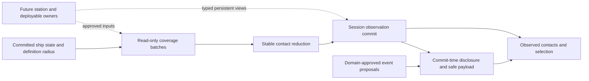
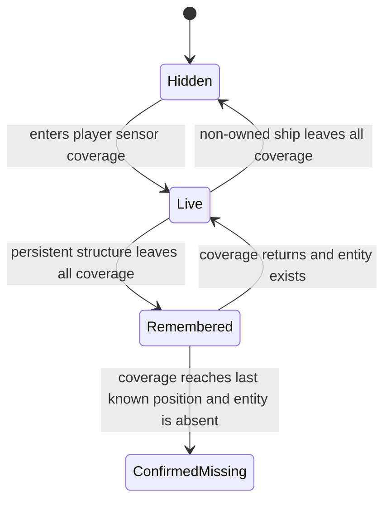

# Fog-of-war and scouting

[Project index](../README.md) · [Player experience](player-experience.md) · [Moving-ship interactions](moving-ship-interactions.md) · [Dialogue](dialogue.md) · [Presentation snapshots](presentation-snapshots.md) · [Authoritative save boundary](authoritative-save-boundary.md) · [Project task list](task-list.md)

## Purpose and decision status

The player needs scouting to reveal useful information without requiring a
general simulation of beliefs, reports, confidence, and knowledge propagation
for every power. This design establishes spatial fog-of-war around player-owned
sensor sources. Current coverage exposes live authoritative information,
transient contacts disappear outside coverage, and discovered permanent
structures retain a stale last-observed view until sensors return.

This document completes the design work approved by the project owner for
`TASK-020` on 2026-08-20. `TASK-073` owns implementation.

**Decision status:** Accepted by the project owner on 2026-08-20.

## TASK-073 implementation scope review

The owner promoted `TASK-073` on 2026-10-19. The accepted observation behavior
above remains unchanged. Review of the current simulation found three gaps
that prevent implementing the complete contract without an owner decision:

- Stations have no runtime identity, lifecycle, or approved observable state.
  `TASK-057` still owns that design and `TASK-105` tracks its runtime; economic facilities cannot implicitly be
  treated as stations.
- Deployable identity, lifecycle, observable state, and sensor-source handoff
  are designed, but their runtime implementation remains `TASK-095`.
- Ship setup, definitions, and content have no base sensor-radius contract.
  This design requires a definition-supplied radius but does not settle its
  initial content values, validation, or integration with ship definitions.

On 2026-10-19 the owner selected a staged implementation boundary for review,
followed by implementation of approved stages. Station and deployable
integration remains open. The owner subsequently approved the boundary and
stage 1, then approved stage 2, decisions S1 through S9, and the proposed 10 km
content radii. Those approvals authorize ship observation implementation. They
do not complete the full ship, station, and deployable acceptance scope.

### Approved stages and completion boundaries

| Stage | Deliverable | Evidence required to finish the stage |
| --- | --- | --- |
| 1. Ship coverage evaluation | Immutable committed ship inputs, system-local source union, stable contact reduction, and a serial reference evaluator. Inputs carry explicit radii; this stage does not change live presentation. | Inclusive range boundaries, moving source and target combinations, overlapping-source loss, transit exclusion, emergence, creation/removal, canonical input ordering, and batch/partition equivalence. |
| 2. Live ship observation | Definition/content sensor capability, session integration, safe ship presentation and selection, commit-time disclosure, Godot consumption, and current-schema checkpoint/save continuation. | Hidden ships and private fields absent from every presentation path; earlier hidden events stay hidden; disclosed events remain readable after coverage changes; restored and uninterrupted runs agree, including bounded fact retention and cursors. |
| 3. Persistent observation owner | Session-owned discovery, stale state, refresh, confirmed absence, and persistence, using concrete approved station/deployable inputs. | Typed owner-approved views, last observation time, no refresh from hidden state, absence without invented cause/time, exact restore, and source/target lifecycle integration. Start when an owning entity domain supplies its runtime contract. |
| 4. Full entity integration and closure | Station sources/targets from TASK-105 after TASK-057 design approval and deployable sources/targets from TASK-095; application consumes their approved records. | Every item in Implementation proof below, across all three entity categories, plus the complete regression suite and appropriate benchmark correctness checks. |

Stages 1 and 2 are approved and implemented.
Stage 3 must wait for a concrete persistent entity presentation contract; test
fixtures alone cannot establish live station or deployable support. Stage 4
is required for full `TASK-073` completion. All stages remain under this task ID;
the entity prerequisites retain their existing owners and task IDs.

### Contract decision register

The owner approved the following contracts on 2026-10-19. Stage 1 supplies the
serial coverage evaluator; stage 2 integrates the live ship boundary. New sensor
worker execution still requires deterministic proof and benchmark evidence.

| ID | Contract | Status |
| --- | --- | --- |
| S1 | Store base ship sensor radius in the ship definition, in authoritative distance units. Require an explicit nonnegative integer value, with zero covering only the source position. Use inclusive Euclidean distance and overflow-safe comparisons. Do not introduce equipment modifiers or an implicit default for old content. | Approved; starter ship and preview courier each use 10,000 meters. |
| S2 | Select sources by asset-owning principal, independently of actor control. Stage 1 receives that principal explicitly. Stage 2 binds one player observer to the session as described in S9; no NPC discovery ledgers are created. Scripted control overrides do not transfer asset ownership. | Approved. |
| S3 | Owned ships retain their currently approved detailed presentation. A covered non-owned ship exposes only entity ID, ship ID, owning principal, design identity, current system-local position, velocity, and heading at capture time. It exposes no orders, controller/override details, cargo inventory identity/capacity, capability revision, motion generation, future segment, objective, or maneuver plan. Use a separate observed-contact type rather than fabricated authoritative fields. | Approved. |
| S4 | Resolve selection and focus through the same observed-contact projection as the map. A hidden requested ship resolves as unavailable without distinguishing hidden from removed. Rendering uses captured non-owned positions and does not extrapolate them between captures. Public static topology and observer-scoped relationships retain their accepted contracts. | Approved. |
| S5 | Decide event disclosure at deterministic owner commit, retain the decision with bounded fact state, and persist it for delayed reads and restore. Evaluate spatial observability from the committed boundary view; for removal, the owner supplies the removed subject's committed removal position and prior ownership. Entering coverage later never retrospectively grants disclosure. | Approved. |
| S6 | Keep complete authoritative facts for simulation/diagnostic consumers. Give presentation a separate safe notice projection: owned-asset detail follows its approved contract; non-owned spatial notices carry only an approved event kind, subject identity, event time, and observed position where applicable. Strip private plans, order IDs, transit destinations, and raw causal payloads. Apply existing relationship privacy as well as spatial disclosure. Unknown future fact kinds require explicit disclosure policy. | Approved with the existing-fact mapping below. |
| S7 | Preserve source ordering, retention-gap signaling, and advancement past inspected hidden facts. Persist the bounded disclosure/projection data with its source fact so restore cannot recompute historical visibility from current coverage. Restore current sources from authoritative definitions and ship state; rebuild coverage and indexes. | Approved. |
| S8 | Evaluate stable inputs in coarse batches, normalize by stable system/entity/source identity, and commit on the owner thread. Keep serial execution as the reference. Add worker execution only with deterministic equivalence tests and measured benchmark evidence; runtime worker/batch settings are not saved gameplay policy. | Serial evaluation, deterministic batches, and live owner commit approved. New worker execution requires measured evidence. |
| S9 | Configure one registered player-observer principal and its exact local player command source in session setup. Persist that binding and validate it on restore. Player presentation requests must match that principal; complete authoritative diagnostic reads remain separate. Command attribution is local gameplay context, not authentication. | Approved. Delayed queries cannot select a new observer for a past commit. |

Stage 1 uses explicit fixture radii. Stage 2 uses the approved definition
values and fact-kind mapping below, with no inference from map size or movement
speeds.
Content, runtime-policy, checkpoint, and save versions change only where their
meaning changes. Historical-save compatibility remains with `TASK-037`; the
implementation must preserve that admission boundary rather than fabricate
missing capabilities or disclosure history.

The staged boundary leaves station identity, station observable fields, and
deployable lifecycle with their owners. Their later adapters must use concrete
typed views approved by those owners. It does not authorize a generic mutable
entity registry, opaque saved presentation payloads, or replacement entity
authority inside the observation component.

### Stage 1 evaluator contract and evidence

`ShipSensorCoverage.Evaluate` consumes one immutable interaction spatial view,
an explicit observer principal, and a copied ship scope containing entity ID,
ship ID, owning principal, and radius. The caller must capture ownership and
capability at the same completed owner boundary as the spatial view. Duplicate
entity or ship identities, zero identities, null inputs, absent scoped ships,
and invalid batch sizes are rejected. The scope is explicit: spatial ships
outside it cannot contribute coverage or become contacts. Live composition in
stage 2 must supply the complete eligible ship roster.

The result contains immutable, ship-ID-ordered owned, covered, and visible
identity sets at the captured timestamp. Visibility is the union of owned and
covered ships. Owned ships in transit stay visible but do not contribute local
coverage. No discovery, disclosure, session, or presentation state is mutated.

The evaluator reuses the shared exact instant geometry and caller-selected
scan, sparse-grid, or hierarchy preparation. Source batches evaluate serially
into private buffers before deterministic union. Grid widths, cell budgets,
hierarchy leaf sizes, input permutations, and batch sizes agree with independent
reference queries. Controlled intervals now use their exact analytic curve in
the shared instant query; rounded published positions cannot create a false
zero-radius contact. There is no worker execution or performance claim in this
stage, and no future crossing is scheduled by this instantaneous evaluator.

On 2026-10-19, all 24 coverage cases and the full 1,430-test solution suite
passed. The Release solution build also passed with zero warnings or errors.
Coverage cases include exact range limits, all moving/stationary
combinations, immediate contact loss, overlap, transit/emergence, lifecycle,
ownership changes, analytic boundaries, controlled intervals, immutable results,
input rejection, and index/batch equivalence. These prove stage 1 only; live
disclosure, persistence, and missing entity integration remain open.

### Stage 2 live contracts

**Decision status:** S1 through S9 and the 10 km starter-ship and
preview-courier sensor radii below were approved by the owner on 2026-10-19.
Stage 2 implementation is authorized. Worker execution still requires measured
evidence, and station/deployable integration remains open under stages 3 and 4.

The binding in S9 makes the one player observer explicit before any
facts commit. Switching the request principal cannot reveal another principal's
history. This binding changes presentation admission only; it grants no actor
control or gameplay permission. A new-game loader must resolve both the player
principal and player command source before creating the session.

For initial content, `sensorRadiusMeters` is **10,000 meters**
for both `galaxy-command.core:starter-ship` and
`galaxy-command.preview:preview-courier`. This is the approved initial tuning
value. All programmatic ship definitions must
also supply an explicit radius, including zero when intentional. No runtime
equipment contribution is introduced. Later balance changes remain explicit content changes.

The safe notice envelope contains source sequence, event time, and
its approved typed notice. It contains no raw `GameFactCause`. Owned-asset
payloads preserve their already approved detail, while non-owned ship payloads
use only the externally observable fields in S3. Relationship payloads retain
their existing observer boundary. Each notice's eligibility and safe payload
are captured at commit and retained with the same bounded lifetime as its
source fact. Later queries do not inspect current positions to decide past
eligibility. The approved existing-fact mapping is:

| Authoritative fact kind | Player disclosure and payload |
| --- | --- |
| `CommandAcceptedFact`, `CommandRejectedFact` | Only for the exact configured player command source. Expose command sequence/kind and rejection code when present, without the raw causal envelope. Autonomous, script, and dialogue command receipts stay private; their owned-asset effects have independent notices. |
| `ShipOrderTransitionFact` | Owned subjects only, retaining their approved order details. Being in sensor range does not disclose another ship's orders. |
| `ShipLocalMotionStartedFact`, `ShipLocalMotionEndedFact` | Owned subjects retain approved detail. Covered non-owned subjects receive only a motion-changed notice with ship identity and committed position, without segment, destination, order, or private end reason. |
| `ShipWaypointArrivedFact` | Owned subjects only. A waypoint is order intent, so range alone does not disclose it. |
| `ShipCruiseEnteredFact`, `ShipCruiseDroppedOutFact` | Owned subjects retain approved detail. Covered non-owned subjects receive a motion-changed notice with ship identity and committed position, without order or motion identity. |
| `ShipConnectorTransitStartedFact` | Owned subjects retain approved detail. A non-owned departure is observable only if its authoritative origin is inside committed player coverage; disclose departure identity/position without transit destination, duration, or order. |
| `ShipConnectorTransitCompletedFact` | Owned subjects retain approved detail. A non-owned arrival is observable only if its emergence position is covered; disclose arrival identity/position without prior origin, transit itinerary, or order. |
| `EntityMaterializedFact` | Owned assets are disclosed. Covered non-owned assets receive appearance identity, owning principal, design, and initial position, without private materialization source details. |
| `EntityRemovedFact` | Prior owned assets are disclosed with approved removal detail. A non-owned removal is observable at its committed removal position under current coverage; disclose disappearance identity/position without reason, cargo disposition, or responsible party. Retain prior ownership and position in the commit input because the entity is already absent afterward. |
| `StandingChangedFact` | Retain the existing rule: only changes whose subject principal is the observer. |
| `DiplomaticConditionChangedFact` | Explicitly public under the existing relationship contract. |
| `RelationshipGrantIssuedFact`, `RelationshipGrantRevokedFact` | Only for the grant holder matching the observer. Resolve and retain the holder at commit, including revocation, without consulting later grant state. |

All spatial anchors above are owner-supplied authoritative boundary positions.
Coverage uses the completed boundary source set, with owned-subject eligibility
retained even when removal or transit eliminates its coverage contribution.
S3 applies to every selection, focus, map, inspector, and application read path;
sanitizing just the map leaves an information leak. Notice projection cannot
forward a private cause through nested payloads or application diagnostics.

Stage 2 must prove delayed-read and restore equivalence for both eligibility
and payload, including a source leaving coverage, an observed subject being
removed, a grant being revoked, and a hidden event followed by later discovery.
Persistent structure records and real station/deployable adapters remain
stages 3 and 4. These ship contracts do not close those stages.

### Stage 2 implementation boundary

The session reuses the relationship owner's registered player principal and
requires an explicit `PlayerCommandSource` in every setup constructor. Static
scenario content now supplies `playerCommandSource`; the Godot client consumes
that binding. `ShipDesign.SensorRadiusUnits` and its runtime-policy checkpoint
carry the explicit definition radius. Content document schema 3 requires the
new fields; package manifest schema remains 1. Save schema 2 reserves the new
observation state, and observation behavior version 1 names its policy.
Missing historical radii or disclosure history are rejected rather than filled
with guessed values. Navigation and maneuver behavior versions are unchanged.

`GameObservedShipSnapshot` is the only ship type in player world, selection,
and focus results. Its `OwnedDetail` contains the existing detailed ship view
only for owned assets. Covered non-owned ships receive current identity and
kinematics; hidden and removed selection IDs both resolve as unavailable.
Godot draws routes only from owned detail and uses no diagnostic world/fact
read to fill an external contact. Command outcomes show approved rejection
codes without forwarding internal diagnostic reasons.

Authoritative facts retain their source sequence and cause. The presentation
path returns separate `GamePresentationFactEnvelope` values without a cause.
A bounded receipt beside each source fact freezes its observer, historical
subject ownership, eligibility, and approved payload. Direct operations join
at their completed boundary; scheduled work joins only after the engine closes
all phases at that timestamp. Fact queries never grant retrospective disclosure.
Receipt preparation finishes before owner publication, and receipts are evicted
with the source ring rather than retained in a second history.

Disclosure evaluation copies only the unjoined retained suffix. Ownership-only
policies use captured pending-subject ownership; other policies prepare one
stable world/source view for that boundary. This avoids rebuilding full sensor
geometry for each owned-asset command while preserving the same policy and
receipt shape. Restore validates the binding, policy version, retained receipt
coverage, historical ownership consistency, and safe source-to-notice mapping.
Current sensor geometry is rebuilt from restored authority.

The persistence proof is the current internal whole-session checkpoint boundary.
General encoded saved-session admission remains unavailable under `TASK-037`,
as it was before this work; stage 2 does not bypass catalog compatibility or
claim a newly supported user save/load flow. Persistent discoveries and real
station/deployable integration remain stages 3 and 4.

### Stage 2 validation and remaining scope

On 2026-10-19, all 1,467 solution tests passed in Debug and Release. The Release
solution build had zero warnings/errors, and the Godot development preview
started successfully in a headless smoke run with an isolated temporary log.
This validates startup and adapter admission, not a visual layout review.
Focused tests cover every existing spatial fact mapping, exact command-source
binding, private order/waypoint exclusion, hidden history, delayed disclosure,
owned and non-owned removal, grant revocation, bounded retention/cursors,
malformed receipt rejection, and uninterrupted/restored continuation. Simultaneous
emergence is tested in both event orders, and the engine join is tested after
all same-time phases and follow-up work drain.

Canonical `spatial.many-quiet`, `spatial.one-crowded`,
`facts.retention-and-read`, and `maneuver.repeated-replanning` benchmarks pass.
`navigation.connector-volume` produces `88e79d6112f53750` against registered
`673c9af7f54a80e4` in both this worktree and an independently built, untouched
`1a5a3d1` HEAD snapshot. The existing mismatch remains visible under `TASK-104`;
its expectation was not changed by observation work.

A separate 500-ship crowded check used two measured iterations and no warmup
before and after limiting disclosure work to pending subjects. Its digest
stayed `fb698bab6e5c0f4d`; median allocation fell from 504,336,064 to 7,716,980
bytes, with informational median times of 438.512 and 71.090 milliseconds on
this host. These figures compare two implementations within stage 2, not the
repository's prior release, and do not establish a timing gate or worker-scaling
claim. Sensor evaluation remains on the serial reference path.

Persistent discoveries, stale/refresh/absence state, and real station/deployable
source and target adapters remain unimplemented stages 3 and 4. `TASK-057` owns
station design, `TASK-105` owns its approved runtime implementation, and
`TASK-095` owns deployables. Full `TASK-073` completion remains open until those
owners supply the concrete inputs required by its accepted proof.

On 2026-10-26 the owner accepted TASK-095's bounded stationary-range extension
and deployable notice proposal. Owned assets retain approved detailed notices;
covered non-owned deployables receive appearance/disappearance notices with
approved entity view fields and committed position, omitting acting ship,
source command, inventory, private cause, and unobserved removal reason.
Disappearance alone does not identify pickup. TASK-073 applies the existing
commit-time disclosure and bounded-receipt rules to this mapping. The approval
changes the accepted future contract, not the implemented stage status. See
the [TASK-095 decision register](sensor-deployables.md#owner-decisions-and-remaining-inputs).

## Decisions at a glance

| Question | Decision |
| --- | --- |
| Who receives fog-of-war? | The initial model is player-facing. NPC planning continues to read approved authoritative state; bounded NPC decision quality remains `TASK-042`. |
| What creates coverage? | Every player-owned ship, station, and deployable with a sensor radius contributes system-local circular coverage. |
| Are owned assets visible? | Yes. The player always receives current information about owned ships, stations, and deployables. |
| What is visible inside coverage? | The latest completed authoritative state exposed by each entity's presentation contract. |
| What happens to ships outside coverage? | Non-owned ships disappear immediately and leave no last-known map contact. |
| What remains after discovery? | Non-owned stations and stationary persistent deployables retain their last observed presentation state and observation time. |
| How is destruction discovered? | If coverage later includes a persistent entity's last known position and the entity is absent, it becomes confirmed missing without revealing how or when it disappeared. |
| Does coverage change simulation outcomes? | No. Observation changes player information and presentation only. |
| Are sensors shared? | Not initially. Diplomacy or standing does not silently share coverage. |
| What is saved? | Persistent discovery records and their last observed views. Current coverage and spatial indexes are derived after restore. |

## Player-facing boundary

Fog-of-war belongs to the player's command experience. It is not a general
belief model for every principal. Autonomous ships and faction planners may
read the stable authoritative views approved for their owning systems. Their
bounded competence, priorities, and decision quality remain separate from
player visibility.

This boundary avoids duplicating discovery state for every faction while still
giving the player a reason to scout, place sensor deployables, and maintain
coverage. A later gameplay design may introduce information sharing or
observer-scoped NPC knowledge only after demonstrating a concrete need.

Owned ships, stations, and deployables are always current in the player view.
Their continued visibility does not depend on another owned sensor source.
Removal of an owned asset is therefore known when it commits through its owning
gameplay and lifecycle contracts.

## Sensor coverage

Each eligible ship, station, or deployable definition supplies a system-local
sensor radius. Initially the area is an unobstructed circle centered on the
entity's authoritative position. A player-owned source contributes its area to
the union of current player coverage.

Coverage has these initial rules:

- overlapping sensor areas provide one visible result rather than duplicate
  observations;
- a source in connector transit contributes no system-local coverage because
  it has no system-local position;
- emergence into a system begins coverage from the committed emergence
  position;
- line-of-sight, occlusion, directional sensors, stealth, detection strength,
  scanning duration, interference, and cross-system sensing are absent; and
- equipment may modify sensor capability only after `TASK-068` defines the
  relevant installed-equipment contract.

The sensor design consumes the deterministic spatial boundaries established by
[Moving-ship interactions](moving-ship-interactions.md), but it owns the meaning
of entering, remaining within, and leaving sensor range. The accepted
ship-to-ship substrate does not by itself cover moving sources against
stationary structures, stationary sources against moving ships, newly created
entities inside existing coverage, or overlapping sensor sources. `TASK-073`
must implement those cases without silently widening `TASK-071`.

Station participation depends on the station identity and lifecycle owned by
`TASK-057`. `TASK-074` has established that a deployable is a portable
inventory item that materializes into a deployed entity, including its identity,
placement, ownership, pickup, facts, presentation, persistence, and committed
sensor-source handoff in [Sensor deployables](sensor-deployables.md). `TASK-075`
completed deployment and pickup range and action-order design. `TASK-095`
implements the deployable contract that `TASK-073` consumes.

## Live contacts and retained discoveries

While an entity is covered, presentation reads its latest completed
authoritative state. The simulation does not continually copy that state into a
knowledge ledger. "Realtime" means that each presentation capture after a
completed commit boundary receives the current permitted values.

When a non-owned ship leaves all player coverage, it is no longer a map
contact. The initial design does not retain, extrapolate, or render a ghost
position. Prior player-visible notifications may remain in the local activity
surface, but they do not authorize a current target or inferred location.

When a non-owned station or stationary persistent deployable leaves all player
coverage, the session retains its last player-visible observation. The record
contains stable entity identity, last known position, observation simulation
time, and the typed presentation fields that the entity's owning domain had
approved for observation. It is not a copy of complete mutable authority.

Later station, market, inventory, production, and other gameplay designs own
the fields they expose. Adding an observable field also requires its owner to
define how it is captured, saved, restored, refreshed, and displayed as stale.
`TASK-020` does not predefine those future domain models.

## Refresh and confirmed absence

Returning coverage replaces a retained observation with the entity's current
player-visible state. The view shows the observation time so presentation can
make stale information understandable without inventing a confidence score.
There is no periodic stale timer and no automatic forgetting.

If current coverage includes the last known position of a remembered
persistent entity and that stable entity can no longer be resolved there, the
record becomes confirmed missing. This confirms absence only. It does not infer
destruction, capture, relocation, cause, responsible party, or exact time unless
another observed gameplay fact establishes one of those meanings.

An entity category that may legitimately move after becoming remembered must
define different loss behavior before using this contract. The initial
persistent category is limited to stations and stationary deployables.

Resources, wrecks, hazards, connector discovery, and later entity kinds do not
inherit persistence automatically. Their owning designs must choose whether
they behave as transient contacts, persistent discoveries, public information,
or something else.

## Facts, notifications, and offscreen events

Authoritative semantic facts remain complete and are not changed by
fog-of-war. Disclosure to player presentation is narrower. An event may reach
the player's presentation when at least one of these is true at its commit
boundary:

- the event is explicitly public;
- it concerns a player-owned asset; or
- its owning domain declares it observable within current player sensor
  coverage.

Visibility is determined from committed simulation state in stable order, not
from render timing or a later presentation query. Entering coverage later
reveals current state but does not replay every unseen event that occurred in
the area. Domains that need a newly observed historical consequence must expose
it through the current observed state or an explicit discovery outcome.

Disclosure means the application is authorized to receive the typed event
notice. It does not assert that a notification was rendered or that the player
saw, opened, or acknowledged it. This boundary allows `TASK-064` to react only
to disclosed offscreen event notices. Hidden combat or other activity cannot
request a player-facing pacing change merely because the authoritative
simulation processed it.

## Dialogue conditions and disclosure

Existing dialogue conditions retain their approved authoritative evaluation
scope. `TASK-020` does not silently reinterpret authored content or introduce a
general knowledge-condition language.

The dialogue condition vocabulary may add narrow deterministic predicates for:

- whether a participant is currently detected;
- whether a persistent participant has been discovered; and
- the age of a retained observation when a concrete authored scenario requires
  it.

Authors use these predicates when conversation or choice availability should
respect fog-of-war. Other authoritative conditions may intentionally hint at
hidden state, but that disclosure remains an explicit content decision. Choice
admission still revalidates authoritative conditions so a stale station view
cannot guarantee that a gameplay consequence remains possible.

## Deterministic ownership and concurrency

One session-owned player-observation component owns persistent discovery
records. Sensor sources and target domains provide stable immutable inputs.
Coverage and observation work follows the project-wide read, propose, and
deterministic commit boundary:

1. read one committed system-local spatial view;
2. evaluate coverage and observation candidates in batchable read-only work;
3. normalize candidates by stable system, entity, and sensor-source identities;
4. reduce overlapping sources without depending on worker completion order;
5. commit discovery, refresh, or confirmed-missing changes in stable entity
   order; and
6. publish presentation and fact-disclosure results only after the owner commit
   joins.

The implementation retains a single-thread reference path. Worker count,
partition layout, source overlap, and candidate discovery order cannot change
which contacts are live, which persistent observations are refreshed, or which
events are disclosed.

## Persistence and restore

The authoritative checkpoint and save boundary includes every persistent
discovery record required to reproduce later player-visible information:

- stable entity identity and category;
- last known system-local position;
- last observation simulation time;
- typed last-observed presentation state;
- confirmed-missing state when retained; and
- any allocator, policy identity, or receipt state introduced by the
  implementation.

Current sensor coverage, spatial indexes, candidate sets, and crossing
forecasts are derived. Restore rebuilds them from restored sensor-source
identity, ownership, position, and radius, then must reproduce the same next
coverage transitions and observation results as uninterrupted execution.

## Implementation proof

`TASK-073`, together with the entity owners it consumes, must provide focused
evidence for:

- ship, station, and deployable sensor sources;
- moving-to-moving, moving-to-stationary, and stationary-to-moving crossings;
- overlapping coverage and loss of only one contributing source;
- connector transit and emergence;
- transient ship disappearance without a ghost contact;
- persistent discovery, stale display, refresh, and confirmed absence;
- entity creation and removal inside existing coverage;
- owned-asset visibility and removal;
- event disclosure at the commit-time visibility boundary;
- exact checkpoint restore and continued observation equivalence; and
- agreement across supported worker, batch, and partition layouts.

## Deferred choices

The accepted initial design excludes:

- fog-of-war state for NPC principals;
- allied, granted, purchased, or intercepted sensor sharing;
- deliberate misinformation, conflicting reports, and confidence values;
- line-of-sight, occlusion, stealth, scanning, and sensor interference;
- equipment-based sensor modifiers before `TASK-068`;
- extrapolated or last-known moving-ship contacts;
- communications networks or information propagation delays;
- automatic forgetting or an unbounded observation history;
- undiscovered topology and connector discovery, which are separately owned by
  `TASK-076`; resources, wrecks, hazards, and unspecified future entity
  categories; and
- reduced-detail simulation for unobserved systems.

Each deferred feature requires a concrete gameplay need and an owning task. It
must not weaken the rule that observation changes player information rather
than authoritative causal outcomes.
