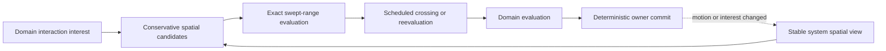
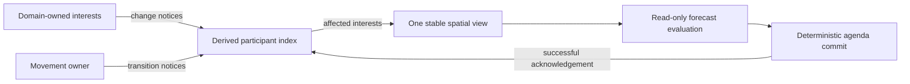
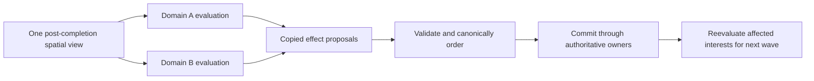
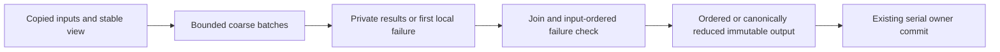
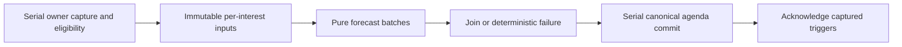
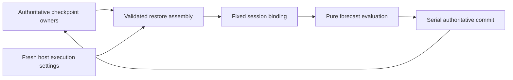

# Moving-ship interaction architecture

[Project index](../README.md) · [Navigation and spatial architecture](navigation-architecture.md) · [Actor control and order lifecycle](actor-control-and-orders.md) · [Simulation architecture](simulation-architecture.md) · [Concurrency and performance](concurrency-and-performance.md) · [Project task list](task-list.md)

## Decision status

**Decision status:** Accepted by the project owner on 2026-08-20.

`TASK-019` defines the shared physical substrate for discovering and timing
interactions while ships remain on authoritative local-motion segments. It does
not define combat, sensor, collision-response, inspection, assistance, or
docking outcomes. Those domains retain their own eligibility, range, duration,
effects, and order-completion policies.

## Purpose and boundary

Normal local travel remains scheduled from departure to arrival. Ships do not
stop at artificial waypoints or enter a global movement tick merely so the
simulation can discover that their paths cross. Instead, the interaction
substrate compares authoritative motion over a bounded interval, calculates
when a requested range is crossed, and schedules reevaluation at that time.

The spatial-interaction owner is responsible for:

- Conservative candidate discovery within one system
- Exact narrow-phase range and swept-path evaluation
- Stable interaction-interest and ship-pair correlation
- Forecast invalidation and triggered reevaluation
- Deterministic proposal ordering and agenda requests

The consuming gameplay domain is responsible for:

- Declaring why an interaction is relevant and the range or geometry it needs
- Deciding whether contact is eligible and what it means
- Proposing any order, movement, damage, knowledge, or other gameplay effect
- Defining any fixed-step activity required after initial contact
- Emitting semantic facts and presentation state for its outcome

Candidate discovery and crossing forecasts are derived data. They do not grant
knowledge to the player, prove that an action is permitted, or change either
ship's motion.

## Interaction model at a glance



The diagram describes authority and data flow. It does not prescribe a spatial
index, public interface hierarchy, or scheduler implementation.

## Queries and durable interests

The shared substrate supports two related forms of work:

- An **instant proximity query** returns candidates satisfying a requested
  system-local range at one authoritative `SimulationTime`.
- A **swept interaction query** examines a bounded interval and returns whether
  two trajectories are already in range, enter range, touch the boundary, or
  pass through range during that interval.

A one-time caller may issue either query against a stable read view. A domain
that needs future notification registers a stable **interaction interest**.
The interest identifies the owning domain, its stable purpose, the participating
roles or candidate scope, and the requested range or geometry. The specific
payload remains domain-owned rather than becoming one universal interaction
record.

Directed gameplay meaning is preserved. For example, an inspector and an
inspected ship retain those roles even though discovery uses a canonical
unordered ship-pair key. A domain must not use spatial partition identity,
collection order, or worker completion order as gameplay meaning.

The substrate does not automatically register every possible ship pair for
every possible domain. Spatial indexes restrict broad-phase candidates, and
explicit interests determine which narrow-phase questions are meaningful.

## Exact crossing time on the millisecond timeline

An authoritative local-motion segment defines linear movement from its origin
to destination over a closed interval of integer simulation milliseconds.
During the time overlap of two segments, their relative position is also
linear. A stationary ship is treated as a constant position for the bounded
interval supplied by the moving participant or query.

For a requested interaction range, narrow-phase evaluation determines the
continuous interval during which the distance predicate is satisfied. It then
schedules the entry at the first representable `SimulationTime` that is not
earlier than the mathematical entry time. In other words, fractional entry is
rounded upward to an integer simulated millisecond.

This rounding rule has two important consequences:

- An interaction is never reported before the paths mathematically reach the
  requested range.
- A very fast pass that enters and exits between adjacent milliseconds is still
  reported at the later millisecond as a swept crossing. The event records that
  contact occurred within the preceding interval; it does not falsely claim
  that the ships remain in range at the event timestamp.

Implementations must reach the same entry timestamp on every supported worker
layout. Floating-point approximation, iteration order, or platform-dependent
rounding must not choose the result. The exact overflow-safe integer or rational
algorithm remains an implementation choice and must be covered by boundary,
tangent, brief-crossing, and large-coordinate tests.

Queries are bounded by the overlap of known authoritative segments and any
explicit caller horizon. The substrate does not extrapolate beyond a segment's
arrival, assume a future course, or create an unbounded forecast for two
stationary ships.

## Scheduling, invalidation, and reevaluation

A crossing forecast records enough stable correlation to determine which
system, interaction interest, ship pair, motion states, range, and bounded
interval produced it. Evaluation workers return an event proposal; only the
agenda owner assigns creation sequence and commits the scheduled event.

Committed changes to any of the following invalidate an affected forecast and
trigger reevaluation from the new stable state:

- Either ship's local-motion segment, position, or system membership
- The interaction interest, including its range or participating roles
- Removal of either ship or cancellation of the owning gameplay intent
- Entry into or emergence from connector transit

Stale scheduled events validate their correlation and become defined no-ops.
Invalidation must not require removing arbitrary entries by scanning the event
agenda. Repeated triggers for the same interest, pair, and timestamp are
deduplicated before event commit.

Due interaction work enters the state-update portion of the timestamp cycle,
after physical completions at that timestamp establish the stable spatial
view. All due interactions at the same timestamp evaluate against that same
view. Their resulting effects commit only through their authoritative domain
owners and cannot reopen an earlier phase.

## Motion and order effects

Discovering proximity or a swept crossing never changes authoritative motion
by itself. A consuming domain may propose one of the existing explicit
outcomes:

- Preserve both current motion segments
- Materialize a ship at the interaction timestamp and interrupt, cancel, or
  replace its current leg through the movement owner
- Replan an order while retaining its stable destination or target intent
- Place an order into a defined waiting, suspended, failed, or completed state

Any motion change advances the affected generation, invalidates old completion
and interaction forecasts, and produces a new stable view before later
evaluation. A gameplay domain may not mutate another ship, movement state, or
order directly from candidate evaluation.

## Following and interception

Following and interception are persistent target intents, not special physical
states and not permanent links between two motion segments.

A following order retains its target identity and domain-owned desired
relationship, such as a preferred distance. An interception order retains its
target identity and completion condition. Navigation may plan against the
target's current authoritative position and finite motion segment, but it must
not extrapolate an unwritten future course.

Committed motion changes by the follower, interceptor, or target trigger
reevaluation. The owning order then preserves its current leg, replaces it with
a newly planned leg, waits, fails, or completes according to its own policy.
The shared substrate supplies proximity, swept crossing, and forecast
invalidation; it does not choose pursuit cadence, lead behavior, acceptable
following error, or the outcome when a target cannot be reached.

This keeps later combat, escort, inspection, and assistance orders on the same
movement and interaction model without placing their policy in navigation.

## Fixed-step participation

There is no universal ship-movement tick. Scheduled range crossings and
triggered reevaluation remain the normal interaction path.

After contact begins, a gameplay domain may create an explicit active
interaction that requires fixed steps, such as later combat or collision
resolution. That domain owns:

- The positive integer-millisecond step duration
- Entry and exit conditions
- Stable participant and interaction identities
- Read-only evaluation inputs and buffered effect outputs
- Checkpoint, save, fact, and presentation requirements

Fixed-step work is scheduled only while the active interaction requires it. It
uses the same timestamp barriers and deterministic evaluate-and-commit path as
other simulation work. A domain cannot change the global time resolution,
derive results from rendered frames, or make outcomes depend on whether the
computer sustains the selected player-facing speed.

## Connector transit

A ship in `ConnectorTransit` has no ordinary system-local position and is not
present in a system spatial index. It therefore cannot participate in
system-local proximity, swept-path, following, interception, combat, collision,
inspection, or assistance interactions while in transit.

A persistent target intent may continue to identify the ship, but its owning
order must wait, fail, or pursue another policy until authoritative emergence.
Emergence inserts the ship into the destination system's stable spatial view
and triggers affected interaction reevaluation.

Connector lifecycle and future connector-specific hazards remain separate from
this substrate. They must not fabricate an in-transit local position or treat
two ships using the same connection as physically colocated.

Session-level tests now exercise durable pair interests through actual connector
orders. Transit produces no local callback, including for two ships traversing
the same connection. After every same-timestamp physical emergence completes,
a contact at the destination is evaluated from one stable local view. A target
remaining in another system receives no contact.

A checkpoint captured during transit resumes with the same emergence contact,
agenda allocation, and event order as uninterrupted execution. Canceling the
interest or removing the traveling participant prevents delivery. These tests
verify the existing movement and interaction ownership path; they add no
connector-specific interaction policy.

## Deterministic discovery and simultaneous interactions

Broad-phase indexing may use grids, trees, or another measured two-dimensional
structure. A moving participant contributes a conservative swept bound over the
query interval so that the broad phase may return extra candidates but may not
omit a possible crossing. Narrow-phase evaluation decides the actual result.

Each candidate is normalized to a stable key containing, in order:

1. System identity
2. Interaction timestamp
3. Lower ship identity
4. Higher ship identity
5. Stable interaction-interest identity

This key deduplicates candidates found through multiple cells or neighboring
partitions and orders simultaneous proposals. Directed participant roles remain
in the proposal payload. Partition shape and batch size may alter where a
candidate is discovered, but never its key or outcome.

Every due interaction at one timestamp reads the same committed spatial view
and returns typed immutable proposals. Domain owners then apply explicit
conflict rules in stable proposal order. A domain that can produce conflicting
effects must define those rules before its interaction kind is admitted; the
shared substrate does not invent combat, collision, or sensor precedence.

## Persistence, facts, and presentation

Authoritative interaction interests and active fixed-step interactions must be
included in their owning domain's checkpoint and save state. Spatial indexes,
broad-phase candidates, and crossing forecasts are derived and may be rebuilt
from authoritative motion and interest state. Restore must reproduce the same
future crossing timestamps and deterministic ordering.

The substrate may expose bounded diagnostics for candidate counts,
invalidations, and scheduled crossings. It does not emit semantic gameplay
facts merely because two paths were candidates. The consuming domain emits
facts only when its authoritative policy recognizes an interaction or commits
an outcome.

Presentation snapshots may expose domain-owned active interactions and the
existing authoritative motion segments. They do not expose mutable spatial
indexes, speculative candidates, or rendered interpolation as simulation state.

## Decisions and deferred choices

The following are architectural decisions:

- Constant local-motion segments use analytic swept evaluation rather than
  repeated polling.
- Fractional first contact rounds upward to the millisecond timeline, and brief
  between-millisecond crossings are retained as swept crossings.
- Motion and interest changes trigger forecast invalidation and reevaluation.
- Candidate discovery alone never changes motion or grants gameplay meaning.
- Following and interception retain target intent and replan from committed
  authoritative changes without extrapolating an unwritten target course.
- Fixed steps are opt-in, domain-owned active interaction work rather than a
  global movement tick.
- Connector-transit ships cannot participate in system-local interactions.
- Simultaneous candidates evaluate from one stable view and use canonical
  pair-and-interest ordering independent of worker and partition layout.

The following remain with later gameplay or measured implementation work:

- Concrete combat, sensor, inspection, assistance, and docking eligibility or
  outcome policy
- Authoritative ship geometry, physical collision, and avoidance, retained by
  `TASK-072`
- Pursuit cadence, lead behavior, following tolerance, and unreachable-target
  policy
- Fixed-step durations and active-interaction state for each consuming domain
- Spatial index type, partition dimensions, batch sizes, and forecast caching
- Cross-platform numeric guarantees beyond the deterministic contract owned by
  `TASK-060`

## Linear swept-range query

`SweptRangeQuery.FindFirstContact` provides read-only narrow-phase evaluation
for two existing `LocalMotionSegment` values or one segment and a stationary
`SystemPosition`. The query clips its closed caller horizon to the known
motion intervals. Different systems and disjoint intervals return no contact;
a reversed caller horizon is rejected. It never extrapolates beyond arrival or
materializes rounded positions to decide contact.

The implementation retains rational relative position and velocity with
`BigInteger` arithmetic. Squared distance minus squared range is a convex
quadratic. An exact minimum test determines whether a continuous prefix of the
query interval contains contact. Binary search over that monotone prefix
predicate finds the first representable entry millisecond, including a tangent
or brief pass entirely between timestamps, without approximating a square root.
The search takes at most 64 iterations over the integer timeline.

The returned `SweptRangeContact` separates the rounded `Timestamp` from
`InRangeAtTimestamp`, which tests the distance at that timestamp, and
`AlreadyInRange`, which refers to the clipped interval's start. A contact that
has already ended remains swept evidence and does not authorize a gameplay
effect. These results allocate no agenda sequences and mutate no movement.

This query accepts linear segments only. Analytic maneuver schedules require
their own integration through the accepted `TASK-090` activation boundary;
callers must not approximate an accelerating maneuver with a linear chord.
Interest ownership, candidate discovery, invalidation, and agenda commit are
handled separately from this narrow-phase query.

## Explicit pair interests and candidate reduction

The project owner selected a session-wide nonzero `InteractionInterestId` on
2026-10-07, following the existing typed identity and deterministic sequence
contract. Its allocation belongs at owner commit, never in evaluation workers.
Domain-owned interests retain that identity through reevaluation. The session
registration boundary now captures their stores and the shared allocator.
Gameplay-specific payload and active-interaction checkpoints remain domain-owned.

`ShipPairInteractionInterest` captures an immutable domain input for a named
source and target, with domain and purpose identifiers, range, and generation.
It preserves directed roles and leaves domain-specific payload, eligibility,
lifecycle, and effects with the caller. This input supports the explicit-pair
form of interest; it does not register a live interest or discover candidate
scopes automatically.

`InteractionCandidate` combines the interest with derived contact evidence.
Its key follows the accepted order: system, timestamp, lower ship identity,
higher ship identity, then interest identity. Normalizing the pair never swaps
the directed source and target in the interest.

`InteractionCandidateNormalizer` copies independently evaluated candidates,
sorts by that key, and returns an isolated read-only collection containing each
distinct candidate once. Identical duplicate evidence reduces to one result.
Unequal evidence for the same key is an invalid evaluation input and is rejected;
choosing a payload by discovery order would violate the stable-view contract.
This validation supplies no gameplay conflict policy and commits no effects.

Focused tests verify complete key ordering, reversed discovery, distinct
directed interests, conflicting duplicate rejection, and reordered batch
concatenation. This is reduction evidence, not proof of a concurrent runtime or
an indexed broad phase, which remain pending within `TASK-071`.

## Spatial revisions and completion receipts

On 2026-10-07, the project owner selected a dedicated spatial revision for
forecast correlation, leaving movement completion-event generations unchanged.
`SpatialRevision` advances on committed departures, replanning, cancellation,
arrival, transit transitions, and analytic maneuver transitions. A revision
never wraps. It is scoped to the lifecycle owner's non-reused ship identity;
missing participants invalidate their forecasts. Movement checkpoints capture
and restore the exact revision along with physical state.

`SpatialMovement.CaptureInteractionReadView` copies participant snapshots and
their revisions at a coordinator-owned stable boundary. Evaluation workers may
share this immutable view; movement commits cannot interleave with its capture.
Changing a trajectory later cannot change a previously captured view.

The owner also selected exact movement-owner completion receipts to preserve
brief crossings rounded to an arrival timestamp. Successful linear arrival
records the completed trajectory, its previous and completed revisions, and
the arrival time. A read view includes that receipt only at the matching
timestamp, including after a new leg starts in the same timestamp. Cancellation
does not create a receipt. Receipts are bounded derived evidence for the current
timestamp, not checkpoint state: whole-runtime checkpoints are permitted only
after that timestamp's phases drain.

`InteractionForecast.Evaluate` clips an explicit pair's query to the caller's
horizon and known linear segments. It handles moving and stationary roles in
either direction and uses a bounded instant check for two stationary ships.
Missing participants, connector transit, and different systems produce no
local forecast. Analytic participants use the immutable geometry adapter
specified below; the evaluator never substitutes a linear chord for acceleration.

Due validation requires the original interest, scheduled generation, exact due
timestamp, and both participant correlations. A changed trajectory is stale
unless an exact same-time arrival receipt proves that the original trajectory
completed uninterrupted. This exception retains swept evidence; it does not
assert eligibility or current range after subsequent same-time changes. Domain
evaluation still reads the stable post-completion state.

`InteractionForecastScheduler` reduces one evaluation wave in canonical key
order and submits `StateUpdate` event proposals through `AgendaCommitOwner`.
Only deterministic commit assigns the transient proposal rank and authoritative
event creation sequences. A shifted reevaluation horizon does not enqueue
another event for an unchanged interest and participant revisions. Pending
correlation is recorded only after agenda commit succeeds. Superseded events
become no-ops and cannot remove a newer pending forecast with the same key.

These components now participate in the live session wave described below.
Restore proof covers movement revisions, domain interest state, exact pending
analytic contact continuation, and already-delivered stationary and moving
contact suppression. Complete save continuation remains with `TASK-037`; broader
interaction discovery and determinism proof remain within `TASK-071`.

## Durable interests and transition-triggered reevaluation

`InteractionInterestOwner` is reusable state composed inside each consuming
domain. It retains authoritative directed interests and allocates identities
from the one shared session allocator. Registration validates input before
allocation. Updates preserve identity and purpose, advancing the interest
generation only when roles or range change. Cancellation withdraws intent
without permitting identity reuse. Its checkpoint retains live interests and
exact generations; the session allocator must be restored once before restoring
the domain owners. Restoration rejects duplicate, foreign-domain, and
unallocated identities, then seeds derived notices for rebuilding forecasts.
The session registration checkpoint now aggregates these component checkpoints
with the exact shared allocator state.

Domain commits coalesce change notices per interest. `SpatialMovement` provides
opt-in derived notification buffers seeded with current actors. Add, movement
revision commits, and removal publish notices; ignored events do not. Each
buffer keeps only its latest notice per changed ship, and disposal detaches it.
Capturing and acknowledging notices cannot discard a later commit. No gameplay
callback runs inside the movement owner, and no notifications accumulate when
no buffer is attached.

`SpatialInteractionCoordinator` holds a derived ship-to-interest index. It
collects domain changes and movement notices, updates participant membership,
and reevaluates only affected explicit interests. One immutable spatial view
serves the complete reevaluation wave, and the existing forecast scheduler
reduces and submits events deterministically. Notices are acknowledged only
after successful evaluation and agenda submission; failures retain work for
retry. The coordinator does not own domain intent or interaction outcomes.

On 2026-10-07 the owner selected the next known motion boundary as the automatic
forecast horizon. For a supported linear pair this is the earliest active
arrival; two stationary participants use an instant check. The arrival or other
spatial transition wakes the affected interests again. This avoids a short
caller horizon expiring without a renewal trigger. Missing participants and
connector transit produce no local forecast and wake on later add or emergence.



These reusable components retain the single-thread reference path and now
support live session dispatch. The coordinator uses both linear arrival and
analytic next-boundary times to drive affected-interest reevaluation.

## Analytic swept-range foundation

On 2026-10-07 the owner selected continuous unrounded kinematic curves within
each phase, with resets to the committed rounded state at phase boundaries.
Contact does not follow rounded integer-millisecond position samples. The owner
also selected that a deceleration curve stops at its exact target-speed point
and holds that position until the rounded-up scheduled boundary. The forecast
must not extend braking past that point and briefly reverse a stopping ship.
This rule defines forecast geometry; it does not change the existing movement
materialization or endpoint velocity contract.

`AnalyticSweptRangeQuery` now evaluates bounded constant-acceleration segments
against a stationary position or another constant-acceleration segment. It
clips to the known phase overlap, retains rational positions from immutable
phase starts, and does not replace acceleration with an endpoint chord. These
standalone segment queries use closed continuous intervals. The future plan
adapter must apply the committed endpoint reset separately; the segment query
does not infer which curve owns a shared plan boundary.

Relative position is quadratic, so squared distance minus squared range is a
polynomial of degree at most four. `PolynomialRangeQuery` uses arbitrary-width
integer coefficients and a sign-preserving Sturm sequence to detect roots,
including tangencies that do not change sign. Integer bisection finds the first
millisecond enclosing contact, preserving brief crossings even if the range
predicate is false at that timestamp. It performs no floating-point search or
per-millisecond polling. Focused tests cover multiple contact intervals,
repeated roots, rational-root cases, phase overlap, rounding-induced early
contact, curvature, and full-width timeline offsets.

## Braking and whole-maneuver queries

`InteractionPhaseCurve` now represents exact rational geometry for acceleration,
active braking, passive drag, and braking to a nonzero target speed. The braking
curve splits at its fractional target time and holds the exact target position
through the scheduled endpoint. Pair queries search the overlap of these pieces
without rounding either direction or target position. Contact can first occur
during the fractional hold; extrapolating deceleration past its target cannot
create a reversal contact. The root search accepts exact rational bounds and
open endpoints in addition to closed integer horizons.

Executable maneuver plans now retain an immutable projection of their original
kinematic curves. Projection covers directional and aligned translation,
precision variants, turns, capped travel, cruise, forced dropout, passive drift,
and waypoint-route composition. It reads concrete plan payloads and preserves
their coefficients; it never fits a curve to sampled rounded positions. The
existing movement evaluator remains unchanged.

`ManeuverSweptRangeQuery` evaluates a plan against a fixed participant or another
plan. Continuous intervals exclude their original kinematic endpoints. At each
such boundary it evaluates the existing plan's committed position instead. This
both admits contact created by a rounded endpoint reset and rejects contact
that existed only at an uncommitted endpoint. Swept contact before a boundary
still rounds up to that boundary and retains its evidence even when the reset
moves the ship out of range.

On 2026-10-07 the owner selected preservation of the underlying curve across
inserted waypoint events. These events split the observable schedule without
creating a kinematic reset. They still provide a timestamp at which a domain
can evaluate interaction effects against the stable state of either participant.
A motion-changing effect must commit through the affected movement owner,
materialize and replace the schedule, and invalidate its forecasts. That domain
effect and runtime due-wave wiring remain later implementation work; merely
observing a waypoint does not change motion.

## Analytic forecast correlation

`SpatialMovement.CaptureInteractionReadView` now captures an immutable executable
plan with each active maneuver snapshot. The cursor, phase, identity, generation,
and next-boundary diagnostic are copied values, not mutable schedule references.
Waypoint-route construction freezes the caller's transition collection so later
caller edits cannot change an already-captured plan's evaluator.

`InteractionForecast` consumes these plans for analytic/analytic,
analytic/linear, and analytic/stationary pairs. It clips its horizon to each
participant's next observable boundary as well as the caller's requested bound.
An inserted waypoint boundary therefore wakes reevaluation without changing the
original curve geometry. `SpatialInteractionCoordinator` now schedules analytic
forecasts with the same next-boundary rule as linear forecasts. An analytic
snapshot missing its exact plan is invalid input, not a no-contact result.

After a successfully applied analytic boundary, the movement owner records the
original motion identity, generation, phase cursor, immutable plan, previous and
completed spatial revisions, and timestamp. Failed or ignored events do not
produce a receipt. A stable read view copies only receipts for its timestamp.
Multiple successful boundaries at the same timestamp retain separate receipts,
including completion followed by a new zero-duration terminal settle. Later
movement commits clear older-timestamp receipts.

Due validation accepts either an unchanged spatial revision or an exact matching
same-timestamp boundary receipt. This preserves swept contact rounded to a
waypoint or completion timestamp even after the phase cursor advances or a new
leg starts. Interruption and replacement do not fabricate completion evidence.
Interest changes, missing participants, and incompatible spatial changes remain
stale or missing-reference no-ops. Acceptance confirms the original contact
evidence; the consuming domain still evaluates present eligibility against the
stable post-completion view before committing effects.

The analytic receipts are derived timestamp evidence and are not checkpointed.
Whole-session checkpoints are taken after timestamp phases drain, and derived
forecasts must be rebuilt from restored authoritative intent and movement.
This slice connects the reusable forecast and scheduler components.
Session intent now round-trips through its registration boundary. Pending
correlation reconstruction, live runtime dispatch, and durable delivery history
are now implemented below.

## Buffered due-wave evaluation

The reusable coordinator validates all supplied due envelopes against one
immutable post-completion spatial view. It copies current domain-owned interests
before evaluating the wave, so cancellation or revision is visible even before
participant-index reevaluation. Results are buffered in canonical candidate and
agenda-key order. Validation accepts contact evidence only; gameplay eligibility
and effects still belong to the consuming domain.

The scheduler retains the exact agenda key returned by deterministic submission.
A foreign envelope cannot consume an existing correlation. Wave completion
releases matching envelopes only, after the caller handles all buffered results,
and preserves any replacement committed in the meantime. Duplicate envelopes,
wrong phases, and mismatched timestamps are rejected before evaluation. A wave
can only be completed by its originating coordinator.

This is component integration. The live session has no gameplay consumer yet.
On 2026-10-07 the owner selected a domain-neutral registration extension point;
registration and authoritative intent checkpoints are now implemented below.
The live StateUpdate evaluation and buffered-effect boundary is now implemented
below.

## Session domain registration

`GameSession.RegisterSpatialInteractionDomain` creates a distinct interest store
for a stable domain name using the session's shared identity allocator. Duplicate
registration is rejected. The consumer retains ownership of that store's intent,
eligibility, payload, and effects. Registration selects no gameplay consumer and allocates no interest identity.
A consumer separately binds its evaluator through
`GameSession.BindSpatialInteractionDomain`. Consumers register explicit pair
interests through the returned store. They continue to own participant-liveness
validation; registration itself neither discovers ships nor fabricates outcomes.

The whole-session checkpoint includes all registered stores, including empty
ones, in ordinal domain-name order, plus the allocator's exact next value or
exhausted state. Cancellation never permits identity reuse. Restore validates
every store and cross-domain identity uniqueness before publishing the session.
Missing registration state, duplicate domains, foreign or unallocated interests,
and duplicate identities are rejected. This internal checkpoint addition does
not define a saved-format migration policy, which remains with `TASK-037`.

After restore, a consumer obtains its restored store through
`GameSession.GetSpatialInteractionDomain`; it must rebind rather than retain an
owner from the previous session. Restored stores seed change notices for later
derived reconstruction. Registered interests now participate in runtime
forecasting. An unbound domain proposes no gameplay effects. Consumers bind
before advancing their interests so domain evaluation occurs at the contact
timestamp.

## Runtime StateUpdate wave boundary

The engine now offers an opt-in `ISimulationStateUpdateRuntime` boundary.
Preparation runs at StateUpdate entry after every same-time physical completion
has drained. The engine captures all currently due StateUpdate envelopes into
one read-only wave before invoking evaluation and buffered commit. The runtime
returns one disposition per input envelope; the engine records them in agenda
order. Work created by that commit drains in a subsequent wave at the same
timestamp before Decision begins. Runtimes without this interface retain their
existing per-event path.

On 2026-10-07 the owner selected same-timestamp domain evaluation followed by
deterministic buffered-effect commit. The session now implements this interface
and attaches its registered interest owners to the derived forecast coordinator.

## Live domain evaluation and buffered effects

External intent and movement changes are reevaluated before session advancement,
including at an already-initialized current timestamp. StateUpdate entry also
reevaluates after physical completions drain. Due interaction envelopes are
validated together against one immutable spatial view. Valid contacts are
partitioned by owning domain while retaining canonical contact order. Every
bound evaluator runs before any effect commits. Domain eligibility and conflict
policy remain with that evaluator; an accepted forecast is contact evidence,
not permission to perform a gameplay action.

`ISpatialInteractionDomainEvaluator` reads that view and its domain's contacts,
returning `SpatialInteractionEffectProposal` values. The runtime copies the
proposals and requires each effect to identify an eligible contact from its
own domain. It rejects duplicate candidate, effect-kind, and local-ordinal keys
before committing any effect. Effects commit in candidate-key, effect-kind,
then local-ordinal order through `ISpatialInteractionEffect.Commit` and the
appropriate authoritative session APIs. Domain evaluators must also keep their
own gameplay state read-only during evaluation. The runtime rejects mutation
through retained registered interest owners and session mutation boundaries.



Successful wave completion releases exact pending correlations, then reevaluates
committed movement and intent changes. New same-phase contact work drains in the
next wave. A domain effect can change either ship through the movement/order
owner without changing the view already used by other evaluations. Existing
agenda phase rules still apply to any events proposed by effects. The runtime
does not introduce a combat, docking, sensor, or assistance policy.

The session records interaction dispositions as event diagnostics, without
fabricating semantic gameplay facts. A failed evaluation or effect commit closes
the session to further mutation and checkpoints because due envelopes may have
been consumed and some effects committed. Effects are not automatically rolled
back. Disposing the session detaches movement notifications and closes its
mutation boundary.

Checkpoint restoration rebuilds pending correlations from exact existing
interaction agenda envelopes without allocating creation sequences. This
retains pending analytic contact timing and diagnostic event order. Evaluator
objects are runtime bindings, not checkpoint payload: the checkpoint retains
which registered domains need rebinding, and advancement rejects missing
bindings before consuming events. Rebinding itself commits no gameplay effects.

## Durable last-delivered correlation

On 2026-10-07 the owner selected durable last-delivered correlation for live
interests. Each domain store now owns delivery history alongside intent. A
correlation records the interest identity and generation plus the directed
source and target spatial revisions in the stable delivery view. It contains no
query horizon, sampled position, forecast geometry, or partition identity.

After all bound domain evaluations and the complete buffered effect commit
succeed, the runtime acknowledges delivery using that captured view. A domain
that proposes no effects still received its contact and is acknowledged. An
unbound domain received no callback and acquires no delivery history. Failed
waves acquire no new acknowledgements and cannot publish a checkpoint.

The revisions belong to the post-completion evaluation view. For swept evidence
retained by a completion receipt, recording the earlier forecast revisions
would allow restore to rediscover the same stationary contact after arrival.
Conversely, the runtime does not resample after effects: an effect that changes
motion must remain a fresh trigger rather than having its new state marked as
already delivered by the preceding evaluation.

Reevaluation suppresses a delivered correlation before geometric querying or
agenda allocation. Due validation also treats an already-delivered correlation
as an ignored state mismatch, protecting against redundant pending envelopes.
A changed spatial revision permits fresh contact evaluation. A real interest
revision clears delivery history and advances its generation; a no-op update
retains both. Cancellation clears history. A wave that cancels or revises an
interest during effect commit cannot attach obsolete delivery history to the
new intent.

Domain checkpoints retain immutable delivery rows in interest identity order.
Restore rejects duplicate rows, missing interests, mismatched generations, and
history beyond a restored live participant's current spatial revision. Missing
participants do not invalidate past history by themselves; the consuming domain
still owns interest lifetime and eligibility, and missing-reference forecasts
remain no-ops. Derived indexes and forecasts remain separate from this durable
acknowledgement state.

Focused continuation tests prove no extra callbacks, agenda allocations, or
event processing after restoration of unchanged stationary contact, contact at
arrival, and delivered contact during an unchanged analytic trajectory. A later
motion boundary produces the same fresh delivery and event order in the live
and restored sessions. Interest and spatial revision changes also permit new
delivery. Broader save compatibility and migration remain with `TASK-037`.

## Conservative swept-bound foundation

The derived bounds query encloses each known phase using exact rational axis
endpoints and any interior quadratic extrema. It also covers the exact
fractional target-position hold after deceleration. Each minimum rounds down
and each maximum rounds up, including negative coordinates. Arbitrary-width
coordinates avoid overflow when an unrounded curve extends beyond the published
coordinate range.

Whole-maneuver bounds union original phase coverage with committed positions at
original kinematic boundaries. An instant query exactly at such a boundary uses
the committed position. Inserted waypoint events preserve the underlying curve
and do not introduce a reset. Over intervals, closed bounds may include the
pre-reset endpoint limit as extra broad-phase coverage; narrow-phase evaluation
still decides whether that endpoint is a contact. Queries clip to known motion
and never extrapolate beyond it.

A conservative pair rejection compares the exact minimum Euclidean distance
between the two outward-rounded boxes against the inclusive requested range.
Different systems reject immediately. The calculation retains arbitrary-width
arithmetic for both coordinate separation and squared range. A surviving pair
still requires narrow-phase evaluation: overlapping boxes do not establish that
the participants occupied nearby positions at the same instant.

This internal geometry foundation chooses no spatial index or durable candidate
scope. Caller-scoped instant proximity is implemented below; index selection and broader
partition and execution determinism proof remain pending. Focused tests cover independent axis extrema,
between-millisecond extrema, signed outward rounding, fractional braking holds,
committed endpoint resets, inserted events, clipped horizons, and coordinate and
timeline extremes. Pair rejection tests also cover inclusive diagonal distance,
containment, different systems, extreme separation and range, and retention of
an actual between-millisecond crossing.

## Caller-scoped instant proximity

On 2026-10-08 the owner selected continuous motion curves for instant proximity
and an explicit caller-supplied candidate ship scope. The one-time query reads a
captured spatial view at its timestamp, searches only those ship identities,
and returns unique matching targets in ship identity order. It excludes the
source itself, absent ships, connector transit, and ships in another system.
It allocates no interest identities, creates no agenda entries, and commits no
effects. Durable future notifications still require explicit interest registration.

Linear positions remain unrounded along their segments. Analytic positions
follow original continuous phase curves and fractional braking holds, with
committed rounded positions at original kinematic boundary instants. Inserted
waypoint events preserve the curve. A missing analytic plan is an invalid read
input rather than permission to substitute the published rounded snapshot.
Completion receipts preserve past swept evidence, but an instant query examines
only the current position and does not replay that earlier crossing.

The reference path uses conservative instant bounds to reject impossible pairs,
then applies exact inclusive Euclidean range evaluation. It does not extrapolate
outside known trajectories. The supplied scope is deduplicated before evaluation
and the returned identity list is immutable. Scope ordering, duplicate discovery,
and splitting the same scope into different batches preserve the combined result.
Spatial indexes were subsequently implemented with explicit caller selection
as recorded below. Measured concurrent execution remains pending.

## Immutable proximity preparation

The owner-selected prepared path captures exact local points once from a
stable spatial read view. `InteractionProximityQuery.Prepare(view)` validates
all captured local geometry, rejecting missing analytic plans even if a later
scope would omit that participant. Each exact point uses integer numerators
with a reduced common denominator. It preserves the reference path's continuous
curves, fractional braking holds, and committed original-boundary resets.

`preparedView.PrepareScope(shipIds)` copies, validates, deduplicates, and orders
a caller-supplied target scope once. Absent and nonlocal targets are omitted;
different-system targets cannot match. The source may be any captured local
ship, including one outside the target scope. Multiple scopes can share the
same immutable per-view geometry. Caller input changes and later movement
commits cannot change prepared results; a new timestamp or updated owner state
requires a new captured view and preparation.

`preparedScope.Find(source, range)` scans those ordered targets, excludes self,
and applies exact inclusive squared distance after exact axis rejection.
Returned identities are immutable and already ordered. Evaluation performs no
shared cache mutation, interest registration, agenda allocation, or owner
commit. This keeps the read path batchable without enabling workers or choosing
a spatial index. The original `Find(view, source, scope, range)` remains the
reference path for comparison. Tests cover reference equivalence, immutable
inputs, scope batching, missing analytic geometry, fractional holds, and full
coordinate and range limits.

## Discovery and scheduling layout proof

The reference-path tests now compare mixed linear and analytic forecasts in two
systems across logical partition counts of 1, 2, 5, and 8 and several batch
sizes and evaluation orders. The inputs include simultaneous crossings,
already-in-range contacts, opposite directed interests, missing participants,
and cross-system pairs. Repeated discovery represents overlap between supplied
candidate scopes without selecting a spatial index.

Every layout produces the same normalized contact evidence, exact committed
agenda keys, and popped event order. Repeated unchanged submission allocates no
additional sequences. Restoring the agenda and rebuilding pending correlations
from reversed envelope input also preserves the result without allocation.
Separate instant proximity checks compare the combined scoped result across
partition assignments and batch completion orders.

Due-wave tests change authoritative intent and movement after scheduling:
interest cancellation, participant removal, and motion replacement produce the
same ordered dispositions regardless of envelope layout. Read-only evaluation
retains all pending correlations until completion releases the exact envelopes.

These are sequential reference-path proofs with simulated evaluation completion
orders. They do not enable workers, establish concurrent performance, or verify
an index's spatial partition coverage. Measured index selection and any future
concurrent execution still need their own evidence.

## Reference-scan performance baseline

The opt-in `interaction.scoped-proximity` workload now measures linear and
stationary caller-scoped queries in sparse and dense layouts. Its versioned
configuration, canonical digest, reduced correctness tests, and Release results
are documented in the [reference-scan baseline](interaction-performance-baseline.md).
Each timed iteration includes fixture construction and query-result digesting;
it does not measure query-only cost or whole-session throughput. The raw reports
retain machine metadata and repeated-run correctness evidence.

The prepared sibling preset now compares identical fixtures and digests while
including immutable geometry and scope preparation in the timed iteration.
The [comparative measurements](interaction-performance-baseline.md#prepared-geometry-comparison)
show substantial allocation reductions at all three sizes. Spatial-index
selection remains open. Analytic forecasting, invalidation churn, spatial-index
coverage, and actual concurrent execution remain separate measurement and
validation work.

## Spatial-index evaluation for owner selection

On 2026-10-08, immutable point and scope preparation completed the first
allocation optimization. Index selection remains unresolved. The following
comparison led to owner approval of benchmark-only sparse-grid and immutable
bounding-box hierarchy prototypes. It does not adopt a runtime index, cell
size, public API, or execution policy.

### What the measurements establish

The prepared path still visits every target in a caller scope. At 2,500 ships
and 100 queries, that means 250,000 scoped entries, even when no target matches.
The recorded sparse and dense comparisons establish the benefit of preparation,
but both fixtures place ships on one horizontal line. They do not measure
coverage across two-dimensional cell boundaries, clustered distributions,
variable ranges, long swept paths, or index construction. A measured index
choice needs those workloads rather than another timing run of the same line.

Dense output has a separate lower bound: when all 2,499 targets match a source,
the query must still return those identities. An index can reject empty space
but cannot eliminate required matches. Construction cost and retained index
memory must therefore accompany candidate-reduction and timing results.

### Candidate structures

| Candidate | Potential benefit | Cost or unresolved issue | Coverage proof needed |
| --- | --- | --- | --- |
| Sparse uniform grid | Direct lookup of occupied cells; simple immutable cell batches for nearby instant queries | Cell width couples occupancy to query range; large queries or long swept boxes may visit or occupy many cells | Negative-coordinate floor division, inclusive cell edges, all overlapped cells, duplicate reduction, huge coordinate spans |
| Hierarchical grid | Multiple cell scales can reduce duplication for differently sized swept boxes | Level assignment, queries across levels, and duplicate ownership add implementation choices | Contacts between levels, level transitions, boundary overlap, large-box placement |
| Bounding-box hierarchy | Stores conservative boxes without inserting each box into every covered grid cell; queries prune nonoverlapping branches | Building the hierarchy and traversing overlapping branches cost work; dense boxes still produce many candidates | Conservative parent unions, exact closed overlap, stable identity reduction, equal coverage under alternative build layouts |

These are expected tradeoffs, not Galaxy Command performance results.
[NVIDIA's spatial-subdivision discussion](https://developer.nvidia.com/gpugems/gpugems3/part-v-physics-simulation/chapter-32-broad-phase-collision-detection-cuda)
describes grid sizing and duplicate pair handling, including hierarchical
approaches for differing object sizes.
[Box2D's tree documentation](https://box2d.org/documentation/group__tree.html)
describes a binary bounding-volume hierarchy with bounding-box queries and
query statistics. Those references inform the comparison; adopting their
libraries, floating-point geometry, collision policy, or GPU execution is not
part of this proposal.

### Shared constraints for either prototype

A prototype would remain a single-thread immutable derived structure built from
one captured view, with separate system roots or cell maps. An instant query
would index conservative bounds of the already prepared exact points. A future
swept query needs conservative coverage over the actual requested interval;
an instant point index alone cannot discover a between-millisecond crossing.
The existing arbitrary-width swept bounds retain analytic extrema, fractional
holds, and committed boundary resets and remain the geometry reference.

The index would restrict candidates inside the caller-supplied scope. Finding
a nearby unscoped ship must not expand the caller's interest or authorize an
effect. Every surviving candidate would use the existing exact narrow phase;
returned ship identities and pair/interest reductions would preserve canonical
order regardless of index traversal, insertion order, or partition shape.
Prepared scans remain the correctness and performance reference.

Range expansion, negative coordinates, and extreme spans must remain
conservative without narrowing arbitrary-width bounds to floating point or
fixed-width arithmetic. Grid traversal must not enumerate every empty cell
across a huge span. How occupied-cell traversal or a reference-scan fallback is
bounded would need an explicit prototype contract before implementation.
Neither prototype would allocate interest identities, change the agenda,
persist derived index internals, or introduce concurrent owner mutation.

### Recommended comparison slice

Compare a sparse uniform grid and an immutable bounding-box hierarchy before
selecting a production index. This recommendation is an inference from the
current contracts: the grid tests the simpler instant-query option, while the
hierarchy tests a structure that also accommodates large swept bounds without
cell duplication. Defer a hierarchical grid until evidence shows that the
uniform grid's range or swept-box scaling warrants that added complexity.

The owner approved this comparison on 2026-10-08. The slice adds reduced
reference-equivalence tests first, then
benchmark-only prototypes and versioned workloads. It would preserve the
current runtime path. Test and measurement coverage would include:

- Two-dimensional sparse placement, clusters separated by empty space, and a
  dense cluster where most scoped targets genuinely match.
- Small and large query ranges, restricted caller scopes, multiple systems,
  and source identities outside the target scope.
- Negative and fractional positions, inclusive boundaries, coordinate limits,
  and duplicate candidates. Swept-box coverage would include opposing paths,
  analytic extrema, braking holds, and original-boundary resets.
- Construction plus repeated-query cost at 250, 2,500, and 10,000 ships, with
  differing queries per view. Reports would separate supplied scope entries,
  broad-phase survivors, exact checks, matches, allocation, and retained index
  size so pruning is distinguishable from required output work.
- Stable digests and ordered results across input permutations, grid widths,
  tree build layouts, and logical batch layouts. Timings remain informational.

### Prototype construction and fixture rules

The opt-in version 1 presets `interaction.index-scan`, `interaction.index-grid`,
and `interaction.index-hierarchy` share exact fixture and digest inputs. The
scan uses the existing prepared query. Indexed modes reuse its exact point
capture and distance predicate through benchmark assembly access to existing
internal geometry. The simulation's runtime query path is unchanged.

The sparse grid uses mathematical floor division and inclusive cell coverage.
Boxes covering more than 4,096 cells go into a per-index overflow array. Queries
covering more than the smaller of 4,096 cells and the occupied-cell count scan
occupied cells instead of enumerating empty coordinates; same-system overflow
boxes are always tested. This bounds traversal by stored coverage even at
arbitrary-width coordinate limits. These are prototype safeguards, not adopted
runtime thresholds. The hierarchy copies per-system boxes, recursively splits
the widest union-bound axis at the median of doubled box centers, and breaks
center ties by ship identity. Default leaf size is four. Both prototypes
reduce overlapping proxies to ordered unique identities before narrow phase.

Default fixtures use 2,500 ships, half moving by (+20, -20) meters over 1,000 ms,
and a view at 501 ms. This deliberately includes fractional continuous points.
Layout 0 is a centered two-dimensional lattice; layout 1 interleaves four
lattice clusters centered at (+/-10,000, +/-10,000). Lattice side length is the
ceiling square root of ships per system, divided among four clusters for
layout 1. A zero spacing gives a dense layout. `scopeStride` selects every nth
identity starting with the first ship; query sources come from all ships and
may be outside that scope. Ship identities interleave configured systems.
The default query count is 100, range is 10 m, cell width is 16 m, and seed is 1.
Tuning parameters affect index cost and traversal, not the result digest.
The canonical digest for all three presets is `b75076796115dc88`.

Construction, exact preparation, fixture setup, all queries, and digesting are
included in each timed iteration. Counters distinguish supplied scope entries,
broad-phase candidates after self exclusion, exact distance-predicate calls,
proxy-box tests, matches, stored proxy references, and cells/tree nodes.
Tree parent traversal is excluded from proxy-box tests. Structural sizes are
retained entry/node counts, not retained managed bytes. Resident-memory and
separate construction/query timing are unavailable in this first comparison.
Swept coverage tests feed the existing conservative bounds into both indexes,
including analytic extrema, fractional braking holds, original resets, and
inserted events. The timed workloads are instant queries over linear motion;
they do not establish long-sweep or analytic forecast performance.

Results are recorded in the [index comparison](interaction-index-comparison.md).
Index adoption, tuning, sharing an instant/swept structure, and concurrent
execution still require separate owner direction and evidence.

## Swept index prototype comparison

The benchmark-only comparison now prepares conservative interval bounds once
and compares linear sweeps, quadratic interior turnbacks, and whole passive
braking plans. The bound-scan reference uses the same broad rejection as both
indexes. Ordered contact digests retain timestamps, already-in-range status,
and contact-at-rounded-time status. Twenty-four controlled comparisons agree
on candidates and exact contact evidence. Grid overflow and cell duplication
are measured separately from exact evaluation.

The [swept comparison](interaction-swept-index-comparison.md) records fixture
contracts, raw reports, timing and allocation limits, and the proposed runtime
selection contract. Prepared scans win low-volume and tested long-sweep
workloads; indexes can amortize across many short-sweep queries. Selection
ownership was settled on 2026-10-09 for instant queries as recorded below.
Swept runtime preparation was subsequently implemented under the fixed-interval
contract below. No automatic
threshold, authoritative index state, or worker execution is added.

## Caller-selected instant preparation

On 2026-10-09 the owner selected explicit caller strategy selection, retaining
scan as the default, integrating instant queries first, and requiring explicit
index tuning. `PreparedInteractionProximityView.PrepareScope(scope)` retains the
existing scan. Its overload accepts an immutable `InteractionPreparationStrategy`:

```csharp
var prepared = InteractionProximityQuery.Prepare(capturedView);
var scan = prepared.PrepareScope(scope);
var grid = prepared.PrepareScope(scope,
    InteractionPreparationStrategy.SparseGrid(cellWidthUnits, cellBudget));
var hierarchy = prepared.PrepareScope(scope,
    InteractionPreparationStrategy.BoundingBoxHierarchy(leafCapacity));
var matches = grid.Find(source, rangeUnits);
```

The caller supplies positive grid cell width in spatial units and a positive
cell budget, or a positive hierarchy leaf capacity. These are workload choices;
the runtime does not choose thresholds or adopt the benchmark defaults. The
cell budget limits cells occupied by each proxy and empty-cell enumeration for
each query. Oversized proxies retain conservative overflow coverage; large
queries scan occupied cells. The hierarchy uses per-system conservative bounds
and stable identity ties when splitting. Both indexes copy scoped targets once
and return unique candidates in ship order before the existing exact range
check. Fractional positions use outward integer bounds, including negative
coordinates and arbitrary-width expansions, so indexes cannot discard an exact
match. Scan avoids index construction entirely.

Prepared geometry and scope remain immutable. A source may be outside the
caller scope; absent, transit, self, and different-system targets retain existing
semantics. Query order and scope partitioning cannot change the reduced result.
Indexes are derived read structures with no movement, interest, agenda, effect,
or save authority. Benchmark adapters now reuse the same index implementations,
while retaining their original explicit experimental settings. Runtime swept
preparation was subsequently implemented below. Measured concurrent execution
remains later work within TASK-071.

Validation for this slice passed all 1,253 solution tests and the Release
solution build with zero warnings or errors. Focused coverage compares public
strategies with the exact reference, including caller/owner mutation, source
lookup outside scope, transit exclusion, empty scopes, reversed partitions,
fractional curves, and coordinate/range limits. All six canonical Release
index presets retain their expected digests: `b75076796115dc88` for instant
queries and `418f5c9774f5bbdc` for sweeps. Those adapters verify shared index
behavior; they do not measure the complete new public preparation API.

The [public API measurements](interaction-runtime-index-measurements.md)
subsequently exercise complete instant preparation and querying through the
public API. Fifteen isolated comparisons preserve semantic evidence and show
workload-dependent construction amortization, while retaining scan as default.
They include fixture and digest costs rather than isolating phase timings.

## Prepared swept runtime contract

On 2026-10-09 the owner selected a fixed interval per preparation and geometry
that stops at each participant's next scheduled movement boundary. This extends
the accepted immutable-view and caller-scope preparation model to swept
discovery. It does not promote the benchmark adapter's whole-plan horizon into
a live runtime promise. The public runtime API now implements this contract
with prepared scan, sparse grid, and bounding-box hierarchy scopes.

### Interval and captured geometry

Preparation takes one `InteractionSpatialReadView` and a caller-supplied end.
The requested closed interval starts at `view.Timestamp`. An end before that
start is rejected, and equal endpoints permit an instant check. The prepared
object retains those endpoints; queries do not supply subintervals or extend
the prepared horizon. A later interval requires a new preparation from the
appropriate captured view.

Each current local participant contributes immutable geometry and conservative
bounds clipped to the requested interval and its known motion. Linear motion
stops at its arrival. A maneuver stops at its next scheduled boundary, or its
plan end if there is no next boundary. Pair evaluation uses the intersection of
both participants' known intervals; an empty intersection has no contact.
Stationary geometry uses the captured position. Two stationary participants
need only an exact check at the interval start, which produces the same earliest
contact as holding both captured positions across the requested interval.

A search can therefore cover less than the requested interval. No match means
no contact in that pair's searched overlap, not a guarantee about times after
its next boundary. The prepared horizon is a request, not permission to
extrapolate. To search beyond a boundary, the caller captures and prepares the
next stable view after movement and other effects have committed.

An inserted waypoint event still stops this preparation's search because effects
at that event may change either ship. It does not reset the underlying continuous
curve. If no effect changes the trajectory, preparation from the later view
continues that same curve. Only original kinematic boundaries use committed
rounded resets. Fractional braking holds at the exact target point until its
scheduled end, preserving the already accepted contact geometry.

Completion receipts remain due-validation evidence for forecasts created from
earlier views. They do not make a new prepared query search the past. Connector
transit contributes no local geometry; emergence requires a later local view.
An active maneuver without its immutable plan is invalid captured input and is
rejected, matching instant preparation and live forecasts.

### Caller scopes and results

Geometry and bounds are prepared once per captured view and fixed interval.
Scope preparation copies, validates, sorts, and deduplicates an explicit caller
scope. Zero identities are rejected; absent and nonlocal targets are excluded.
A source can come from anywhere in the captured view, including outside the
scope. Missing or nonlocal sources yield no matches. Self and different-system
pairs are excluded.

Each query supplies a source and inclusive range, and returns an immutable list
of target identities with their existing `SweptRangeContact` evidence. Each
target appears once, in ship identity order. The contact is the earliest contact
within that pair's searched overlap, including the existing rounded timestamp,
`AlreadyInRange`, and `InRangeAtTimestamp` meanings. A brief swept contact may
remain valid even when the published positions are outside range at its rounded
timestamp. The query does not turn contact evidence into gameplay eligibility
or a scheduled interaction candidate.

Caller-selected preparation follows the existing strategy contract: omitted
selection uses scan; grid and hierarchy require explicit positive tuning. All
strategies use the same conservative closed bounds and exact mixed-motion
narrow phase, including maneuver-versus-linear pairs. Bounds may admit extra
candidates but cannot remove an exact contact. Scan remains the single-thread
reference. Scope partitioning and reversed query order must reduce to the same
ordered target/contact evidence.

Preparation and query operations retain no owner mutation authority. They
allocate no durable interest identities, agenda entries, event sequences, or
effects and persist no index internals. Changing movement or scope ownership
cannot mutate an already prepared view. A new preparation observes new state;
it does not silently refresh the existing object.

### Runtime API

`InteractionSweptQuery.Prepare(view, through)` returns a
`PreparedInteractionSweptView` exposing the requested `From` and `Through`.
`PrepareScope(scope)` retains scan as default, and its strategy overload uses
`InteractionPreparationStrategy` with explicit tuning. A scope's
`Find(source, rangeUnits)` returns immutable `InteractionSweptMatch` records
with `Target` and `Contact` properties. The fixed requested interval is distinct
from each pair's boundary-clipped search overlap as described above.

```csharp
var prepared = InteractionSweptQuery.Prepare(capturedView, through);
var queries = prepared.PrepareScope(scope,
    InteractionPreparationStrategy.BoundingBoxHierarchy(leafCapacity));
var contacts = queries.Find(source, rangeUnits);
```

Geometry and conservative bounds are captured once before scope construction.
Scopes share that geometry; each selected index contains only scoped targets.
Queries reuse existing exact linear and maneuver solvers, supporting both
maneuver-versus-linear directions without creating temporary durable interests.
Completion receipts and agenda metadata do not participate in discovery.

### Implementation proof

The runtime implementation must compare prepared scan, grid, and hierarchy
against the existing exact pair queries over the same clipped intervals. Proof
must cover mixed motion, stationary checks, partial horizons, equal endpoints,
arrival and original phase boundaries, inserted waypoint boundaries followed by
unchanged continuation, fractional braking holds, between-millisecond contact,
nonlocal sources and targets, source lookup outside scope, caller and owner
mutation, extreme coordinates and ranges, and partition reduction. The existing
whole-plan swept benchmarks remain useful geometry evidence but do not prove
next-boundary runtime preparation. Public runtime measurement follows semantic
equivalence, with no timing thresholds or automatic selector added.

The implementation slice passes 12 focused prepared-swept tests. All strategies
agree with existing exact forecasts over identical clipped intervals and with
ordered reductions of reversed scope batches. Separate cases prove inserted
boundary cutoff and unchanged continuation, brief rounded contact without
receipt replay, fractional braking and committed endpoint resets, immutable
caller/owner inputs, missing-plan rejection, and coordinate/range limits. All
1,271 solution tests pass, and the Release solution build has zero warnings or
errors. These checks prove read-only query equivalence. The subsequent
[public swept measurements](interaction-runtime-swept-measurements.md) use real
movement-owner captures and preserve ordered contacts across 15 controlled
comparisons. They include setup and digest costs and retain explicit selection
with scan as default. Concurrent execution and whole-session invalidation costs
remain outside those measurements.

## Remaining implementation review

The 2026-10-17 review checks the shared implementation against the focused tests
and retained measurement reports. Discovery, bounded forecasts, interest ownership,
serial effect commit, explicit index selection, pure worker batches, and existing
interest/session continuation have evidence. The new controlled-motion components
also support exact geometry, atomic entry/update/release, and atomic analytic
handoff. Guarded session APIs stop at explicit interval ends rather than
inventing activity steps.

The controlled-motion snapshot projection gap and owner-approved cross-owner
rejection guards are implemented. The owner accepted the shared-foundation
completion scope and closed TASK-071 on 2026-10-17.
Domain roster validation, automatic steps, order holds and pursuit, and active
domain persistence are not demonstrated by these shared APIs. The owner froze
combat design under TASK-046 on 2026-10-16, then explicitly deferred interval-end
callbacks and step scheduling on 2026-10-17. Those decisions remain in force;
this review does not expand the shared runtime into combat policy.

The most recent implementation validation passed all 1,406 solution tests and a
Release build with zero warnings/errors. This review changes documentation only;
its focused rerun is recorded in the canonical tracker. Earlier benchmark counts
and timings below remain measurements of their stated fixtures and revisions,
not a fresh performance measurement of the session advancement guard.

| Requirement | Source and test evidence | Limit of the evidence |
| --- | --- | --- |
| Exact contact and bounded discovery | `SweptRangeQueryTests`, `AnalyticSweptRangeQueryTests`, `BrakingSweptRangeQueryTests`, `ManeuverSweptRangeQueryTests`, and `PreparedInteractionSweptTests` cover continuous geometry, tangency, endpoints, resets, holds, brief contacts, and bounds | Runtime sweeps stop at scheduled boundaries; whole-plan queries do not extend captured runtime trajectories |
| Durable interests and invalidation | `InteractionForecastTests`, `SpatialInteractionChangesTests`, `SpatialInteractionCoordinatorTests`, and `GameSessionInteractionConnectorTests` cover generation/revision changes, cancellation, replacement, removal, arrival receipts, and connector emergence | Gameplay relevance and caller scope remain domain-owned |
| Deterministic agenda and due processing | `InteractionCandidateTests`, `InteractionDiscoveryDeterminismTests`, `GameSessionInteractionRuntimeTests`, and `SpatialInteractionCoordinatorBatchTests` cover duplicate reduction, canonical keys, stable due views, ordered effects, and retry without partial agenda append | Domain evaluation and effect commit remain serial; a failed effect is fail-closed rather than rolled back |
| Restore and repeated delivery | `GameSessionInteractionRegistrationTests`, `GameSessionInteractionRuntimeTests`, `GameSessionInteractionConnectorTests`, and `GameSessionInteractionExecutionTests` compare allocator/interests, pending analytic/transit continuation, delivery correlation, and restored execution choices | General save serialization, compatibility, and migration remain TASK-037; evaluators require rebinding |
| Conservative spatial indexes and partitions | `InteractionCandidateIndexTests`, `PreparedInteractionProximityTests`, and `PreparedInteractionSweptTests` compare scan/grid/hierarchy, tuning, extreme coordinates, caller scopes, and partition reduction | Query partitions are caller scopes, not independently committing domain owners; index selection remains explicit |
| Actual workers, batch layouts, and failure ordering | `InteractionBatchExecutionTests` compares repeated exact evidence and agenda keys at 1/2/4/8 workers, proves overlapping coarse batches, and forces later-input failure before earliest-input failure; coordinator/session execution tests compare serial ownership results | Logical partition/reduction permutations and real-worker proofs are complementary; parallel domain callbacks are not part of the supported execution contract |
| Advancing-session measurement | `InteractionSessionBenchmarkTests` and the [12 controlled runs](interaction-session-measurements.md) retain digests/counts across worker settings with replacement, cancellation, stale due work, and serial effects | Two bounded synthetic fixtures do not establish production targets or phase-specific bottlenecks; allocation profiling remains TASK-100 |
| Exact controlled motion and complete participant claims | `InteractionMotionOwnershipTests`, `InteractionMotionReleaseBatchTests`, `InteractionMotionHandoffTests`, and `SpatialManeuverHandoffTests` cover exact curves, revisions, completion evidence, component restore, whole-batch preflight, canonical commits, and agenda cancellation | Movement bindings identify domain/activity ownership; they do not validate a gameplay roster or persist an active domain |
| Guarded session handoff and bounded advancement | `GameSessionInteractionMotionTests` covers registration, stable input/effect barriers, explicit renewal/release, earliest interval stops, admission during initial and future contact waves, navigation exclusion, and typed active-save rejection | Navigation, scripted override changes, and direct/inbound-order removal reject controlled ownership before mutation. The public position accessor now supports captured controlled state. Automatic steps and full active-domain restore remain unsupported |
| Fine-grained gameplay activation | Accepted [fixed-step participation](#fixed-step-participation) and the frozen [combat activation contract](combat-activation.md) define the intended consuming domain | Contact delivery and bounded controlled motion are not an implemented combat engagement. Membership, step scheduling, order holds, outcomes, continuation/pursuit, and active-domain persistence remain consuming-domain work; the owner deferred scheduling rather than authorizing a new lifecycle callback |

### Closure recommendation and deferred scope

The shared runtime now has evidence for discovery and timing, durable interests,
invalidation, normalized candidate reduction, deterministic scheduling and
serial effects, explicit prepared indexes, opt-in pure workers, exact atomic
motion handoffs, bounded session advancement, mutation exclusion, and public
snapshot position. The review has not identified a further shared implementation
gap after the mutation-guard and projection fixes. This is a bounded source and
test review, not a claim that every future consuming domain is already supported.

On 2026-10-17 the owner accepted TASK-071 as the shared discovery, timing, and
explicit motion-handoff foundation and authorized closure. Domain roster
validation, authorized admission, automatic steps, order holds, outcomes, pursuit, and the matching
active-domain checkpoint state remain consuming-domain work. TASK-046 retains
its frozen design scope; new TASK-103 explicitly tracks the runtime implementation
and active-domain continuation that the design task did not already cover.
General save serialization, content-reference compatibility, and migration remain TASK-037; repeated exact-query allocation investigation remains
TASK-100. Keep these task IDs and ownership boundaries rather than
creating replacement tasks or reopening combat design here.

On 2026-10-26 the owner accepted a bounded shared spatial extension within
TASK-095 for ship-to-commanded-position and ship-to-live-stationary-entity
interests, including durable correlation, invalidation, scheduling, and
checkpoint validation. The current live runtime remains ship-pair based; this
approval does not claim stationary-target support is implemented or reopen
TASK-071. Deployable eligibility and stable command-order contention remain
with the deployable/order owners. See the [TASK-095 decision
register](sensor-deployables.md#owner-decisions-and-remaining-inputs).

The accepted completion scope narrows the original evidence requirement
for restoring active interactions: interest/session continuation and controlled
movement-component restore are implemented, while full active-domain session
restore is explicitly unsupported. Active controlled-motion session capture
continues to reject, and no step callback is added. The checklist's original
active-interaction restore requirement must not be marked proven by component
restore or by a successful ordinary session save after release.

TASK-071 is recorded under Completed foundations with its existing identity and
a concise implementation record. The owner explicitly authorized the narrowed
completion scope; full active-domain restore remains unproven and assigned to
TASK-103. No domain callback, implicit motion release, or combat behavior is
introduced by task closure. TASK-046 remains frozen, and TASK-103 stays in Future
parking lot rather than being promoted by this bookkeeping change.

### Controlled-owner mutation guards

The 2026-10-17 source review found that scripted overrides and entity removal
bypassed the navigation exclusion guard. The owner selected rejection until
explicit release. These paths now preflight controlled ownership without
introducing an exit callback or choosing domain policy.

Begin/end scripted override evaluation preserves existing authorization and
controller-revision rejection precedence, then returns InvalidState while the
ship has controlled motion. The check runs before orders, suspended queues,
control revision, or movement change. The rejected command still produces the
normal command rejection record and fact. After explicit release, the same
otherwise-valid command can proceed.

Entity removal returns OwnerConflict if the removed ship is controlled or if
removal would invalidate any active or queued order on another controlled ship.
This check occurs after pure lifecycle preparation and before economy, agenda,
order, lifecycle, or removal-receipt mutation. No removal fact is published for
the rejected operation. Explicit release allows a retry, and successful removal
retains existing idempotence. Five session regressions cover begin/end override,
direct removal, and active/queued inbound-order removal, preserving state on
rejection and proving successful retry after release. All 14 guarded-session
cases and all 1,403 solution tests pass. Release build has zero warnings/errors
using the writable temporary NuGet HTTP cache.

### Controlled-motion snapshot position

The 2026-10-17 guard review found that `GameShipSnapshot.Position` lacked a case
for `ShipSpatialSnapshotState.InteractionControlled` and threw when public
snapshot consumers read that property. The accessor now returns the controlled
snapshot's captured `CurrentState.Position`, matching ordinary analytic motion
and the immutable interaction read view. It does not reevaluate a live interval
or extend the snapshot's horizon.

Three new session cases cover entry, an intermediate timestamp, and the exact
interval end. Each compares the public position, velocity, and heading with the
original curve and the interaction view, then releases and advances the session
to prove that earlier snapshots retain their captured values. All 17 controlled
session-motion cases and all 1,406 solution tests pass. Release build has zero
warnings/errors using the writable temporary NuGet HTTP cache. Domain scheduling
and active-domain saves remain deferred; this projection fix changes no gameplay
policy.

### Accepted concurrency boundary

The owner selected opt-in coarse batches of pure query/forecast evaluation first
on 2026-10-12. Domain evaluator callbacks remain serial. The current
`ISpatialInteractionDomainEvaluator` contract requires pure evaluation but does
not promise thread safety, reentrancy, or that splitting a domain's contact list
preserves its conflict policy. Registration alone cannot authorize parallel
callbacks.

The implemented batch path distributes read-only work from one captured
view into coarse batches, retains private outputs, and normalizes those outputs
before authoritative scheduling or effects. Candidate/interest allocation,
transition acknowledgement, agenda sequence allocation, delivery history, and
movement/effect commit remain with their existing serial owners. Read-only
parallel evaluation must never call back into those owners. This extends the
accepted evaluate-and-commit model rather than introducing a global simulation
scheduler or one task per ship.

Proof must run actual workers against the same single-thread reference and
compare exact contact evidence and deterministic agenda results across worker
counts, batch layouts, and repeated runs. Timing is informational. Failures
must not publish partial results or acknowledge triggers before successful
owner commit. The owner subsequently selected bounded shared-pool execution, explicit tuning,
and earliest-input failures in the opt-in contract below. No global runtime
worker policy or parallel domain callbacks were introduced.

### Fine-grained activation scope

Prepared queries and due-contact effects do not create an active fixed-step
interaction. The accepted activation contract requires entry to materialize
kinematic state and invalidate the old analytic schedule, followed by domain
steps and an exit that commits stable state and rebuilds an analytic schedule.
The consuming domain must define when those transitions occur and how active
interaction state survives restore. Observation cannot activate this path.

TASK-071 retains the shared activation handoff and determinism work already
listed in the tracker. Combat, collision/avoidance, docking, and sensor behavior
remain with their existing owner tasks. The implementation must stop for owner
feedback when required activation semantics are missing; a generic tick or
placeholder gameplay interaction is not a substitute. On 2026-10-13 the owner
selected combat as the first domain, with multi-ship engagement ownership,
separate engagement identity, explicit restored step duration, authorized combat
intent, exit before replacement navigation, and rejection of competing admission.
The subsequent design slice accepts first-valid canonical admission, immediate
entry motion evaluation with entry-anchored cadence, and exact-time materialization
between steps. The next lifecycle slice accepts immediate motion reevaluation
after roster changes, old-interval settlement before boundary roster changes,
and termination when no authorized combat pair remains. The following slice
accepts explicit order-backed create/join claims, smallest eligible origin key,
and exactly-once elapsed settlement through a durable cursor. The subsequent
lifecycle slice accepts Active-only order authority, continuation eligibility
separate from entry range, and ordinary pursuit for valid intent after release.
On 2026-10-14 the owner accepted the single-actor/single-target command payload,
combat-domain authority for hostile target admission, and independently
authorized Active orders for each additional ally. TASK-102 defers group/area
targeting. The owner subsequently accepted preservation of defender ordinary
work with a combat-specific suspension cause, defender-owned response policy,
and exact-state release revalidation with fresh planning. The owner then accepted
scripted override transitions with authority revalidation: combat release preserves
an active override, and override release preserves a still-authorized combat
motion hold. The owner then approved single-authority combat membership, derived
order holds and structured blocking causes, and exact pending-step-key restore
validation. On 2026-10-16 the owner approved canceling every queued step before
removing engagement state; restore rejects queued steps naming absent engagements
while preserving valid stale-generation no-ops for live engagements. Compiled
owner/checkpoint layouts remain to be settled.
[TASK-046's contract](combat-activation.md) records the accepted rules and remaining
design questions. TASK-101 revisits competing admission later. Collision and
docking decisions remain deferred; the shared handoff remains TASK-071 work.

## Opt-in pure batch execution

The owner selected explicit maximum worker capacity and batch size, bounded
shared-thread-pool execution, and earliest-input failure ordering on 2026-10-12.
`InteractionBatchExecution(maximumWorkers, batchSize)` validates positive values.
The public opt-in APIs are `InteractionForecast.EvaluateBatch` and `FindBatch`
on prepared instant/swept scopes. Existing scalar calls and default session runtime execution remain serial;
the coordinator overload below opts in one wave. No runtime default worker
count is introduced.

Forecast batches copy supplied interests, evaluate against one captured view and
caller horizon, then sort/deduplicate by complete candidate key. Conflicting
correlation under a key is rejected. Query batches copy source identities and
preserve their caller order, including duplicates. They return an immutable outer
collection of the existing immutable scalar results. Neither form allocates
interests or invokes domain callbacks, schedules events, acknowledges triggers,
or changes delivery history.



The executor assigns contiguous input ranges to batches and uses private buffers.
It joins all scheduled work before publication. Each batch stops at its first
failed pure input; after join, the earliest failed batch supplies the earliest
failed input globally. The original exception and stack are rethrown. Other
batches may finish privately but their results cannot escape a failed call.
One-worker execution uses the same evaluations in a direct serial loop, stopping
at its first exception. Shared-pool worker availability affects cost only.

A later successful serial commit can allocate deterministic agenda sequences;
workers never do. Forecast normalization and effect policy remain separate.
The [batch measurements](interaction-batch-measurements.md) record actual
worker-capacity proofs and 18 controlled public swept runs. Opt-in coordinator
reevaluation and failure/retry proofs were subsequently
implemented below. Default session configuration and domain fine-grained
activation remain later TASK-071 work. Pure API failure alone is not a proof of
coordinator or live session failure handling.

## Opt-in coordinator reevaluation

On 2026-10-12, the coordinator gained a `Reevaluate` overload that accepts an
explicit `InteractionBatchExecution` for one affected-interest wave. The original
three-argument call retains serial evaluation. The existing GameSession runtime
continues to use that original call; this slice does not introduce a session-wide
setting, persist performance tuning, or parallelize domain evaluator callbacks.

```csharp
var execution = new InteractionBatchExecution(maximumWorkers, batchSize);
var keys = coordinator.Reevaluate(agenda, now, wrapEvent, execution);
```

The caller maintains the same stable owner boundary as for serial reevaluation.
Before dispatch, the coordinator captures owner changes and movement notices,
updates derived membership and dirty identities, and captures one spatial view.
It reads current interests and durable delivery history in stable interest-ID
order on the caller thread. Already delivered or withdrawn interests are
excluded there. Each retained interest receives its own next-boundary horizon;
stationary pairs retain instant checks. Using one maximum horizon for the wave
would change stationary forecast metadata and is deliberately avoided.

Workers receive only immutable interest/horizon pairs and the captured view.
They run the existing exact forecast evaluator through the tested coarse-batch
executor. No owner dictionary or delivery-history lookup runs on workers. After
join, the caller submits complete forecasts through the existing scheduler,
which reduces them in canonical candidate order. Event wrapping, agenda
sequence allocation, pending correlation updates, and trigger acknowledgement
remain serial on the caller thread.



Evaluation failures expose no complete forecast wave to the scheduler and do
not invoke event wrappers, allocate sequences, update pending correlations, or
acknowledge notices. The scheduler publishes no proposals or pending correlations if payload
wrapping fails. Agenda preflight rejection occurs before any append or sequence
allocation. Captured triggers remain available for retry in both cases. Derived
membership may already reflect captured authoritative changes; retry reapplies
current changes safely and reevaluates the retained dirty identities. Notices
are acknowledged only after successful agenda submission, using the existing
capture-aware owner acknowledgement rules.

Twelve focused tests exercise opt-in reevaluation at worker capacities 1, 2, 4,
and 8 and several batch sizes. They compare exact agenda keys and popped
forecast evidence against serial reevaluation, preserve linear/analytic/instant
horizons, suppress unchanged resubmission, and reject null tuning before capture.
Failure cases include an expired unapplied physical boundary repaired before
retry, a wrapper failure after some payloads were constructed, agenda preflight
rejection, and a movement-only trigger with no new interest changes. Successful
retries retain canonical results without losing changes or duplicating events.

The review also reproduced a shared-agenda capacity gap: with one sequence left,
a two-proposal commit appended the first event before the second allocation
overflowed. The owner selected shared capacity preflight within this slice.
`AgendaCommitOwner` now validates capacity for the complete wave before appending
any event. Exhaustion leaves pending events and the next sequence unchanged; an
empty wave remains valid at exhaustion, and the last available sequence can
still be consumed. Coordinator proof includes rejection of a 120-forecast wave
with only 119 slots, followed by a successful retry against a valid agenda.
The original seven coordinator tests also pass.

All 1,309 solution tests pass and the Release solution build has zero warnings
or errors. The [pure batch measurements](interaction-batch-measurements.md)
establish shared-backend query evidence; they do not measure this coordinator's
capture/commit overhead or advancing invalidation workload. Session-level opt-in configuration and continuation proof were subsequently
implemented below. Advancing-session measurement and domain fine-grained
activation remain subsequent work.

## Fixed session forecast execution settings

On 2026-10-13 the owner selected execution settings fixed at session creation or
restore, kept outside authoritative checkpoints. The three-argument
`GameSession` constructor accepts an optional `InteractionBatchExecution`.
The original two-argument constructor and a null execution binding retain serial
forecast evaluation. Positive worker capacity and batch size remain explicit
when a caller selects batching; there is no runtime default or automatic tuning.

```csharp
var execution = new InteractionBatchExecution(maximumWorkers, batchSize);
var session = new GameSession(setup, navigation, execution);
```

This binding is immutable for that session instance. There is no idle-time
setter. The runtime reads it before affected-interest reevaluation and selects
the coordinator's opt-in overload when present. Owner capture, individual
horizons, delivery history, event wrapping, agenda commit, trigger acknowledgement,
domain evaluation, and effects retain their serial boundaries. Only pure
forecast work runs on the bounded shared pool.

Checkpoint restoration accepts fresh execution settings through the
`RestoreCheckpoint` overloads, including the current-definition and material-map
paths. Callers may restore the same authoritative checkpoint with a different
worker capacity or batch size. Restoring through an existing overload without
settings selects serial execution, even if the checkpoint came from a batched
session. Null settings are rejected by the explicit restore overloads; callers
select serial restoration by using the existing overloads.



No execution settings are added to checkpoint records or runtime behavior-policy
manifests. Evaluator objects still require rebinding after restore. Performance
configuration does not provide evaluator policy, reconstruct domain state, or
change checkpoint compatibility rules. A missing evaluator is rejected before
advancing the restored session, preserving its healthy state for rebinding.
Diagnostic event history before the checkpoint is not replayed; continuation
comparisons use the new event suffix and existing authoritative agenda state.

Thirteen focused tests cover creation at worker capacities 1, 2, 4, and 8 with
several batch sizes; pending contact continuation with changed settings; omitted
settings on restore; caller-selected bindings on all restore paths; serial
domain/effect callbacks; and preservation of the domain mutation guard. A
64-interest fixture delivers contact before a physical boundary and legitimately
rearms after the spatial revision changes, producing two delivery waves. Its
reports, event order, movement state, agenda allocator and pending work, command
admission, facts, interests, and durable delivery history agree with serial
execution. Restoring after delivery produces no duplicate notification without
a new state change.

All 1,322 solution tests pass, and the Release solution build has zero warnings
or errors. Existing public query batch measurements establish backend evidence;
this slice does not measure advancing-session throughput, invalidation churn,
or worker scaling of the complete session. Those measurements and consuming-domain
fine-grained activation remain later TASK-071 work. General serialized
save compatibility remains TASK-037.

## Advancing-session measurement

The subsequent 2026-10-13 slice adds serial and explicitly batched session
benchmarks that advance through analytic replanning and durable-interest churn.
They exercise real stale-event rejection and serial effect delivery. Ordered
contact digests and semantic counts agree across worker capacities and batch
sizes in two bounded workloads. The
[measurement record](interaction-session-measurements.md) defines the timed
boundary, fixture, allocation, throughput, limitations, and reproduction commands.
At 2,048 interests, eight-worker execution measures 56.79 ms versus 131.06 ms for
the original serial path. This supports explicit opt-in settings without changing
defaults or introducing concurrent domain evaluation. Consuming-domain activation
remains separate work, and TASK-100 retains allocation profiling.

## Shared batch analytic handoff

On 2026-10-16 the owner froze further TASK-046 design and resumed TASK-071
implementation. The first bounded shared handoff slice adds
`SpatialMovement.TryInterruptTerminalManeuvers`. It extends the existing singular
analytic interruption contract to an explicit collection of ships. No combat
eligibility, steering, damage, or response policy is chosen here.

The serial movement owner canonicalizes distinct ship IDs, validates every
selected analytic phase at the current agenda timestamp, checks spatial-revision
and motion-generation capacity, materializes exact kinematics, prepares wrapped
event envelopes, and preflights all exact cancellations before mutation. Wrapper
callbacks are pure envelope adapters and run only during preparation. Commit
uses cached payloads and the existing singular interruption path in ship identity
order. Results are an immutable ordered dictionary of the existing interruption
receipts. An empty selection is a no-op; duplicate IDs reject before wrapping.

A missing or mismatched cancellation returns no result and retains every
participant's state, agenda work, and movement-notice buffer. Wrapper failure or
capacity/time validation also occurs before any selected schedule is canceled.
Under exclusive serial owner commit, a post-preflight mismatch is an invariant
failure, matching the existing singular cancellation contract. No agenda or
motion ID is allocated by successful interruption; unrelated events and allocator
positions are preserved.

This API handles active bound analytic maneuvers, preserving position, velocity,
and heading while invalidating their remaining schedules and advancing movement
correlation. Exact pending phase boundaries must complete before interruption,
as in the existing singular API. Ordinary stationary, compatibility-motion,
and transit participants are outside this analytic-only slice. The resulting
position state is a handoff intermediate, not a new active-domain movement mode.

Seven focused regressions cover exact batch state/results, unrelated agenda work,
missing/mismatched later participants, wrapper failure, later revision exhaustion,
duplicate/empty selections, notices, and one-time wrapper preparation. Tests
use real analytic plans and the shared agenda. Active-domain ownership,
caller-supplied interval motion, mixed-mode entry, exit/replanning, and their
checkpoint continuation remain subsequent implementation slices. Domain policy
remains with its owner; TASK-046 design is frozen. All 1,341 solution tests pass
and the Release solution build has zero warnings/errors. Both checks use a
writable temporary NuGet HTTP cache after the default audit-cache permission
error; these results exercise the current shared implementation, not active
combat behavior.

## Caller-owned controlled intervals

On 2026-10-16 the owner selected a domain kind plus domain-owned nonzero activity
ID for shared movement binding, and one existing `AnalyticManeuverSegment` for
the first caller-supplied interval. These are TASK-071 boundary decisions; the
combat design remains frozen under TASK-046. Movement allocates no domain IDs
and chooses no steering, acceleration, or response policy.

`InteractionMotionOwner` carries the domain/activity key.
`SpatialMovement.TryCommitInteractionMotion` enters from a stationary handoff
or replaces the same owner's current interval, guarded by expected spatial
revision. The new segment must begin at the exact current timestamp, position,
velocity, and heading. Start-state mismatch, invalid ownership, stale correlation,
and checked arithmetic failure cannot silently replace another motion. A live
analytic schedule must first use the existing interruption handoff; compatibility
motion and transit cannot be overwritten by this API.

`ShipSpatialState.InteractionControlled` retains the owner reference and original
immutable segment. Position, kinematics, presentation snapshots, and stable
interaction views evaluate that same bounded curve. There is no extrapolation
past its end, automatic owner release, or generated stationary fallback.
The caller must replace or release the interval on time. Replacement and release
advance movement generation and spatial revision and publish transition notices.
Only a matching owner/revision may release it. Release materializes the segment
at that exact timestamp, retaining velocity and heading, and returns the ship
to the existing position/handoff state without choosing its next order or plan.
Ordinary navigation rejects takeover until release.

Discovery uses continuous interval geometry, clipped at the known interval end,
with the committed rounded endpoint treated as a boundary reset. Controlled
pairs and mixed controlled/linear/analytic/stationary pairs share the existing
exact solvers. Prepared scan, grid, and hierarchy queries use conservative bounds
for the same curve. An exact-end replacement or release retains an owner/curve/
revision completion receipt for same-timestamp due correlation. A mid-interval
interruption cannot fabricate that receipt. Receipts remain derived timestamp
proofs, like existing analytic and linear completion evidence.

Movement-component checkpoints retain owner identity, the original segment,
generation/revision, and exact evaluated velocity/heading. Restore rejects an
invalid owner, out-of-range interval, or geometry/kinematic mismatch; it does
not restart the curve at the capture timestamp. This is component continuation,
not active-domain membership persistence or full session activation. Existing
session checkpoint cross-validation does not yet admit this new mode without
the matching domain/scheduled-work integration. Domain roster validation, timing
of interval renewal, and session scheduling must be integrated in later slices.
No recurring event or default gameplay evaluator is introduced here.

Thirteen focused tests prove owner/revision rejection, exact intermediate
release, no extrapolation, ordinary navigation exclusion, component restore and
corruption rejection, analytic interruption followed by controlled entry,
continuous swept contact, exact completion versus interruption receipts, and
mixed-motion/index equivalence. All 1,354 solution tests pass. Release build
passes with zero warnings/errors using the writable temporary NuGet HTTP cache.
Work remains serial and owner-committed;
this slice adds no new concurrent mutation path or performance claim.

## Atomic controlled-motion entry and updates

`TryCommitInteractionMotions` accepts a complete batch for one domain/activity
owner at one timestamp. Each immutable `InteractionMotionRequest` supplies a
ship, its expected spatial revision, and its next bounded segment. A batch can
combine stationary handoffs with updates to intervals already held by that
same owner. Gameplay membership and authorization remain with the calling domain.

The movement owner captures and sorts the requests by ship identity, rejects
zero or repeated identities, then prepares every participant before committing
any of them. Preparation verifies ownership, revision, exact start kinematics,
endpoint arithmetic, and spatial-revision/movement-generation capacity. A
missing actor, stale revision, or competing owner returns false. Invalid
arguments, geometry, or exhausted counters throw. These failures leave all
participants, completion receipts, and transition notices unchanged. Empty
input succeeds without changes. Single-ship entry/update uses the same
preparation and commit path.

Successful batches commit serially in ship identity order. No caller callbacks,
geometry evaluation, or counter arithmetic run during that commit. This contract
requires the existing exclusive movement-owner boundary; it adds no concurrent
mutation authority. Exact-end updates retain completion receipts only after
all participants pass preparation. Input order cannot change the resulting
motion, revisions, or receipts.

This batch starts from existing stationary handoffs or matching controlled
ownership. Analytic cancellation plus controlled entry and atomic multi-ship
release are implemented below. Domain roster validation and session step/restore
integration remain later implementation work. Combat design stays frozen under
TASK-046.

Nine additional focused cases cover mixed entry/update in both input orders,
stale revision, competing owner, invalid start, future overflow, exhausted
revision/generation capacity, missing actors, and duplicate/zero/empty input.
All 22 controlled-motion tests and all 1,363 solution tests pass. The Release
build passes with zero warnings/errors using the writable temporary NuGet HTTP
cache.

## Atomic controlled-motion release

`TryReleaseInteractionMotions` releases a caller-supplied complete batch for one
domain/activity owner at one timestamp. Each `InteractionMotionReleaseRequest`
contains a ship and its expected spatial revision. The movement owner captures
and sorts requests by ship identity, validates distinct nonzero identities, and
prepares each exact interval state and next revision/generation before releasing
any participant. Single-ship release shares that preparation and commit path.

A missing actor, stale revision, stationary participant, or conflicting owner
returns false with null results. Invalid input, release outside a captured
interval, or counter exhaustion throws before any participant changes. Input
enumeration also finishes before preparation or mutation. An empty batch succeeds
with an empty result. All validation failures preserve ownership, counters,
completion receipts, and transition notices.

Successful releases commit serially at the exclusive movement-owner boundary
and return an immutable dictionary of exact position, velocity, and heading in
ship identity order. Each ship returns to the existing position/handoff state;
the movement owner chooses no replacement plan. Only intervals ending exactly
at the release timestamp retain completion receipts. Releasing a still-running
interval records no completion proof. No geometry evaluation or caller code runs
between participant commits.

Ten focused cases prove equivalent results across input orders, exact-time
kinematics, immutable results, exact completion versus intermediate release,
missing/stale/conflicting/stationary participant rejection, exhausted counters,
out-of-bounds evaluation, invalid/throwing input, and empty batches. All 32
controlled-motion tests and all 1,373 solution tests pass. Release build has zero
warnings/errors using the writable temporary NuGet HTTP cache. Combined analytic
cancellation and controlled entry are implemented below. Domain-roster validation
and session step/restore integration remain separate implementation work. Combat
design stays frozen under TASK-046.

## Atomic analytic-to-controlled handoff

`TryHandoffInteractionMotions` combines analytic schedule interruption and
controlled entry for a complete caller-owned claim. It accepts the same immutable
ship/interval/expected-revision requests as direct entry, together with the agenda
and a pure event-envelope adapter. Stationary handoffs and updates already held
by that owner may participate in the same transaction. The caller still owns
gameplay authorization, membership, and the chosen next interval.

Preflight captures and sorts the requests, requires the agenda's current time,
and verifies every participant before committing any of them. For analytic
participants it prepares the exact interruption state, validates continuity and
endpoint arithmetic for the supplied segment, checks both counter increments,
and correlates every pending schedule key, generation, and wrapped payload with
the agenda. Repeated cancellation keys across participants reject the batch;
a restored claim cannot consume the same envelope twice. Event adapters run only
during preflight. Exact pending phase boundaries must be processed through the
existing physical-completion path before handoff can occur.

Missing actors, stale revisions, competing ownership, and missing/mismatched or
shared cancellation envelopes return false. Invalid inputs, invalid geometry,
unbound schedules, invalid interruption timestamps, exhausted counters, or
adapter failures throw before ownership, agenda work, or notices change. Empty
input succeeds without changes. Successful serial commit invalidates the selected
analytic schedules, cancels their exact envelopes, and installs the prepared
controlled intervals. Unrelated agenda work and creation-sequence capacity remain
unchanged. This requires exclusive movement and agenda commit authority.

The combined operation preserves the counters from separate interruption then
entry: analytic participants advance spatial revision and movement generation
twice. It publishes only the final controlled state and revision. Stationary
entry and same-owner updates retain their existing single-transition semantics.
Interruption does not fabricate completion proof. The single-ship and direct
batch APIs still require analytic handoff rather than taking schedules over.

Sixteen focused cases cover input-order equivalence against the separate
operations, mixed participant modes, exact materialization, retained unrelated
agenda work, adapter call counts, stale/missing claims, missing/mismatched/shared
cancellation envelopes, adapter and geometry failures, both counter increments,
pending-boundary rejection, duplicate/zero input, time mismatch, and empty input.
The shared-key regression also covers standalone batch analytic interruption,
which now returns Mismatch before mutation for aliased envelopes. All 48
controlled-motion tests and all 1,389 solution tests pass. Release build has zero
warnings/errors using the writable temporary NuGet HTTP cache.
Domain-roster validation and session scheduling/restore integration remain work;
combat design stays frozen under TASK-046. No concurrent mutation or performance
claim is introduced.

## Guarded session controlled-motion APIs

On 2026-10-17 the owner selected guarded session APIs while deferring interval-end
callbacks and step scheduling. The owner also selected stopping `AdvanceTo` at the
earliest active interval end, returning that timestamp in `RunReport`, so the
caller can renew or release before continuing. No automatic renewal or gameplay
step policy is added.

`GameSession.CaptureSpatialInteractionView` returns immutable movement evidence
at the session's current timestamp. `TryHandoffInteractionMotions` uses the shared
atomic handoff against the live session agenda, while
`TryReleaseInteractionMotions` materializes the complete matching release batch
at that same timestamp. Both mutation APIs require a registered domain. All
three APIs use the existing evaluation, health, and disposal guards. Registration
identifies a domain; the caller still owns activity identity, eligibility,
participant claims, order holds, and authorization. Session handoff does not
create a gameplay roster or choose replacement orders.

Advancement checks live controlled boundaries after each completed agenda
timestamp. It cannot overrun an interval admitted or replaced by a contact
effect partway through the same run. Reaching an interval end leaves the session
healthy and its exact endpoint readable. Repeated requests to advance farther
return at that boundary until an explicit renewal or release changes it.
A derived set of controlled ship references bounds this lookup without scanning
unrelated ships; movement remains the authoritative binding. No interval-end
agenda event or creation sequence is allocated. Existing physical-completion
and contact phases retain their ordering.

Navigation commands reject controlled participants before creating or replacing
orders; callers must release motion before navigation takes over. This is a
shared exclusion guard, not combat order interpretation, automatic engagement
exit, or pursuit resumption. Those remain domain work under TASK-046's frozen
design. Scripted holds, membership persistence, and full active-domain restore
remain outside these APIs.

Active controlled-motion session checkpoints return a typed movement failure
without poisoning the session, because the domain roster and scheduled-step
persistence contract is not integrated. Movement-component checkpoints remain
supported. After release, ordinary session capture is available again when all
existing capture requirements are met; this slice does not invent a persisted
activity record or silently restore motion without its owning domain.

Nine focused session cases cover renewal/release continuation, earliest-participant
boundaries, analytic cancellation and registration rejection, healthy checkpoint
rejection, admission from initial and future contact effects, event-count
preservation, evaluation/disposal guards, navigation exclusion, and atomic
rejection without a lingering boundary. All 1,398 solution tests pass. Release
build has zero warnings/errors using the writable temporary NuGet HTTP cache.
Step scheduling stays deferred by owner decision, and combat design remains frozen.

## Implementation evidence required

Implementation is tracked separately from this design. It must retain the
single-thread reference path and prove:

- Moving-versus-moving, moving-versus-stationary, tangent, already-in-range,
  no-contact, endpoint, and between-millisecond crossings
- Replanning, cancellation, arrival, removal, and connector-emergence
  invalidation
- Duplicate discovery across spatial partitions with exactly one normalized
  candidate
- Same-timestamp interactions evaluated from one stable view
- Equal authoritative results across worker counts, batch layouts, partition
  shapes, and evaluation completion orders
- Checkpoint and save restoration of authoritative interests and active
  interactions without persisting derived index internals. Interest/session
  continuation and movement-component restore have evidence; full active-domain
  session restore remains deferred and is not satisfied by those proofs. See
  [Closure recommendation and deferred scope](#closure-recommendation-and-deferred-scope)
  for the owner-accepted closure scope and TASK-103 follow-up.
