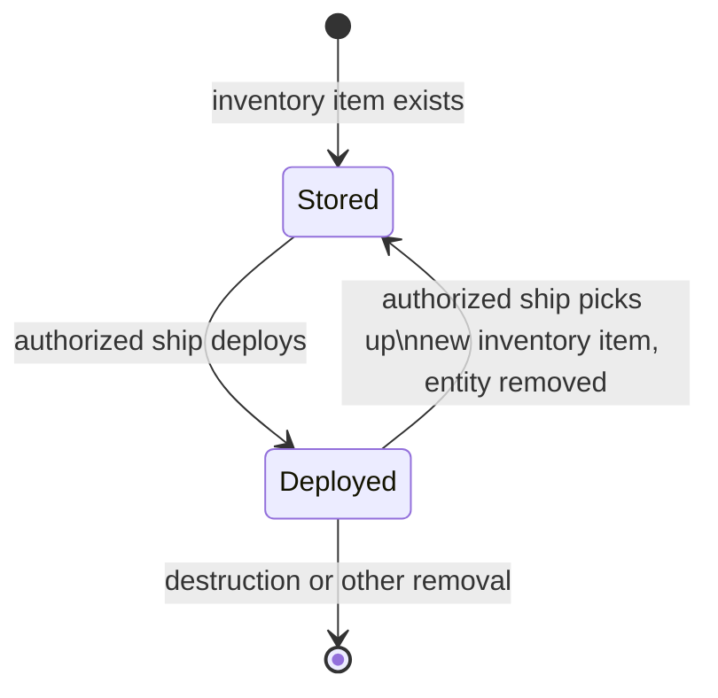
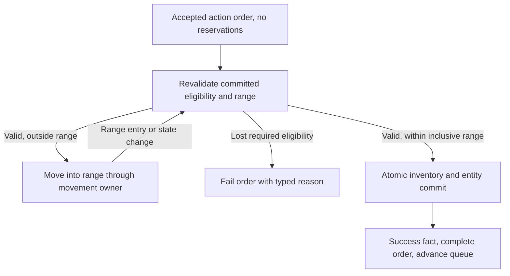
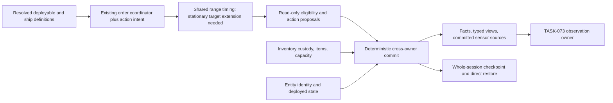

# Sensor deployables and placement lifecycle

[Project index](../README.md) · [Project task list](task-list.md) · [Fog-of-war and scouting](fog-of-war-and-scouting.md) · [Entity lifecycle and explicit spawning](entity-lifecycle.md) · [Inventory and cargo](inventory-and-cargo.md) · [Gameplay content](gameplay-content.md)

## Purpose

`TASK-074` defines the entity and lifecycle boundary for the initial stationary
sensor deployable before `TASK-073` consumes it as a sensor source. It does not
define sensor observation outcomes, construction assets, equipment, combat, or
general placement mechanics. Completed `TASK-075` defines deployment and pickup
range policy and the orders that move an acting ship into range.

## Accepted boundary

A deployable is its own category of portable inventory item. A successful
deployment materializes that item into a deployed entity. The deployed entity
is not a construction asset, and distinct construction assets are outside the
scope of `TASK-074`.

This establishes a physical transition between custody in an inventory and a
live deployed entity. Every successful deployment creates a new entity. Pickup
removes that entity, so no deployed-entity identity persists through pickup or
redeployment. The deployable is a discrete physical-item definition with its
qualified content key, capacity cost, presentation fields, and fixed sensor
radius. Each stored deployable is a discrete instance. Deployment consumes that
instance; pickup creates a new instance with the same definition and
properties. The initial item has no durability, charge, condition, or
per-instance configuration.

All operations preserve the atomic, deterministic inventory and entity-lifecycle
boundaries established by `TASK-041` and `TASK-011`.

The deployed entity belongs to the controlling principal of the source
inventory. Principals always control their own inventories, so deployment does
not introduce a separate ownership transfer or authorization source.

## Approved interactions

Player-visible deployable information follows the existing `TASK-020`
sensor-range and presentation boundary. NPC planners read their approved
authoritative views and do not gain a persistent discovery ledger or a
principal-scoped fog-of-war model from deployables.

Every principal may shoot a deployable when that principal is capable of
shooting and all other relevant conditions admit the action. Shooting is an
interaction permission, not a combat contract. `TASK-046` defines targeting,
range, damage, destruction, and their outcomes.

Only a ship owned by the deployed entity's owning principal and acting through
its valid current controller may deploy, pick up, or redeploy it. That principal
is the controller of the source inventory at deployment. These permissions do
not grant those commands to stations, deployables, facilities, or other entity
kinds. The initial model has no delegated authorization, capture, or use of
another principal's ships.

Successful pickup produces a new inventory item with the same definition and
properties as the item that created the deployable. It removes the deployed
entity and does not restore its identity. A later deployment therefore creates
a new entity.

The owner accepted the TASK-095 scope proposals on 2026-10-26: deployment takes
its item from the acting ship's cargo inventory, and pickup returns the item to
that same ship's cargo inventory. Control of another inventory alone does not
authorize using it for either operation.

`TASK-075` owns the numeric deployment and pickup ranges. `TASK-046` owns
shooting range, destruction behavior, and resulting disposition.

## Placement contract

An authorized ship submits an explicit deployment command that names one
eligible inventory item and a target `SystemPosition` in that ship's current
system. The command is admitted only when the ship is live and not in connector
transit, the source inventory is controlled by the owning principal, the item
is available, and the target is valid system-local position data. The owner
confirmed under `TASK-075` that an out-of-range command creates an order to move
into range and then act. Command admission and execution of the inventory and
entity transition are therefore distinct checks, as defined below.

Under the accepted TASK-095 extension, both action commands support ReplaceAll
and Append through the existing order coordinator. Initial pickup requires a
live acting ship and live target in the same system; a cross-system pickup
approach is not admitted. Pickup admission rejects insufficient cargo capacity and execution checks it
again. At most one action executes per ship in each evaluation wave; immediate
queue progression may start another wave at the same timestamp. These decisions
were confirmed by the owner on 2026-10-26.

The initial contract adds no occupancy, minimum-separation, collision,
avoidance, terrain, or other physical-placement rule. Independent deployables
may occupy the same position. A later geometry task must define any restriction
before it becomes an admission condition.

Deployment atomically consumes the eligible inventory item and materializes the
fresh deployed entity at the target position. Pickup atomically removes the
target deployed entity and restores the equivalent inventory item. A rejected
operation changes neither inventory nor entity state.

Each command carries a stable identity. Commands contend in that stable commit
order. Conflicts for the same inventory item or the same deployed entity have
one deterministic winner. Independent items targeting the same position do not
conflict under the initial no-occupancy contract. Under the owner's clarified
TASK-095 interpretation, each ship executes at most one deploy or pickup action
per evaluation wave; queue progression may create another wave at the same time.

### Deployment and pickup range design (TASK-075)

**Decision status:** Confirmed by the project owner on 2026-10-01. The
completed `TASK-075` design establishes the range values, definition owners,
move-into-range behavior, execution while
moving, no reservations, inclusive boundaries, and terminal failure on lost
eligibility. Successful execution immediately advances the order queue.

The completed lifecycle contract establishes who may act and which inventory
and entity changes commit together. This design establishes how close the
acting ship must be, where that policy comes from, and what happens when the
ship is outside the permitted range.

Completed `TASK-087` supplies the measurement contract: one coordinate unit is
one meter, positions represent points, and ordinary range uses Euclidean
distance. Authoritative comparisons use squared distances with wide checked
arithmetic inside the common coordinate envelope. See [Authoritative
system-local coordinate scale](system-local-coordinate-scale.md).

#### Confirmed range and order decisions

| Operation | Initial range | Policy source | Out-of-range behavior |
| --- | --- | --- | --- |
| Deploy | 2,500 meters | Deployable item definition | Create an order that moves into range, then deploys at the commanded position |
| Pick up | 5,000 meters | Acting ship definition | Create an order that moves into range, then picks up the named deployed entity |

Deployment and pickup use independently defined ranges. The authorized ship's
committed system-local position is the interaction origin. The deployment
target remains the explicit commanded position; pickup names the live deployed
entity. Moving the ship does not move the deployment target or the stationary
deployable. Sensor radius and shooting range retain their separate owners.
The ship-defined interaction/pickup range does not by itself define outcomes
for other interaction domains.

The order retains its action intent through movement rather than requiring the
caller to submit a second deploy or pickup command. It must participate in the
existing actor-control and order lifecycle, including cancellation, suspension,
target invalidation, and deterministic commit. These confirmed decisions do not
select a new navigation algorithm or create a second movement owner.

#### Execution and failure

Deployment and pickup may execute while the acting ship is moving. Neither
action requires zero speed. Both ranges include their exact boundary:
deployment permits a distance of exactly 2,500 meters and pickup permits
exactly 5,000 meters. Compare squared distance with squared applicable range
using the shared wide-arithmetic contract.

Approach orders reserve neither the deployment item nor pickup inventory
capacity or the target deployable. Accepting an order does not prevent another
eligible operation from consuming that item, filling the inventory, or picking
up that target first. Execution revalidates live actor and target state,
current controller and ownership authorization, system membership, applicable
range, item availability, and destination inventory capacity before the atomic
inventory and entity transition. A ship in connector transit cannot execute
either action because it has no system-local position.

An invalid initial submission is a rejected command under the existing command
contract. An accepted order that subsequently loses its required item,
capacity, authorization, target, or another required eligibility condition
fails with a typed reason. It does not wait for the item or capacity to return,
reserve resources retroactively, or retry after failure. Outside range during
a valid approach is expected progress, not itself a failure.

Range-entry work uses `TASK-071` and the authoritative motion schedule. Due
reevaluation reads the committed spatial view after physical completions at
that timestamp. A forecast or a crossing in the preceding interval triggers
reevaluation; it does not authorize execution if the ship is already outside
range at the representable timestamp. Committed changes to motion, target,
inventory, authorization, or applicable policy invalidate affected evaluations.
Stale scheduled work cannot execute a cancelled, failed, or completed order.

Evaluation reads stable inputs and returns buffered proposals. Deterministic
owner commit revalidates contended resources in the existing stable command
order, so two unreserved orders cannot both consume one item or pick up one
entity. A losing accepted order fails without a partial inventory or entity
transition. Only a successful action emits the deployment or pickup success
fact. Failure uses the existing semantic order-transition fact and terminal
order reason; the accepted command receipt remains distinct from its later
order outcome.

The player must eventually be notified when an order fails. The notification
system and its presentation are explicitly deferred to `TASK-094`. Recording
the authoritative failure and its reason is required even before that surface
exists. This design does not add a temporary notification mechanism.

#### Successful execution and order progression

Successful deployment or pickup completes the action order and immediately
advances the order queue through the existing order coordinator. It does not
wait for the ship to stop or finish the remaining approach movement. Movement
handoff uses the committed position and velocity and the existing movement and
order lifecycle; success does not introduce an instantaneous stop. Any
replacement or invalidation of approach work goes through the movement owner.
Stale approach events cannot execute the completed action again.

#### Verification criteria

Implementation must prove exact-boundary, just-inside, just-outside, diagonal,
and large-coordinate comparisons for both independently sourced ranges. It
must cover moving execution, brief swept crossings that end outside range,
connector transit, cancellation and stale events, same-time contention without
reservations, item or capacity loss, authorization loss, and target removal.
Failed execution must leave inventory and entity state unchanged while exposing
the terminal reason through the order lifecycle. Checkpoint continuation must
produce the same outcomes as uninterrupted execution. Any batched evaluation
must preserve the single-thread result across worker counts, partition layouts,
and batch sizes.

Neither operation may execute outside its applicable bounded range, even when
the actor and target are in the same system. Accepting an approach order does
not authorize its later inventory or entity mutation without execution-time
eligibility.

## Facts, presentation, persistence, and sensor handoff

Successful deployment emits a deployable-deployed fact. Successful pickup emits
a deployable-picked-up fact. Each fact identifies the deployed entity, its
definition key, owning principal, acting ship, system-local position, and source
command identity. The pickup fact refers to the entity that was removed.

An observed live deployable exposes its stable entity identity, definition,
owning principal, system-local position, and observation time. It does not
expose its source inventory, authorization state, or combat details. This is
the typed view retained by the `TASK-020` persistent-discovery contract when a
non-owned stationary deployable leaves coverage.

The owner accepted the TASK-095 fact-disclosure proposal on 2026-10-26. Owned
assets retain their approved detailed notices. Covered non-owned deployables
receive appearance/disappearance notices with approved entity view fields and
committed position, without acting ship, source command, inventory, private
cause, or unobserved removal reason. Disappearance alone does not identify
pickup. TASK-073 retains this decision at commit through its bounded disclosure
receipts; later discovery never replays hidden events. The authoritative
deploy/pickup facts retain their full payload independently.

The checkpoint and save boundary retains each live deployable's entity identity,
definition key, owning principal, and position, together with the applicable
entity and item allocator states and required command idempotency receipts.
It does not retain derived spatial indexes or sensor coverage. Restore resolves
the definition and ownership links, validates them, then publishes only fully
live deployed entities.

Pending deploy and pickup orders retain their stable order and source-command
identities, acting ship, action kind, source or destination inventory references,
deployment item and position or pickup entity target, lifecycle state, and
movement correlation through the existing authoritative order and movement
checkpoint boundaries. There is no reservation state to save. The resolved
item-defined deployment range and ship-defined pickup range must retain their
authoritative meaning through versioned definition references or saved policy,
following the existing content and save compatibility contracts. Restore must
not silently substitute changed range values or execute a pending action twice.
Spatial candidates and range forecasts remain derived data and rebuild from
restored committed state.

After a successful deployment commit, the deployable owner publishes an
immutable sensor-source record containing entity identity, owning principal,
system, position, and sensor radius. `TASK-073` reads only this committed record
to calculate coverage, and stops reading it after removal commits. It does not
own placement, inventory, command, or lifecycle transitions.

## TASK-095 implementation-scope review

**Review date:** 2026-10-26. The owner requested a bounded review of the
implementation scope. The owner accepted the concrete proposals on 2026-10-26
and requested documentation updates followed by a stop. The accepted extensions
are recorded below alongside the questions for which no concrete answer had
been proposed. The approved TASK-074 and TASK-075 behavior above remains the
contract, supplemented by those accepted extensions. The review itself made no
runtime or content changes. Subsequent delivery and verification are recorded
below and in the canonical task list.

### Readiness and ownership

TASK-069 supplies discrete inventory instances, custody, capacity, reservations,
and deterministic inventory commits. TASK-071 supplies exact geometry and
ship-pair interaction timing. Neither foundation implements a deployed entity
or a deploy/pickup order. In particular, a stationary ship in TASK-071 tests is
still a ship; it is not evidence of a stationary deployable runtime.

TASK-095 must supply the real deployable owner and its immutable observation
inputs. TASK-073 owns consuming those inputs for coverage, discovery, stale
views, refresh, and confirmed absence. TASK-073 stage 3 can begin once that real
runtime contract exists; deployable work cannot close the station requirements
that remain with TASK-057 and TASK-105.

The arrows describe the accepted ownership boundaries, not selected interface
signatures. Evaluation must remain batchable and read-only. Identity
allocation, contention, inventory/entity publication, order completion, and
fact publication must commit deterministically through their existing owners.
The serial reference path remains required; this work does not authorize a new
worker scheduler.

### Map from the approved contract to current code

This table records the pre-implementation baseline used for the scope review.
The runtime delivery below records the subsequent implementation.

| Area | Current implementation and required integration |
| --- | --- |
| Content definitions and setup | [ContentPipeline](../src/GalaxyCommand.Content/ContentPipeline.cs) resolves qualified keys and canonical content. [StaticNewGameLoader](../src/GalaxyCommand.Simulation/Loading/StaticNewGameLoader.cs) admits only principal, ship-design, and standing-policy kinds; its ship fields include sensor radius but no pickup range. [PhysicalDefinition](../src/GalaxyCommand.Simulation/Economy/Inventory/PhysicalDefinitions.cs) supplies holding kind and capacity cost, but no deployable capability. TASK-095 needs explicit deployable definition validation, the approved item deployment range and ship pickup range, runtime definition resolution, and an initial-inventory composition path. The current static loader does not seed generalized inventory holdings. Names, sensor radius, capacity cost, and scenario quantities have not been selected. |
| Inventory transactions | [PhysicalInventoryHoldings](../src/GalaxyCommand.Simulation/Economy/Inventory/PhysicalInventoryHoldings.cs) provides exact instance lookup and internal prevalidated removal/storage. [InventoryCommitOwner](../src/GalaxyCommand.Simulation/Economy/Inventory/PhysicalInventoryCommit.cs) allocates items only on accepted creation, orders proposals by operation key, and retains idempotency receipts. Its supported operations do not include consuming one discrete item into an entity or creating an item while removing an entity. TASK-095 needs preparation and revalidation of both sides before either publishes. Two separately successful inventory/lifecycle calls are not an atomic deploy/pickup transaction. Existing item reservations and incoming-capacity commitments must still be respected, although action orders reserve nothing. |
| Entity lifecycle | [EntityLifecycleOwner and EntityRegistry](../src/GalaxyCommand.Simulation/Entities/EntityLifecycle.cs) own session-wide entity allocation, but registration, lookup, materialization, removal preparation, and removal receipts are ship-specific. [Lifecycle checkpoints](../src/GalaxyCommand.Simulation/Entities/EntityLifecycleCheckpointModels.cs) also contain only live ships. TASK-095 needs real stationary deployed records, shared entity-ID uniqueness, creation/removal correlation, and target invalidation without inventing a ShipId, cargo inventory, controller, or motion actor for each deployable. Pickup creates a fresh ItemInstanceId; redeployment creates a fresh EntityId. Combat destruction remains with TASK-046. |
| Commands, orders, motion, and range timing | [Ship orders](../src/GalaxyCommand.Simulation/Actors/Orders/ShipOrders.cs) retain movement destinations, source attribution, queue/override state, and motion correlation. They have no deploy/pickup intent or original CommandSequence. [Order runtime](../src/GalaxyCommand.Simulation/Session/Runtime/ActorOrderRuntimeCoordinator.Orders.cs) completes work at destination satisfaction; action success must instead complete immediately at valid range entry and preserve the committed velocity when handing off movement. [Entity destination planning](../src/GalaxyCommand.Simulation/Session/Runtime/ActorOrderRuntimeCoordinator.Planning.cs) resolves entity targets through ship identity and movement. [ShipPairInteractionInterest](../src/GalaxyCommand.Simulation/Spatial/Interactions/ShipPairInteractionInterest.cs), [InteractionForecast](../src/GalaxyCommand.Simulation/Spatial/Interactions/InteractionForecast.cs), and the live scheduler are ship-pair based. Exact ship-to-fixed-point geometry exists, but durable fixed-point/deployable interest scheduling does not. The approved approach orders require that extension plus item, capacity, target, authority, and motion invalidation. |
| Checkpoints and continuation | [Whole-session checkpoint models](../src/GalaxyCommand.Simulation/Session/GameSessionCheckpointModels.cs), [order checkpoints](../src/GalaxyCommand.Simulation/Actors/Orders/ShipOrderCheckpointModels.cs), and inventory receipts supply the existing direct-restore boundary. TASK-095 must add live deployables, pending action payloads, original command correlation, applicable definition/range policy, allocator continuity, and exactly-once outcome receipts. Restore must cross-check entities, holdings, targets, orders, authority, and pending event keys before publishing a session. Rebuild derived geometry and forecasts without replaying an action. General encoded saved-session admission remains blocked by TASK-037, as documented in [Save format and migration](save-format-and-migration.md); checkpoint proof must not be reported as a new user save/load flow. |
| Facts and observation inputs | [Entity facts](../src/GalaxyCommand.Simulation/Session/Facts/EntityGameFacts.cs) require ship-specific fields. [Runtime observation](../src/GalaxyCommand.Simulation/Session/Runtime/ActorOrderRuntimeCoordinator.Observation.cs) builds sources from ships only. [Player disclosure](../src/GalaxyCommand.Simulation/Session/GameSession.Observation.cs) and [presentation facts](../src/GalaxyCommand.Simulation/Presentation/GamePresentationFacts.cs) retain bounded ship disclosure receipts; the player world/selection model is ship-oriented. TASK-095 must supply typed deploy/pickup facts, a live view with entity identity, definition, principal, position and observation time, and committed sources with identity, principal, position and radius. TASK-073 owns integrating sources and persistent observations. New fact kinds need an explicit safe disclosure mapping; raw acting-ship, inventory, command, or cause data cannot be forwarded merely because the deployable is covered. |

The existing [interaction effect contract](../src/GalaxyCommand.Simulation/Spatial/Interactions/SpatialInteractionDomainEvaluation.cs)
poisons the session on an unexpected commit failure and does not roll back
partially applied effects. Expected contention or eligibility loss must therefore
be an ordinary typed action failure established before mutation, not an exception
used to undo one side of the transaction.

The current [interaction wave](../src/GalaxyCommand.Simulation/Session/Runtime/ActorOrderRuntimeCoordinator.Interactions.cs)
commits effects in canonical contact-key order. The deployable contract instead
requires contended actions to resolve in stable command order. The extension must
explicitly collect and order action proposals by their retained command identity
before allocating IDs or mutating resources. Existing contact order must not
silently become a different contention policy.

### Owner decisions and remaining inputs

The owner accepted the concrete proposals below on 2026-10-26. Acceptance does
not supply values or select between alternatives where the review only asked
a question. Those remaining inputs are explicit in the final column.

| ID | Area | Accepted contract | Remaining input |
| --- | --- | --- | --- |
| R1 | Stationary range extension | TASK-095 includes a bounded shared spatial extension for ship-to-commanded-position and ship-to-live-stationary-entity interests, with durable correlation, invalidation, scheduling, and checkpoint validation. Action eligibility and command-order contention remain with the deployable/order owners. Do not create fake stationary ships or a second movement/scheduling loop. TASK-071 remains complete; a separate prerequisite task is not selected. | None for this scope boundary. Interface and implementation details must satisfy the accepted ownership and determinism contracts. |
| R2 | Inventory locality | Both operations initially use only the acting ship's cargo inventory. Other inventories require a separately defined locality or transfer contract. Execution revalidates capacity and respects other workflows' commitments; later capacity loss fails an accepted order under TASK-075. | Resolved on 2026-10-26: reject insufficient pickup capacity at submission and recheck at execution. |
| R3 | Action admission and queue placement | Support ReplaceAll and Append through the existing order coordinator. Initial pickup requires a live actor and target in the same system; cross-system pickup approaches are excluded. Initial deployment during transit remains rejected. Immediate queue progression after success remains required. | Resolved on 2026-10-26: one execution per ship per evaluation wave, with immediate queue progression into subsequent waves allowed at the same timestamp. |
| R4 | Deployment/pickup notice policy | Preserve approved detailed notices for owned assets. Covered non-owned deployables receive appearance/disappearance notices with approved entity view fields and committed position, omitting acting ship, source command, inventory, private cause, and unobserved removal reason. A disappearance alone does not identify pickup. Hidden events remain hidden on later discovery. Apply this mapping through TASK-073's commit-time disclosure and bounded-receipt boundary. | None for the proposed disclosure boundary. The authoritative facts retain their approved full payload independently of these safe notices. |
| R5 | Initial content and delivery surface | Deployment range remains 2,500 meters and pickup range remains 5,000 meters. Content must supply an explicit qualified key/display text, positive per-item cargo-capacity cost, nonnegative sensor radius in meters, and explicit starting quantities. | Resolved on 2026-10-26: the owner requested two basic X4 deployables with project-appropriate adjustments and selected runtime/content integration first. The concrete adaptation is recorded below. Player controls remain outside this delivery; TASK-073 retains persistent observation ownership. |
| R6 | Independent ship-definition retention | Include independent definition retention within TASK-095. Once construction commits, ship operation, saving and restoration must not depend on the producing facility, construction policy or production history. Starting and constructed ships use the same retention path; no construction facility is invented for setup-only ships. | Resolved by the owner on 2026-10-26. See [Construction materialization handoff](entity-lifecycle.md#construction-materialization-handoff) and [Authoritative save boundary](authoritative-save-boundary.md). |

No default sensor radius, cargo cost, item count, unanswered admission rule, or
new UI interaction should be inferred from the ship sensor implementation. These
decisions do not reopen equipment, station services, combat, docking, collision,
or notification design. TASK-094 still owns player order-failure notifications;
TASK-095 must retain typed failures and semantic order outcomes independently.

### Initial content adaptation and delivery

On 2026-10-26 the owner asked to use two basic X4 deployables, adjusted to fit
this project, and selected runtime/content integration before player controls.
The initial pair is Satellite and Advanced Satellite. Their keys are
`galaxy-command.core/sensor-deployable/satellite` and
`galaxy-command.core/sensor-deployable/advanced-satellite` in the built-in
package, with corresponding `galaxy-command.preview` keys in the independent
preview package.

| Definition | Sensor radius | Cargo-capacity cost | Initial stock per player ship |
| --- | --- | --- | --- |
| Satellite | 30,000 meters | 1 unit | 2 |
| Advanced Satellite | 75,000 meters | 1 unit | 1 |

Both retain the accepted item-defined 2,500-meter deployment range. Ship pickup
range is 5,000 meters. Definitions and stock apply to the built-in minimal
scenario and the development preview. Starting quantities are project tuning
selected under the owner's adaptation instruction, not a claim about an X4
start. This initial delivery does not add deploy/pickup controls or select a UI
interaction design.

The [Egosoft deployables guide](https://wiki.egosoft.com/X4%20Foundations%20Wiki/Manual%20and%20Guides/Objects%20in%20the%20Game%20Universe/Equipment/Consumables/Deployables/)
identifies the two satellite categories and their observation roles. The
[reported X4 radii](https://steamcommunity.com/app/392160/discussions/0/4407417073566254282/)
are 30 km and 75 km; these numerical values come from community reports, not
from a locally inspected X4 installation. Roguey's
[Satellite](https://roguey.co.uk/x4/wares/satellite_mk1/) and
[Advanced Satellite](https://roguey.co.uk/x4/wares/satellite_mk2/) ware entries
list volume 1 for each. One project cargo-capacity unit per item adapts that
value to this project's integer capacity model. Prices, hull strength,
construction recipes, remote trading, and damage behavior are not imported.

### Verification required for implementation

Existing tests supply regression patterns, not deployable implementation proof.
[InventorySessionDeterminismTests](../tests/GalaxyCommand.Simulation.Tests/Economy/Inventory/InventorySessionDeterminismTests.cs)
exercise ordered worker buffers and catalog-aware restore, but its "sensor"
definition is a plain discrete item.
[InteractionForecastTests](../tests/GalaxyCommand.Simulation.Tests/Spatial/Interactions/InteractionForecastTests.cs)
cover exact timing, stale forecasts and stationary ships, not fixed deployed
targets. [StaticNewGameLoaderTests](../tests/GalaxyCommand.Simulation.Tests/Loading/StaticNewGameLoaderTests.cs)
cover the currently admitted content kinds, and
[PlayerFactProjectorTests](../tests/GalaxyCommand.Simulation.Tests/Presentation/PlayerFactProjectorTests.cs)
cover the existing ship mappings. None closes TASK-095 by analogy.

| Boundary | Required evidence |
| --- | --- |
| Definitions and initial state | Strict admission and deterministic resolution for deployable definitions, explicit ranges, capacity, qualified references and seeded instances; malformed content publishes no partial setup. |
| Atomic lifecycle | Deploy consumes exactly one available instance and creates exactly one fresh entity; pickup removes exactly that entity and creates a fresh equivalent instance. Rejected mutations preserve holdings, entity state and capacity and allocate no item/entity IDs. Command and order failure records remain valid, but no action-success receipt or fact is emitted. Respect reservations made by other workflows. |
| Timing and orders | Inclusive exact, inside/outside, diagonal and large-coordinate ranges; moving execution; brief swept contact ending outside range cannot execute; physical completions precede reevaluation. Cover queue advancement and velocity-preserving handoff, cancellation, replacement, override suspension/resume, transit, stale work, target removal, item/capacity loss and authority loss. Verify the owner's interpretation of same-boundary admission and execution. |
| Deterministic contention | Reorder discovery and evaluation buffers and vary supported worker, partition and batch layouts. The same command wins an item/target conflict, and outcomes, IDs, order transitions, facts, receipts and state match the serial path. Do not inherit contact-key priority for contended action commits. |
| Continuation | Compare uninterrupted and restored pending approaches and completed actions. Validate range/definition meaning, exact command and event correlations, live/removed identities and malformed cross-owner links. Restore cannot duplicate consumption, entity creation, pickup items or success facts. |
| Observation handoff | TASK-095 proves committed typed views/sources, immediate withdrawal at removal, safe historical fact disclosure and receipt restoration. TASK-073's separate integration must prove stationary-source/moving-ship and moving-source/stationary-target coverage, overlap, owned visibility and persistent stale/refresh/absence behavior. Runtime handoff fixtures cannot claim that later live observation integration. |

After implementation, run the relevant content, inventory, lifecycle, order,
interaction, presentation and checkpoint tests, followed by the solution build
and regression suite and appropriate benchmark correctness checks. TASK-104's
known connector-navigation digest mismatch must remain visible and must not be
"fixed" by replacing its expected value to pass this work. Timing and allocation
remain informational; worker execution requires its own measured evidence.

This review used source and test inspection only. It did not execute tests or
revalidate the historical test counts recorded elsewhere. The owner subsequently
authorized TASK-095 implementation and resolved the remaining inputs on 2026-10-26. Implementation remains subject to the full
verification requirements above and TASK-073's separate entity-integration scope.

### Implementation progress and checkpoint scope gap

Implementation began on 2026-10-26 after the owner's instruction to implement
TASK-095. The first foundation admitted sensor-deployable definitions and explicit
initial cargo, required independent ship pickup range, and extended the existing
interest/coordinator/scheduler path with fixed positions and stationary entity
references. Shared keys preserve existing ship-pair ordering and distinguish
fixed targets without registering synthetic ships. The deployable domain cancels
or revises its interests when targets change or disappear.

The initial cargo checkpoint test exposed a runtime-manifest gap, recorded as
TASK-106. The owner explicitly included independent ship-definition retention
within TASK-095 on 2026-10-26: after construction commits, operation, checkpoint
capture and restore must not depend on the producing facility, construction
policy or production history. Starting and constructed ships use the same path.

That foundation is implemented. The session retains one canonical definition
catalog and construction policies checkpoint design-ID references. Restore
resolves definitions before ships and their derived maneuver/sensor lookups.
Portable sensor definitions retain their own capacity and range values for
inventory restoration, rejecting conflicts with a supplied physical catalog.
Tests prove capture, restore, movement and recapture after removing producer
policy, facility aggregate and production history, as well as initial cargo
continuation and missing/conflicting definition rejection. All 1,500 solution
tests pass. TASK-106 is complete within this work; no producer is fabricated.

### Runtime delivery and verification

Deployment and pickup now retain typed action intent in the ordinary ship-order
lifecycle. Admission and execution check cargo custody, exact item or target,
ownership, system-local eligibility and capacity independently. An approach
reserves nothing. Stationary interests and coarse resource-change wake batches
use the existing agenda after physical completions. Evaluation captures stable
scoped geometry and buffers proposals; commit revalidates resources in original
command order. One actor executes once per wave, with immediate queue progression
into a later wave at the same timestamp. Movement interruption preserves the
committed velocity for the next order or ordinary passive drag.

The lifecycle owner commits item consumption/entity creation and entity
withdrawal/fresh-item creation atomically. Shared allocators advance only after
preflight succeeds. Explicit sensor removal has its own typed receipt and
invalidates inbound current, queued and suspended orders. Removing an acting
ship emits terminal failure facts for its accepted sensor actions before its
order owner is withdrawn. Unexpected partial-commit failures invalidate the
session. Successful command receipts make replay harmless, including after
pickup or later removal.

Checkpoint restoration joins action intent, order state, managed stationary
interests, wake events, live and historical entity identities, item/command
allocator bounds, definition meaning, atomic receipts and retained success
facts. It restores state directly and rebuilds geometry without replaying an
inventory or lifecycle action. A managed sensor domain cannot acquire an
external evaluator dependency or expose its mutable interest store to another
domain consumer.

`GameSession.CaptureSensorDeployableObservation()` supplies immutable committed
views with observation times and stationary sources with retained radii. These
are authoritative inputs for TASK-073, rather than player-filtered presentation.
Pickup and explicit removal withdraw the source immediately. TASK-073 still owns
coverage consumption, persistent discovery, stale views, refresh and confirmed
absence. Player controls remain TASK-107. Owned action facts retain their
detail; covered non-owned facts use appearance/disappearance notices without
actor, command, inventory, private cause or removal reason. Bounded disclosure
receipts freeze this decision at commit, including across restoration.

Focused evidence is in
[transaction tests](../tests/GalaxyCommand.Simulation.Tests/Entities/SensorDeployableTransactionTests.cs),
[order and continuation tests](../tests/GalaxyCommand.Simulation.Tests/Actors/Orders/SensorDeployableOrderTests.cs),
[economy invalidation tests](../tests/GalaxyCommand.Simulation.Tests/Actors/Orders/SensorDeployableEconomyTests.cs),
[stationary interaction tests](../tests/GalaxyCommand.Simulation.Tests/Spatial/Interactions/StationaryInteractionTests.cs),
and [content tests](../tests/GalaxyCommand.Simulation.Tests/Loading/SensorDeployableContentTests.cs).
These cover geometry, moving execution, swept-contact rejection, contention,
resource loss, suspension, cancellation, removal, replay, direct restore and
historical disclosure. Shared stationary-range benchmark evidence is recorded
with the [advancing-session measurements](interaction-session-measurements.md).

Verification on 2026-10-26 passed all 1,570 Release tests and the full solution
Release build with zero warnings or errors. Both shipped content packages passed
the production validator. The Godot headless build and preview startup passed.
Six existing canonical benchmark presets retained their expected digests;
stationary-target serial and batched variants matched each other across the
measured worker settings. TASK-104's existing navigation mismatch remains
`88e79d6112f53750` versus expected `673c9af7f54a80e4`; its baseline was not changed.
TASK-095 is complete within the approved runtime/content scope.

## Deferred work

`TASK-095` completes the accepted runtime lifecycle and range-order contracts.
`TASK-107` owns player deployment/pickup controls, and `TASK-094` owns deferred
player notification of order failure. `TASK-046`
owns combat targeting, shooting range, damage, destruction, and its resulting
disposition.

The approved interactions do not imply capture, transfer between principals,
repair, resupply, refuelling, hacking, deactivation, recovery after damage, or
salvage. A later task may introduce any of these only with an owning contract.

Completed `TASK-069` supplies generalized inventory. `TASK-095` supplies the
deployable transactions over that foundation. `TASK-073` consumes committed
deployed entities as stationary sensor sources.
