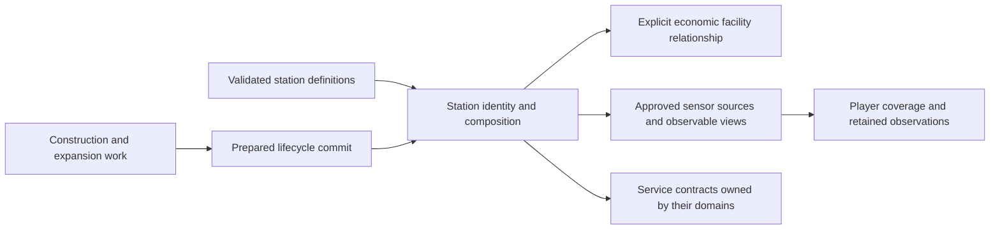

# Station composition, construction, and expansion

[Project index](../README.md) · [Economy](economy.md) ·
[Equipment and ship slots](equipment-and-ship-slots.md) ·
[Entity lifecycle](entity-lifecycle.md) ·
[Fog-of-war and scouting](fog-of-war-and-scouting.md) ·
[Project task list](task-list.md)

## Purpose and decision status

Stations turn delivered resources and production work into persistent local
capacity. Their composition must explain which services exist, what expansion
changes, and what happens when construction is interrupted or a station is
removed. A station also needs a concrete observable identity before player
fog-of-war can discover it, remember it, or use its sensors.

**Design owner:** TASK-057, begun at the owner's request on 2026-10-29.

**Decision status:** Accepted by the project owner on 2026-10-29, including
Q01-Q58 and the [closing technical contract](#accepted-technical-contract),
R01-R05. TASK-057 design review is complete. Runtime implementation remains
TASK-105; station observation integration remains TASK-073.

**Implementation boundary:** TASK-105 owns the approved station runtime;
TASK-073 consumes its sensor sources and observable views. Those tasks implement and consume this accepted contract without selecting
additional station policy.

## Existing requirements and boundaries

| Established requirement | Consequence for this design | Source |
| --- | --- | --- |
| Major assets require resources and production capacity. | Station construction and expansion must account for material and work rather than unexplained spawning. | [Vision](vision.md) |
| Stations can provide storage, production, trade, repair, construction, defense, and services. | The accepted capability categories are recorded in Q57; operational services require implemented domain providers. | [Economy](economy.md#stations) |
| Stations reuse the equipment vocabulary; slots remain ship-specific. | Reuse does not approve ship slot counts, hull restrictions, or ship fitting rules for stations. | [Equipment Q24](equipment-and-ship-slots.md#q24-ship-and-station-boundary) |
| Refitting requires a station with the requisite service module. | TASK-057 supplies composition context; TASK-097 defines refit service identity, eligibility, resources, and settlement. | [Equipment Q12](equipment-and-ship-slots.md#q12-eligibility-and-location) and TASK-097 |
| Player-owned stations with sensor capability contribute system-local circular coverage and are always current in the player view. | Station definitions must explicitly supply their sensor capability; ship radius tuning is not a station default. | [Fog-of-war](fog-of-war-and-scouting.md#sensor-coverage) |
| Discovered non-owned stations retain last observed identity, position, time, and approved typed fields. | Station design must select the observable fields and explain their refresh, stale representation, and restore validation. | [Persistent observation](fog-of-war-and-scouting.md#live-contacts-and-retained-discoveries) |
| Content definitions are immutable, qualified, validated data. | Definitions and starting stations must use the existing content pipeline, with no inferred capability defaults. | [Gameplay content](gameplay-content.md) |
| Lifecycle commits prepare all affected owners before mutation and publish complete entities. | Station creation and removal must account for every affected owner and preserve rejection atomicity. | [Entity lifecycle](entity-lifecycle.md#ownership-model) |
| Stable evaluation, buffered effects, and deterministic commit are required. | Station workloads must be batchable; worker completion order cannot allocate identities or decide contention. | [Concurrency](concurrency-and-performance.md) |

The current runtime has ship and sensor-deployable entity kinds. Economic
facilities have their own identities, inventories, production/construction work,
and positions, but are not registered station entities. Q48 defines an explicit module-to-facility relationship for the future station runtime. Existing facilities must not silently gain
station identity, ownership, disclosure, or lifecycle semantics.

## Accepted foundation decisions

The owner accepted these foundation decisions on 2026-10-29. They establish the
model before defining records, commands, or content fields.

| Review ID | Question | Decision and consequence | Status |
| --- | --- | --- | --- |
| Q01 | Is a station one entity with attached modules, a fixed type with predefined capabilities, or a complex of independently placed structures? | One persistent station entity with attached modules. Expansion changes capabilities while preserving station identity. Q04-Q07 settle composition and Q23/Q37-Q46 settle removal and capacity safety. | Accepted |
| Q02 | When does station identity become visible during construction? | A visible construction site from the start retains the same station identity when the initial build completes. Visibility follows the normal observation boundary. Q17 and Q34 settle capability activation on completion; Q18 supplies explicit site staging capacity. | Accepted |
| Q03 | Should this review settle the complete construction and expansion contract now, or first review a bounded contract for station runtime and observation integration? | Settle the complete TASK-057 construction and expansion design now. TASK-105 implements the approved contract afterward; TASK-073 owns observation integration. Adjacent tasks retain their existing design ownership. | Accepted |
| Q04 | Do attached modules have identity and ownership? | Each module has a stable identity within its station, distinguishing identical modules through construction, disabling, upgrades, and removal. Modules share the station's owner. | Accepted |
| Q05 | Do modules have independent simulation positions? | One simulation position per station. Modules are attached logically; visual placement does not affect range or capacity. Q31 permits independent targeting by identity. | Accepted |
| Q06 | How do station modules share storage and work? | One shared station inventory; production and construction modules retain their own queues and throughput. Materials use ordinary inventory reservations and transfers, without internal transport between attached modules. Storage modules extend the base station inventory's capacity and do not create separate inventories. | Accepted |
| Q07 | What limits station expansion? | A station definition specifies allowed module types and maximum total module capacity. Each module consumes explicit capacity. These are station expansion limits, independent of ship slots. Numeric limits remain content choices. | Accepted |
| Q08 | When does new storage capacity activate? | Storage capacity activates when construction completes. Unfinished storage cannot accept cargo against its future capacity. | Accepted |
| Q09 | When may storage be voluntarily removed? | Reject removal if existing holdings plus reserved incoming capacity would exceed the remaining inventory capacity. Cargo and commitments must be resolved first. | Accepted |
| Q10 | What happens when storage is disabled? | Disabling storage stops new intake without deleting stored cargo or reducing physical capacity. | Accepted |
| Q11 | What happens when storage is destroyed? | Cargo loss is proportional to the fraction of total storage capacity destroyed. Losing 25% of capacity removes approximately 25% of stored cargo from the station inventory. Q35-Q36 and Q50-Q54 settle rounding, item selection, commitments, and the small-loss cutoff. | Accepted |
| Q12 | Can lost cargo become recoverable objects, and who owns that policy? | Support an implementable cargo-disposition policy outside the specific station. Some cargo removed from station inventory may be ejected as collectible physical items instead of being permanently destroyed. Recovery fractions and collectible-object behavior are not selected here; shared design and implementation are tracked by TASK-108. | Accepted boundary; policy details open |
| Q13 | What supplies initial station construction work? | A construction-capable ship at the site supplies work. Materials are delivered to the site's shared station inventory. | Accepted |
| Q14 | What supplies expansion work, and do existing services stop? | An attached construction module or a construction-capable ship can supply expansion work. Existing station services continue operating during expansion. Q21 settles simultaneous contribution and project concurrency. | Accepted |
| Q15 | When are construction materials consumed? | Materials are consumed as work progresses. Each recipe defines total materials and work. Partial deliveries permit partial progress; missing materials pause construction. | Accepted |
| Q16 | What happens when construction work is interrupted? | Progress is preserved when a builder leaves or becomes unavailable. Construction pauses without eligible work supply, and another eligible builder can resume it. | Accepted |
| Q17 | When do module capabilities activate? | Each completed module activates as a whole. Unfinished modules provide no services, sensors, or storage capacity; existing completed modules continue operating. | Accepted |
| Q18 | How does the initial site receive materials before base completion? | The station definition declares explicit staging capacity available during base construction, using the same station inventory. This does not activate unfinished storage-module capacity. Q22 constrains the transition to completed base capacity. | Accepted |
| Q19 | What does construction cancellation retain? | Unconsumed cargo remains in the shared station inventory and project reservations are released. Consumed materials and completed work receive no automatic refund. Any recovery requires an explicit dismantling policy. | Accepted |
| Q20 | Does cancelling initial construction remove the site? | No. The site retains its identity and inventory until explicitly dismantled. Cancellation cannot silently delete delivered cargo. | Accepted |
| Q21 | Can builders combine work or advance separate projects? | Multiple eligible ships and construction modules can combine throughput on one project. Each builder works on one project at a time. Separate builders may advance separate projects concurrently. Q33 settles material ordering and Q55 settles explicit builder assignment. | Accepted |
| Q22 | Can base completion reduce capacity below site staging capacity? | No. Validate station definitions so completed base capacity is at least staging capacity. Completion preserves inventory identity, cargo, and incoming commitments. | Accepted |
| Q23 | How are modules dismantled? | Dismantling requires builder-supplied construction work over time. Module services stop when dismantling starts. Content defines recovered materials. Storage removal remains subject to the accepted capacity checks. Q37-Q43 settle recovery timing, destination, interruption, and capacity protection. | Accepted |
| Q24 | How do modules upgrade? | Explicit authored upgrade paths consume materials and work while preserving module identity. Existing capability remains available until completion, when the replacement capability activates atomically. | Accepted |
| Q25 | Can stations relocate? | No towing or station movement. Moving infrastructure requires dismantling and construction elsewhere. | Accepted |
| Q26 | Who may change stations and direct construction ships? | Creating, expanding, upgrading, cancelling, and dismantling require authorization from the owning principal. Commands assigning construction ships also respect each ship's active controller. | Accepted |
| Q27 | How is a station placed? | The owner chooses an explicit system-local position. Admission validates authored placement restrictions and applicable territory permissions. Expansion keeps that position. Collision and docking remain with their owning designs. | Accepted |
| Q28 | When may a construction ship supply work? | It must remain stationary within the range defined by its construction capability. Leaving range pauses its contribution. Initially it may build only stations owned by the same principal. | Accepted |
| Q29 | What does ordinary non-owner observation reveal? | Identity, name, owner, position, construction/operational state, visible module types, and available service types. Inventory quantities, reservations, queues, exact construction progress, and throughput remain private. | Accepted |
| Q30 | How do station sensor contributions combine? | Use the greatest active radius from the base definition and completed sensor modules, without adding radii. Unfinished, disabled, dismantling, or destroyed sensor modules contribute nothing. Numeric radii remain content choices. | Accepted |
| Q31 | Can modules be targeted independently? | Yes, by module identity, while sharing the station position. Combat owns hit resolution, damage, and destruction effects. | Accepted |
| Q32 | How do pause and cancellation differ? | Pausing preserves resumable progress. Cancellation retires the project; restarting requires fresh work and materials. Recovering material from an unfinished structure requires dismantling. | Accepted |
| Q33 | How do projects compete for capacity and materials? | Claim expansion capacity at project admission to prevent overbooking. Competing projects receive available materials in acceptance order, with stable project identity breaking ties. | Accepted |
| Q34 | When do base sensors activate, and does damage reduce radius? | Base sensors activate on base construction completion. Damage does not gradually reduce radius unless a later damage design explicitly adds that behavior. Disabling or destroying the source removes its contribution. | Accepted |
| Q35 | Do reservations protect cargo from destruction? | No. Loss of reserved cargo invalidates the affected commitment and notifies its workflow owner. That workflow applies its own pause, cancellation, or failure rules. | Accepted |
| Q36 | What if reduced capacity cannot support incoming commitments? | Preserve older commitments first; release newer ones until remaining commitments fit. Ships retain undelivered cargo. | Accepted |
| Q37 | Where and when is dismantling recovery delivered? | Before work starts, reserve destination room for recovered materials, accounting for storage being removed. Deliver recovery only on completion, atomically with removal. Interrupted dismantling preserves progress and produces no partial recovery. | Accepted |
| Q38 | When can the whole station be dismantled? | First remove attached modules and clear cargo, projects, and external commitments. Base recovery goes to an explicitly selected external inventory. | Accepted |
| Q39 | What intake remains possible when storage is disabled? | Existing cargo remains intact and unloading remains possible. New deliveries must fit enabled storage capacity after counting existing cargo and incoming commitments. | Accepted |
| Q40 | Does cancelled construction release occupied module capacity? | If materials were consumed, the unfinished structure occupies capacity until dismantled. Cancellation before any consumption releases capacity immediately. | Accepted |
| Q41 | What remains after an upgrade is cancelled? | Preserve the original module and its existing capabilities. Consumed upgrade materials receive no refund. Unfinished additions require dismantling and retain any extra expansion capacity they occupy. | Accepted |
| Q42 | Can dismantling be reversed, and what if its destination is lost? | Once work begins, dismantling is irreversible. It may pause and resume but cannot restore the module to service. If the recovery destination becomes unavailable, completion waits for a replacement with reserved capacity. | Accepted |
| Q43 | How is remaining storage capacity protected during dismantling? | From dismantling start, new cargo and incoming commitments must fit the capacity that will remain, including reserved recovery output. | Accepted |
| Q44 | How are upgrade capacity changes admitted? | Claim additional module capacity at admission and keep original capacity occupied until completion. For inventory-capacity reductions, cargo and commitments must fit before admission and the lower limit is protected throughout the upgrade. | Accepted |
| Q45 | May structural projects overlap on one module? | No. Construction, upgrading, and dismantling are mutually exclusive on a module. Projects on different modules may still progress concurrently. | Accepted |
| Q46 | What happens when the station base is destroyed? | Remove the entire station; attached modules cannot survive independently. Resolve remaining cargo through the shared disposition policy, stop work and services, and invalidate external commitments in the same lifecycle commit. | Accepted |
| Q47 | Which owners hold station state and economic state? | Station authority owns identity, composition, module state, and capability changes. Inventory owns holdings and reservations. Production and construction own their workloads. Changes spanning owners commit atomically. | Accepted |
| Q48 | How do economic modules relate to facilities and existing scenarios? | Each production and construction module has an explicit facility identity linked to the shared station inventory. Existing scenario facilities become station modules only through explicit authored conversion preserving recipes, queues, and throughput. | Accepted |
| Q49 | How is incremental material consumption rounded? | For each material, cumulative consumption is ceil(total required times completed work divided by total work). Consume only the difference from prior consumption. Completion consumes exactly the recipe total, independent of pauses, update sizes, or builder count. | Accepted |
| Q50 | How is proportional cargo loss calculated and rounded? | Calculate separately for each cargo definition, using the destroyed fraction of total storage capacity, and round fractional quantities upward. This includes the count of discrete items of each definition. Q52-Q54 add the small-loss cutoff and physical-overflow exception. | Accepted |
| Q51 | Which discrete items are selected, and how are they disposed of? | Select the required count using deterministic randomness rather than a permanent older/newer identity bias. Pass selected cargo to the shared disposition policy for permanent destruction or recoverable ejection. | Accepted |
| Q52 | Can very small storage losses be exempted from cargo loss? | Use a 1% cutoff, configurable outside the specific station. Below the cutoff, suppress proportional cargo loss, subject to Q53-Q54. | Accepted |
| Q53 | Does the cutoff permit physical inventory overflow? | No. Below the cutoff, remove enough cargo to fit surviving physical storage if necessary. | Accepted |
| Q54 | How are repeated small storage losses treated? | Accumulate small storage losses toward the cutoff so repeated sub-threshold hits cannot indefinitely avoid proportional cargo loss. R01 defines saved accumulation, overflow credits, and settlement/reset bookkeeping. | Accepted |

| Q55 | How are builders assigned? | Explicit normal commands assign a builder to a named project. Completion releases the assignment; builders do not automatically select another project. | Accepted |
| Q56 | How much input may construction reserve? | Reserve only the next material increment that can be consumed, and consume it atomically with work advancement. Paused projects retain no input reservations. Dismantling recovery reservations are separate. | Accepted |
| Q57 | When may a service be advertised as operational? | Composition supports storage, sensors, production, construction, trade, repair, defense, and refitting. Operational availability requires an implemented provider from the owning domain. | Accepted |
| Q58 | Does this design include capture or ownership transfer? | No. Initial owner and shared module ownership are fixed here. TASK-109 owns later capture/transfer design, including cargo, projects, permissions, and observation effects. | Accepted |

## Accepted composition and inventory contract

A station is one persistent entity with one owning principal and one
system-local simulation position. Attached module instances retain stable
identity within that station and inherit its owner. Their visual arrangement
does not change simulation range or capacity. Modules can be targeted
independently by identity while sharing the station position. Combat owns hit
resolution, damage, and destruction effects; this contract does not select
combat mechanics.

The station definition declares the allowed module types and maximum total
module capacity. Module definitions declare how much of that capacity they
consume. Module capacity limits composition; inventory capacity measures how
much physical cargo the station can hold. These are distinct quantities.

The station owns one shared inventory. A storage expansion increases that
inventory's capacity rather than adding an inventory per storage module.
Existing holdings, custody, reservations, and the inventory identity continue
to refer to the shared station inventory. Production and construction modules
have separate workloads, queues, and throughput while drawing on this shared
storage through ordinary inventory operations. Attached modules require no
internal material transport.

Storage capacity activates only when its construction completes. Until then,
the station cannot admit cargo using the unfinished expansion's future capacity.

Voluntary storage removal must leave enough capacity for all current holdings
and reserved incoming capacity. Otherwise removal is rejected before mutation;
the player must first move cargo or resolve commitments.

Disabling storage does not delete cargo or reduce physical capacity. Existing
cargo remains intact and unloading remains possible. New deliveries must fit
within enabled storage capacity after counting existing cargo and incoming
commitments. Physical retention capacity and enabled intake capacity are
therefore distinct. Destruction physically removes capacity and
causes proportional cargo loss: destroying a fraction of total storage capacity
removes approximately that fraction of the stored cargo. For example, a station
holding 400 units in 1,000 capacity loses approximately 100 units when 250
capacity is destroyed, even though the remaining cargo could otherwise fit.
For each cargo definition, round the proportional loss quantity upward. For
discrete items, this gives the count selected from that definition using
deterministic randomness, without a fixed older/newer identity bias. This means
even a single item can be selected after a small capacity loss. Selected cargo
passes to the shared disposition policy, so removal from inventory does not
necessarily mean permanent destruction.

Use a 1% small-loss cutoff, configurable outside the specific station. Below
the cutoff, suppress proportional cargo loss, but remove enough cargo to fit
surviving physical storage if necessary. Accumulate small storage losses toward
the cutoff so repeated sub-threshold hits cannot indefinitely avoid proportional
loss. R01 defines the exact accumulation baseline, settlement/reset conditions,
and credit for cargo already removed to prevent overflow as saved authority.

Reservations do not protect cargo from destruction. If reserved cargo is lost,
invalidate its affected commitment and notify the workflow owner; the workflow
applies its own pause, cancellation, or failure rules. If reduced capacity cannot
support incoming commitments, preserve older commitments and release newer ones
until they fit. Ships retain undelivered cargo. R04 breaks age ties by reservation
identity. Shared inventory does not assign cargo to individual storage modules.

### Shared cargo-disposition policy

Loss from station inventory does not necessarily mean permanent destruction.
The owner requires an implementable policy outside the specific station that
can turn some affected cargo into ejected physical items that can be collected.
The station supplies the storage-loss context and affected cargo; the shared
policy determines disposition. The station does not own the recovery algorithm
or collectible-object lifecycle.

Cargo retained in station inventory, permanently destroyed cargo, and cargo
transferred into collectible objects must be accounted for without duplication.
Object creation and inventory removal must participate in the prepared lifecycle
commit. Existing inventory behavior does not create salvage objects implicitly.
TASK-108 owns the shared policy and collectible-cargo design and implementation,
including recovery fractions, placement, identity, collection, observation,
persistence, and deterministic execution. The owner approved the complete
[TASK-108 cargo contract](cargo-disposition-and-collection.md#accepted-technical-contract-2026-11-09)
on 2026-11-09. Its design dependency is resolved; shared runtime delivery remains
pending. TASK-057 retains the proportional storage-loss contract and its
integration with station inventory and reservations.

## Domain relationships

The diagram connects station composition to economic work, service providers,
and observation. Each domain retains authority over its own state.



Station identity, the owner principal, position, installed configuration, and
capability state need clear authoritative ownership. Q01 establishes attached
modules within one station entity. Q04-Q07 establish module identity, one station
position, shared inventory, and expansion limits. Q31 permits independent module
targeting. R01-R05 settle accounting and runtime integration.

Station authority owns identity, composition, module state, and capability
changes. Inventory owns holdings and reservations; production and construction
own their workloads. Cross-owner changes commit atomically.

Each production and construction module has an explicit facility identity linked
to the shared station inventory. Existing scenario facilities become station
modules only through an explicit authored conversion preserving recipes, queues,
and throughput. Their current facility identities do not silently become station
identities. Module-to-facility and shared-inventory links are authoritative
cross-references that must be checked on admission, removal, and restore.

## Construction and expansion contract

Initial station construction requires a construction-capable ship at the site.
Delivered materials enter the site's shared station inventory, and the ship
supplies the construction work. The visible site retains its station identity
when construction completes.

Expansion can receive work from an attached construction module or a
construction-capable ship. Existing station services continue operating while
expansion proceeds. Multiple eligible builders can combine their throughput on
one project. Each builder contributes to only one project at a time; separate
builders can advance separate projects concurrently. Normal commands explicitly
assign a builder to a named project. Completion releases the assignment without
automatically selecting another project. Q33 defines material contention order. A construction ship must be stationary and
within the range defined by its construction capability. Leaving range pauses
that ship's contribution. Initially, construction ships can contribute only to
stations owned by the same principal.

Each construction recipe defines total material requirements and total work.
Materials are consumed as work progresses, so partial deliveries can support
partial progress. Missing materials pause construction. Projects claim expansion
capacity on admission so queued projects cannot overbook it. Competing projects
receive available materials in acceptance order, with stable project identity
breaking ties. For each material with total recipe quantity M, completed work w,
and total work W, cumulative consumption is ceil(M * w / W). Each advancement
consumes only the difference from the prior cumulative amount. Completion
consumes exactly M. Use exact integer arithmetic without floating-point rounding
or overflow. Missing inputs limit progress to the greatest affordable work
amount; builder count, pauses, and update sizes cannot change material totals.
Reserve only the next consumable material increment and consume it atomically
with work advancement. Paused projects retain no input reservations; dismantling
recovery reservations have their own accepted lifetime. The approved gameplay rule differs
from the existing runtime's consume-all-inputs-at-start behavior.

Construction progress survives interruption. If the contributing builder leaves
or becomes unavailable, construction pauses unless another eligible work source
continues it. Another eligible builder may resume the preserved project.

An unfinished module supplies no services, sensors, or storage capacity. Its
capabilities activate together when its construction completes. Existing
completed modules continue operating during expansion.

The station definition explicitly supplies initial-site staging capacity in the
same shared station inventory. This allows construction deliveries before base
completion without activating unfinished storage-module capacity. Completed base
capacity must be at least staging capacity, enforced by content validation.
Completion preserves the same inventory, cargo, and incoming commitments.

Cancelling construction releases project reservations and leaves unconsumed
cargo in the station inventory. Consumed materials and completed work receive
no automatic refund; any recovery requires an explicit dismantling policy.
Cancelling initial construction leaves the site and its inventory in place
until explicitly dismantled. Pausing preserves resumable progress, whereas
cancellation retires the project. Restarting requires fresh materials and work;
the retained site identity does not restore cancelled progress. Recovery from
an unfinished structure requires explicit dismantling. If a cancelled project
consumed any materials, its unfinished structure retains occupied module
capacity until dismantled. Cancellation before any material consumption releases
its capacity immediately.

### Dismantling, upgrades, and authority

Module dismantling takes construction work supplied by a builder. Module
services stop when dismantling begins. Recovered material quantities are
content-defined. Before work starts, reserve destination capacity for recovery,
accounting for any storage being removed. Recovery is delivered only on
completion, atomically with removal. Interruptions preserve progress without
producing partial recovery. Storage removal must pass the accepted capacity
checks rather than silently discard cargo. Dismantling is irreversible once
work begins: pausing preserves progress, but cancellation cannot restore the
module to service. If the recovery destination becomes unavailable, completion
waits for a replacement destination with reserved capacity. From dismantling
start, new cargo and incoming commitments must fit the capacity that will
remain, including reserved recovery output.

Whole-station dismantling requires attached modules to be removed and stored
cargo, projects, and external commitments to be cleared first. Base recovery
goes to an explicitly selected external inventory. Final base removal and
recovery share the prepared lifecycle commit; neither may appear independently.

Module upgrades follow explicit authored paths and consume materials and work.
The module retains its identity. Its existing capability remains available
until the upgrade completes; completion atomically replaces that capability.
Cancelling an upgrade preserves the original module and its existing
capabilities. Consumed upgrade materials receive no refund. Unfinished additions
must be dismantled and retain any extra expansion capacity they occupy.
An upgrade claims any additional module capacity on admission while retaining
the original occupied capacity until completion. If it reduces inventory
capacity, current cargo and commitments must fit before admission, and the lower
limit remains protected throughout the upgrade.

Only one structural project may act on a module: construction, upgrading, and
dismantling cannot overlap there. Projects on different modules may progress
concurrently under the accepted builder and resource-allocation rules.

Stations cannot move or be towed. Moving infrastructure requires dismantling
and constructing elsewhere.

Creating, expanding, upgrading, cancelling, and dismantling require
authorization from the station's owning principal. Assigning a construction
ship additionally respects that ship's active controller; ownership alone does
not bypass command admission.

The owner chooses an explicit system-local construction position. Admission
validates authored placement restrictions and applicable territory permissions.
Expansion retains that position. R02-R03 define the placement-restriction
vocabulary and admission interface. TASK-072 owns collision and
geometry; TASK-059 owns territory policy; this contract does not choose their
unresolved rules. Construction range does not imply docking eligibility.

Composition supports storage, sensors, production, construction, trade, repair,
defense, and refitting. A service may be advertised as operational only when its
owning domain supplies an implemented provider. A module descriptor does not
implement docking, trade, combat, repair, or refitting.

Capture and ownership transfer are outside this design and tracked by TASK-109.
The initial station owner and shared module ownership remain fixed. Relocation
is excluded by Q25; unfinished modules provide no capabilities under Q17.

Creation and removal must join the existing prepare/apply/publish lifecycle
contract. Before runtime work begins, the design must explain affected
inventories, reservations, queued work, scheduled events, inbound references,
facts, and observations. A station must not become partially visible because
one owner has committed while another can still reject.

Base destruction removes the whole station. Attached modules cannot survive as
independent structures. The same lifecycle commit stops all work and services,
invalidates external commitments, and resolves remaining cargo through the
shared disposition policy. Cargo already accounted for in a storage-loss effect
must not be counted again in whole-station disposition.

## Observation contract needed by TASK-073

Ordinary non-owner observation reveals station identity, name, owner, position,
construction/operational state, visible module types, and available service
types. Observation time accompanies the captured state under the existing
fog-of-war contract. Inventory quantities, reservations, queues, exact
construction progress, and throughput remain private. R02 defines the typed
representations and state vocabulary. Available service types do not by
themselves authorize a service transaction.

Base definitions and completed sensor modules can supply explicit radii. The
station uses the greatest active radius rather than adding radii. Unfinished,
disabled, dismantling, and destroyed sensor modules contribute nothing. Base
sensors activate on base construction completion. Damage does not gradually
reduce radius unless a later damage design explicitly adds that behavior;
disabling or destroying a source removes its contribution. No numeric station
radius has been selected.

Every approved exterior field follows R04 for live capture, stale retention,
refresh, checkpoint representation, and restore validation. Hidden changes must
not refresh a retained non-owner record. Re-covering the last known position
can confirm absence under the accepted observation rules without revealing an
unobserved cause or removal time. Owned stations remain current.

## Accepted technical contract

**Status:** R01-R05 accepted by the project owner on 2026-10-29. These settle
TASK-057's accounting and runtime handoff contract. TASK-105 implements the
contract; deferred service domains retain their own implementation owners.

### R01. Small-loss accounting and whole-item overflow

Use exact integer/rational arithmetic. The 1% default is shared session policy,
with a versioned policy identity and explicit rational cutoff; it is not a
per-station behavior implementation. Each station retains an accounting window:
accumulated destroyed capacity A, and overflow-loss credits by cargo definition.
Credits count cargo removed from inventory, whether destroyed or ejected.

Initially A and credits are zero. For each committed storage destruction, add
destroyed capacity to A. Let C be surviving physical capacity. The pending loss
fraction is A / (C + A). Capacity additions and voluntary capacity reductions
change C without erasing A. Thus new storage can dilute the fraction, but cannot
silently clear accumulated destroyed capacity. Disabled storage remains in C.
Compare the fraction with the cutoff exactly; equality triggers settlement.
Group module storage losses from one causal commit before rounding.

Below the cutoff, proportional loss waits. If cargo exceeds C, select overflow
cargo in a deterministic random order until it fits. Fungible quantities are
removed in the minimum whole-unit amount needed at that selection step;
discrete items are removed whole. This may free more capacity than required
when the final item is indivisible. Record removed quantities as credits.

At or above the cutoff, for each definition let q be its current held quantity
and e its credited overflow loss in this window. The additional loss is:

```text
min(q, max(0, ceil((q + e) * A / (C + A)) - e))
```

This uses current stock plus already credited loss, without charging credited
loss twice. Deliveries and withdrawals do not reset the accounting window;
current stock at settlement participates in the deferred proportional loss.
Select discrete instances with deterministic randomness. After proportional
selection, enforce physical capacity with the same whole-item overflow rule.
Then reset A and credits. Settlement on an empty inventory also resets them.
Base destruction bypasses the cutoff and disposes of all remaining cargo once.

Randomness uses the accepted session random contract, scoped by station,
committed loss occurrence, purpose, and definition. Start from canonical cargo
and instance order; evaluation or rejection does not advance committed random
state. Worker partitioning cannot change selection or draw consumption.

### R02. Identity, definitions, and visible target handles

Use one session-wide entity identity linked to a typed station identity. Module
and project identities are stable and never reused within their documented
scope. A project targets a station base, module, or unfinished upgrade addition;
it is not a second independently positioned entity. Creation allocates identities
only after all owners prepare successfully. Completed base construction changes
phase without allocating a replacement station or inventory.

A station definition declares its qualified content key, localized naming,
allowed module definitions, module-capacity limit, site staging capacity,
completed base capacity, base recipe/work, base sensors, and placement rules.
Module definitions declare their qualified keys, capacity cost, capabilities,
construction and dismantling work, recipes/recovery, and explicit upgrade paths.
Ship construction capability declares range and throughput. All numeric values
are explicit authored data; no ship sensor or slot defaults are inherited.

Validate references, nonnegative capacities and radii, positive required work,
positive physical input quantities, checked totals, compatible upgrades, and
completed base capacity at least staging capacity. A site's usable staging
capacity must be able to admit the material increments needed to make progress;
content validation must reject a recipe/capacity deadlock. Module construction
and services wait for completed base construction. Dismantling an unfinished
structure recovers no more than its actually consumed material inputs, using an
explicit authored recovery rule; repeating cancel/dismantle cannot create value.

Placement rules are explicit allowed-system references, allowed regions, and
exclusion regions using shared system-local geometry. An omitted restriction
means no restriction of that kind, not an inferred territorial permission.
Territory admission has an explicit provider boundary; scenarios without
territory policy declare that absence. Geometry collision and docking policies
are not synthesized by this contract.

Represent base phase as site, operational, or dismantling. Represent module
structural phase separately from enabled/disabled condition and any upgrading
project. A cancelled unfinished module/addition remains an inactive physical
structure until dismantled. Removed/destroyed objects leave live authority;
retained observation records are not live objects.

The non-owner exterior projection contains the accepted station fields plus
opaque handles for visible modules, sufficient to address independent targets.
It reveals module types and exterior operational condition, but not private
queues, exact progress, recipes, or contents. A service descriptor distinguishes
its type from current provider-backed availability. Private project reasons and
progress remain owner-only. No extra detection mechanic is introduced.

### R03. Commands, work assignment, and interruption

Admit normal commands for site creation, module construction, upgrade,
pause/resume/cancel, dismantling, builder assignment/release, and replacement
recovery destination. Requests carry explicit target, requesting authority,
applicable controller revision, and expected target revisions. The causal
command/event identity supplies retry identity; retrying committed work cannot
allocate another site, project, module, or recovery output.

Site creation requires an eligible construction ship already stationary in
range of the proposed location. It creates only an empty site with explicit
staging capacity and its initial project, not free materials or work. The ship
may subsequently leave, preserving the accepted paused-site behavior.

A station construction module initially contributes only to projects on its own
station. A builder has one active named assignment; changing assignment releases
the old claim atomically. Completion clears it. An explicit pause retains its
assignment but supplies no work. Cancellation and target destruction release
assignments. Missing inputs or an out-of-range/unavailable builder pause work
without losing progress; those conditions may resume when eligibility returns.

Builder throughput combines in exact work units. Retain fractional time/work
remainders as authority so update boundaries cannot create or lose work. A
module providing construction work cannot work on its own upgrade or dismantle.
An independent builder is required; self-generated capacity is not a bootstrap.

Cancelled unfinished base construction can be restarted as a fresh project at
the same retained site, with zero progress and fresh recipe inputs. Previously
consumed material remains recorded only for explicit dismantling recovery; it
is not credited to the replacement recipe. Cancelled unfinished module/addition
structures must be dismantled before their capacity is reused. Cancelling an
upgrade leaves only cleanup work for its unfinished additions; it does not
permit an overlapping new structural project on that module.

Preparation checks target identity/revisions, principal/controller authority,
placement, capability, range, project exclusivity, capacity claims, and inventory
commitments. Return typed reasons, including stale target, wrong authority,
wrong controller, invalid placement, unavailable builder/provider, insufficient
module capacity, insufficient cargo capacity, and missing inputs. Transient
work pauses differ from rejected commands and terminal cancellation.

### R04. Commit ordering, persistence, and observation

Use the existing timestamp/event phases and stable input admission sequence;
there is no station-specific second scheduler. Within a work evaluation wave,
collect builder contributions by project and reduce in stable identity order.
Resolve project input contention in accepted admission order, then project ID.
Break incoming-commitment age ties by reservation identity. Shared-inventory
production, transport, and construction retain their existing phase ordering;
project FIFO does not override an earlier committed reservation.

Prepare the entire cross-owner change before mutation: station/module/project,
inventory, facility work, builder orders, agenda, service provider, lifecycle,
randomness, facts, and observation inputs. Revalidate against the current commit
view. Earlier committed destruction invalidates later work; effects proposed
against an old revision cannot resurrect it. Only accepted commit order allocates
identities, acceptance sequences, random draws, and facts. Publication is last.

Committed transitions publish typed causal facts for creation, project changes,
completion, capability changes, cargo disposition, commitment invalidation,
dismantling, and removal. Work progress is authoritative saved state, not an
unbounded stream of per-tick facts. Preserve causal identities and idempotent
receipts so retries and restore do not duplicate outcomes. Player-facing facts
use the approved observation disclosure boundary; facts cannot refresh a hidden
non-owner station or reveal its private inventory/project reasons.

Checkpoints retain exact definition and policy references; identity allocators;
station, module, project, and unfinished-addition identities; owner/position;
structural and enabled state; occupied and claimed module capacity; consumed
inputs and completed work; time/work remainders; builder assignments; admission
order; recovery destination and reservation; protected capacity transitions;
facility/inventory links; scheduled generations and receipts; and small-loss
accumulation/credits. Inventory, random streams, and observation retain their own
authority once, with validated references rather than duplicated writable copies.

Restore validates these links and invariants before publication, including no
builder assigned twice, no overlapping structural projects, exact consumed
amounts, valid reserved recovery capacity, and valid accounting credits. Derived
spatial indexes, coverage, and batch layouts are rebuilt. Save/restore never
refreshes non-owner exterior data from hidden current state. Live capture,
last-observed time, stale retention, re-observation, and confirmed absence use
TASK-073's existing rules for every approved exterior field.

### R05. Delivery and proof boundary

TASK-105 implements the complete approved station domain and construction
contracts, including explicit scenario conversion. It adapts facility consumers
to shared station storage without adding a compatibility inventory per module.
TASK-073 consumes concrete committed station sources and typed views. Provider
hooks for trade, repair, defense, docking, refitting, and territory do not count
as implementations of those domains. TASK-108 supplies recoverable physical
objects and their policy; no placeholder object or silent ejection is accepted
as that integration. TASK-109 retains future ownership changes.

Retain the single-thread reference evaluation/commit path. Before adding
concurrent execution, require focused comparisons across worker, partition,
and batch layouts plus benchmark evidence. No task-per-module execution or
completion-order sequence allocation is permitted.

Implementation proof must include material progress with partial deliveries and
multiple builders; identical totals across update sizes and restore; cancellation
and unfinished structures; protected capacity under concurrent projects;
interrupted/destination-invalidated dismantling; atomic upgrade replacement;
small-loss threshold equality and accumulation; overflow credits and indivisible
items; deterministic random selection and retry non-consumption; simultaneous
module/base loss without duplicate cargo; invalidation of reservations and
builder orders; stale observation and confirmed absence; malformed restore;
and explicit scenario conversion retaining economic behavior. Build and existing
regression/benchmark checks must pass before runtime delivery is complete.

## Adjacent design ownership

TASK-051 retains docking, berths, and congestion and was explicitly deferred by
the owner. TASK-097 retains refit and reclamation service rules; TASK-055 retains
Credits and economic settlement. TASK-059 retains territory policy; TASK-026
retains faction strategic construction. Combat and repair behavior remain with
their owning tasks. Station design must identify these interfaces without
choosing their unresolved behavior.

TASK-057 completed the full design review accepted in Q03. TASK-105 has an
approved delivery contract in this document and has begun the independent
arithmetic foundation described below. TASK-073 station integration follows
concrete runtime delivery; fixtures alone do not complete it.

## Initial arithmetic implementation (2026-10-29)

TASK-105 now supplies two internal pure evaluators under
`Entities/Stations`. They calculate proposed quantities without changing any
inventory, allocating identity, scheduling events, advancing random streams,
or publishing a station. The existing economic construction pipeline retains
its current behavior until explicit station integration.

`StationConstructionProgress` implements Q49's cumulative ceiling rule using
an existing `ConstructionRecipe`, prior completed work, supplied whole work,
and currently available material quantities. It finds the greatest affordable
new work and returns only the incremental consumption in canonical material
order. Missing inputs stop at the affordable boundary; already consumed inputs
can support further work until the next material increment is required.
Multiplication widens to exact 128-bit arithmetic. Runtime preparation must
still validate revisions and availability and commit consumption with progress.

`StationStorageLoss` implements R01's rational cutoff comparison, additional
per-definition loss after overflow credits, and minimum whole-unit overflow
count at a selection step. Accumulated capacity and intermediate loss products
use arbitrary-precision integer arithmetic because repeated capacity changes
and held-plus-credited quantities can exceed one quantity's range. The cutoff
is supplied by the caller; this helper does not create session policy. It does
not retain or reset the accounting window, select cargo or item identities,
invalidate reservations, or dispose of holdings.

The 36 focused tests cover all 2,048 update partitions of a representative
recipe, an exhaustive small-integer affordability oracle, missing and partial
inputs, bounded work and completion, immutable consumption results, threshold
equality, accumulated loss and dilution, current-stock changes, overflow
credits, whole-unit rounding, and large arithmetic values. This proves the
calculations, not station runtime, checkpoint continuity, builder timing,
concurrency, observation, or R05's full delivery boundary.

The owner selected independent implementation followed by a stop at the
TASK-108 dependency. Cargo selection and disposition commits must wait for
that task's shared recovery policy and physical-object contract. No default
permanent destruction or placeholder ejection has been introduced. Station
identity/composition, content, work and inventory commit, lifecycle, facts,
checkpoints, scenario conversion, and observation integration remain under
TASK-105 and TASK-073 as already assigned in the canonical task list.
